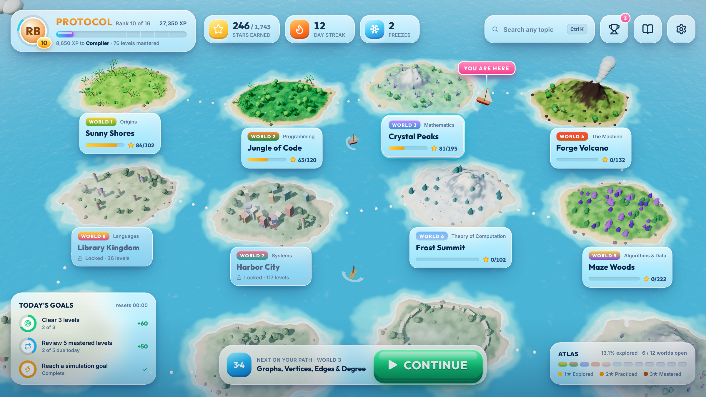
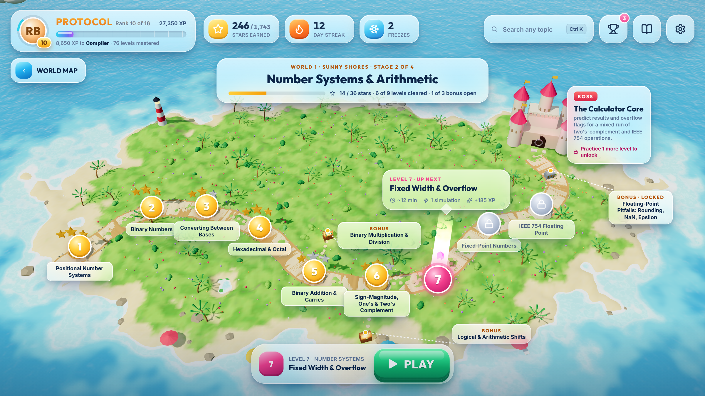
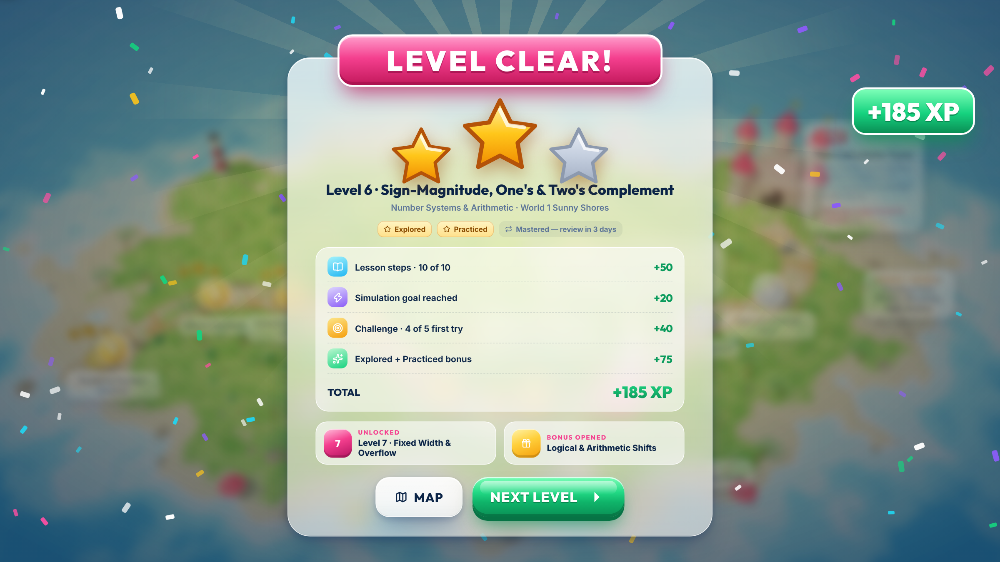

# 01 — World & Experience: **Isles of Computing**

> Personas: **Technical Artist** + **Senior UI/UX & Motion Designer** (lead), Game Systems Designer, Real-time 3D Engineer.

The renders below are real-time three.js frames (lighting, soft shadows, water shader, instanced props) with the HTML/CSS game UI on top, rendered from the **real curriculum graph** and a simulated learner who has finished the first 9 Core Path subjects. They define the target look; Phase 2 builds it for real. Source: [`design/prototype/`](../../design/prototype/).

## 1. Direction decision log

| Rev | Direction | Outcome |
|---|---|---|
| A | Three space concepts (galaxy, orbital strata, commit-graph) → "Stellar Arbor" star-tree | Rejected by owner: not game-like, space theme unwanted |
| B | Bright 2D level map, space backdrop | Rejected: still space, cartoonish |
| C | Bright island archipelago, flat 2D | Theme accepted; look rejected as cartoonish |
| **D** | **Isles of Computing — premium 3D island adventure** (this doc) | **Current recommendation** |

Deviation from master prompt §1 ("3D space world"): replaced by a 3D island world at the owner's direction. Every §2 required property still holds (table §3).

## 2. The look

### World Map (Universe level)

### Stage Map (Subject level)

### Level Clear (node celebration)

## 3. How the curriculum becomes a game map

| Curriculum | Game object | On screen |
|---|---|---|
| Universe | **World Map** — an archipelago on a turquoise sea | 12 islands linked by a buoy sea-route in Core Path order |
| Domain (12) | **World** — one island, one biome | Glass card: world #, biome name, domain, star bar |
| Subject (41) | **Stage** — a region of that island with its own winding road | Stage header: stage n of m, stars, levels cleared |
| Core Path topic | **Numbered level** on the road (1, 2, 3…) | Medallion on a stone pedestal, 3D stars above |
| Off-path topic | **Bonus chest** on a side trail, hung off the level that unlocks it | Chest + glass tag, dotted leader line |
| Subject boss | **Castle** at the end of the road | Boss card with unlock rule |
| Topic lesson | **Level play** — the lesson chamber | Full-screen panels, world blurred behind |
| Mastery tier | **Stars**: 1★ Explored · 2★ Practiced · 3★ Mastered | 3D gold stars; HUD shows 246 / 1,743 |
| Prerequisite from another world | **Bridge** marker on the level card ("Needs: Dijkstra's Algorithm · World 5") | Card line + fly-to |

DAG on a road: levels are numbered in Core Path topological order, so walking the road never hits a lock. Locks still come only from prerequisite edges (02); bonus chests open when their host level's prerequisites are met.

| Requirement (master prompt §2) | Isles of Computing |
|---|---|
| DAG, multi-parent edges | Road = core topological order; extra parents shown as bridges; full edges in Atlas and on level focus |
| ≥ 4 zoom levels | World Map → Island → Stage → Level focus → Level play |
| Core Path + freedom | Road + sea-route = Core Path; any open level/chest/island is clickable |
| Lock states | Locked = grey medallion + padlock; Available = glowing rim; In progress = partial ring; 1–3 stars = tiers |
| Visual progress | Islands go from mist-covered grey to full colour; road tiles brighten as levels clear; castle raises its flag when beaten; sea-route turns gold |
| Legibility | One focus; labels are DOM cards placed by a collision solver (no overlaps, leader lines when displaced) |
| 1,000+ nodes | Per stage ≤ ~50 levels; world map renders islands, not topics; instanced props |
| Deterministic build-time layout | §6 |

## 4. Worlds & biomes

| World | Domain | Biome | Signature props |
|---|---|---|---|
| 1 | Origins | Sunny Shores | Palms, beach umbrellas, lighthouse, dock |
| 2 | Programming | Jungle of Code | Dense broadleaf canopy |
| 3 | Mathematics | Crystal Peaks | Snow peak, violet crystal fields |
| 4 | The Machine | Forge Volcano | Basalt cone, glowing lava, smoke column |
| 5 | Algorithms & Data | Maze Woods | Violet pine forest |
| 6 | Theory of Computation | Frost Summit | Snowfields, teal pines |
| 7 | Systems | Harbor City | Coloured towers, lighthouse |
| 8 | Languages | Library Kingdom | Spired towers |
| 9 | Building Software | Builder's Meadow | Village houses |
| 10 | Distributed Systems | Sky Archipelago | Floating rock islets |
| 11 | Security & Cryptography | Shield Fortress | Ring wall with towers |
| 12 | Intelligence | Neon Grove | Cyan/magenta crystal garden |

New domains (Graphics, HCI, Quantum, Robotics) arrive as new islands beyond the current map edge; the sea-route extends.

## 5. Visual language (premium, not cartoon)

| Layer | Spec |
|---|---|
| Lighting | Warm key sun + sky hemisphere, ACES tone mapping, soft shadow maps, subtle haze fog |
| Terrain | Procedural heightfield per island: shelf → wet sand → beach → biome turf with two-tone noise → rock on slopes → snow/basalt on peaks |
| Water | Custom shader: depth-tinted turquoise→deep blue, caustic shimmer in shallows, animated shoreline foam bands, fresnel sky reflection, sun glint |
| Props | Instanced low-poly kit with flat-shaded facets (trees, palms, pines, crystals, rocks, buildings, towers, walls, chests, castle) — crafted, not toy-like |
| Fog of war | Locked islands desaturated and veiled in soft mist sprites |
| UI material | Frosted glass (blur 18 px, saturate 170 %), 1 px white inner highlight, two-layer soft shadow; dark-glass variant for contrast |
| CTAs | Bevelled "gem" buttons: 4-stop gradient body, top gloss strip, 6 px base lip, coloured glow |
| Type | **Outfit** (display) + **Inter** (text) + JetBrains Mono (code) — all OFL |
| Icons | Lucide (ISC) |
| Colour | Bright, saturated game palette for state and rewards (gold stars, magenta "current", emerald "go"); calm glass neutrals for information |
| Finish | Screen vignette, top light wash; bloom only on emissive accents (High tier) |

## 6. Build-time layout

| Step | Operation |
|---|---|
| 1 | Validate graph (02) |
| 2 | World Map: islands placed on a serpentine grid in Core Path order; seeded jitter; sea-route spline through docks |
| 3 | Island: stages laid out as regions, ordered by Core Path, sized by level count |
| 4 | Stage road: Catmull-Rom spline through level slots, spacing from local prerequisite depth; boss castle at road end on a raised hill |
| 5 | Bonus chests: side trail from host level (latest prerequisite on the road); placement avoids road and other props |
| 6 | Terrain: heightfield bumps for hills/pond/castle mound; road and pedestals flatten their footprint |
| 7 | Props: seeded scatter with slope/height rules and exclusion zones (road, pedestals, labels' world anchors) |
| 8 | Emit `world.json` + per-stage `stage-<id>.json` (positions, splines, prop instances, label anchors), content-hashed |

Same input ⇒ identical output. Existing levels keep their slots when content grows (anchoring).

## 7. Camera & navigation

| Level | Camera | Entry/exit |
|---|---|---|
| World Map | High three-quarter view, drag to pan (map scrolls beyond the frame), pinch/wheel zoom clamped | App start, "World Map" button |
| Island | Orbit-limited view of one island | Click island |
| Stage | Three-quarter view along the road, pans along it | Click stage / Continue |
| Level focus | Short dolly to the pedestal, level card opens | Click level |
| Level play | Fly-in, world blurs, lesson chamber opens | "Play" |

Springs everywhere, no cuts; reduced motion → cross-fades. Keyboard: arrows move along the road, Enter plays, Esc goes up a level, Ctrl K search.

## 8. HUD (all views)

| Element | Content |
|---|---|
| Profile card | Avatar with XP ring, level badge, rank name (PROTOCOL), XP to next rank, levels mastered |
| Chips | Stars earned / total · day streak · streak freezes |
| Tools | Search (Ctrl K) · achievements (badge count) · journal · settings |
| Today's goals | 3 optional daily goals with progress rings and XP; no penalty for missing them |
| Atlas card | % explored, per-world progress meter, star-tier legend |
| Continue CTA | Next Core Path level with thumbnail + big PLAY |
| Stage extras | World Map back button, stage header with stars/levels/bonus counts, level callout (time, simulations, XP), boss card with unlock rule |

## 9. Level play (lesson chamber)

Same 10-section lesson model and step rail as before, restyled in the glass language over a blurred stage: Hook → Intuition → Formal model → Mechanism (simulation) → Worked example → Trade-offs → Pitfalls → Context → Challenge → References. Exiting plays the Level Clear sequence (03 §6).

## 10. 2D Atlas mode

Same data as a fast, accessible 2D list/map: worlds → stages → levels with state, stars and prerequisite links; full keyboard and screen-reader support; default when WebGL is unavailable.
