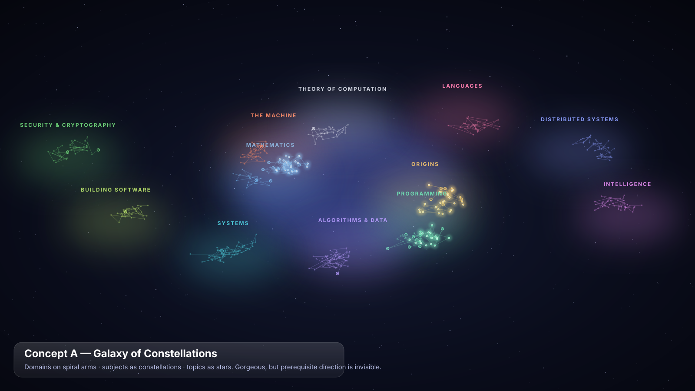
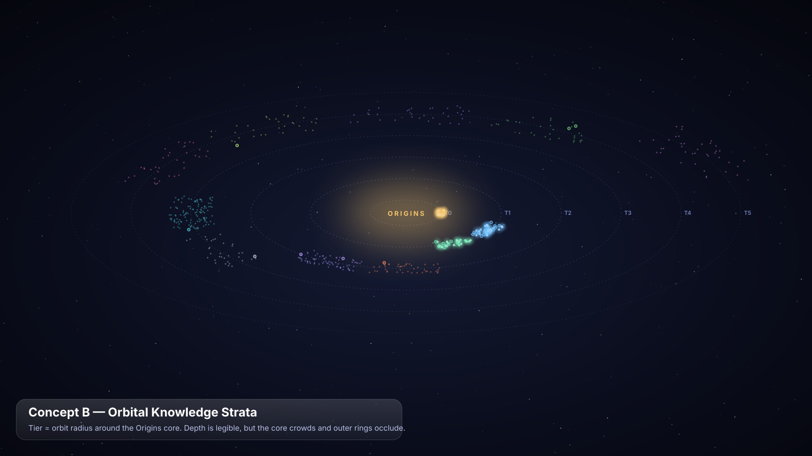
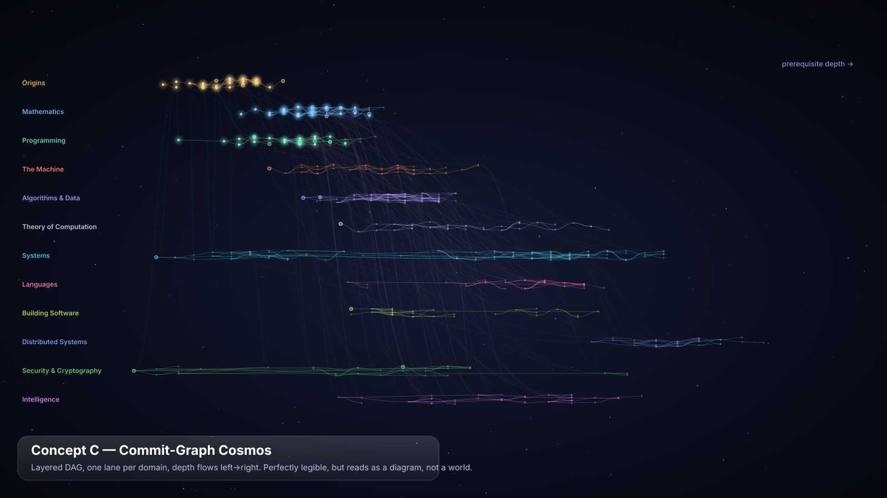
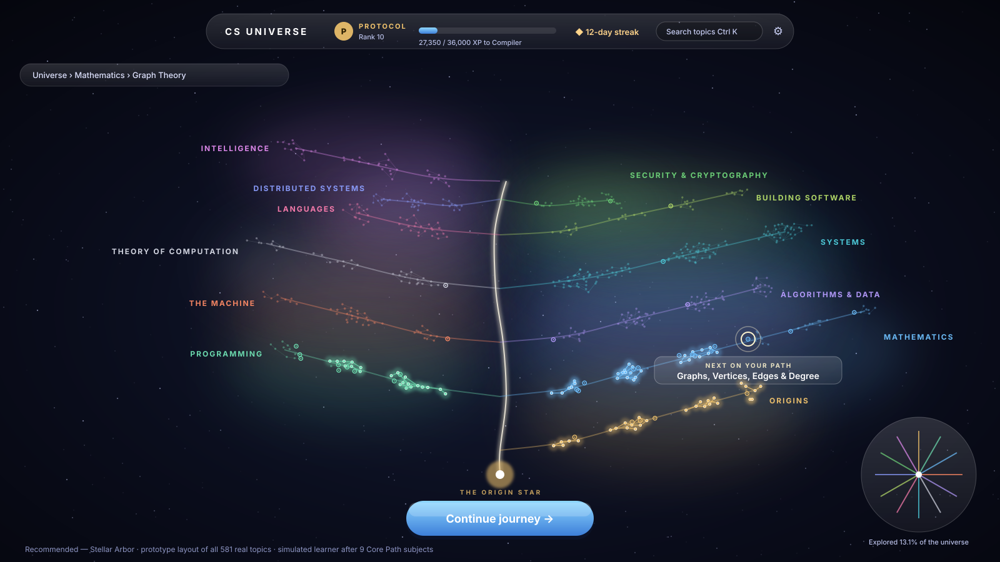
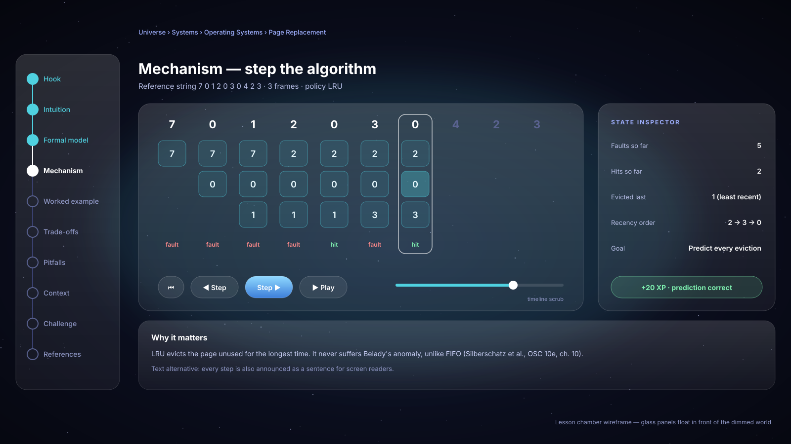

# 01 — World Metaphor & Experience

> Personas: **Technical Artist** + **Senior UI/UX & Motion Designer** (lead), Principal Product Architect, Real-time 3D Engineer.

Sketches in [`sketches/`](sketches/) are rendered from the **real curriculum graph** (581 topics), with a simulated learner who has finished the first 9 Core Path subjects. They are design sketches, not final art.

## 1. Three concepts evaluated

| | **A — Galaxy of Constellations** | **B — Orbital Knowledge Strata** | **C — Commit-Graph Cosmos** |
|---|---|---|---|
| Sketch |  |  |  |
| Idea | Domains on spiral arms; subjects = constellations; topics = stars | Concentric shells: tier = orbit radius around an Origins core | Layered DAG in space: one lane per domain, depth flows forward |
| Beauty | ★★★★★ | ★★★★☆ | ★★☆☆☆ |
| Prerequisite legibility | ★☆☆☆☆ direction invisible | ★★★☆☆ inward→outward only | ★★★★★ |
| "Where next?" clarity | ★★☆☆☆ | ★★★☆☆ | ★★★★☆ |
| Scales to 1,000+ nodes | ★★★★☆ | ★★☆☆☆ core crowds, outer rings occlude | ★★★★☆ |
| Expansion (new regions) | ★★★★★ add an arm | ★★★☆☆ rings fill up | ★★★★☆ add a lane |
| Matches your references (tree / branches / database-tree, not a hub) | ✗ | ✗ centered hub | ✓ but reads as a diagram |
| Verdict | Keep its **look** | Keep its **tier = altitude** idea | Keep its **directed layout** |

## 2. Recommendation — **Stellar Arbor** (hybrid)

A luminous **world-tree made of stars**. The **Origin Star** sits at the base. A glowing **trunk** (the Core Path axis) rises through space. Each domain is a **branch** leaving the trunk at the altitude of its tier, ending in its own colored **nebula**. Along each branch, subjects are **constellations**, and each constellation's stars are laid out as a small **directed graph** that flows outward along the branch, so the next step is always further out.

| Requirement (master prompt §2) | How Stellar Arbor satisfies it |
|---|---|
| DAG with multi-parent edges | Topic edges drawn inside constellations; cross-subject edges appear as faint "hyperlanes" only for the focused node (never all at once) |
| ≥ 4 zoom levels | Universe (tree + nebulae) → Domain (branch + constellations) → Subject (stars + edges) → Topic (focus + neighbours) → Lesson chamber |
| Core Path + freedom | The trunk and a bright thread through Core Path stars; every Available star is clickable |
| Lock states | Locked = dim mote · Available = glowing ring · In progress = partial ring · Explored / Practiced / Mastered = increasing core + halo |
| Visual progress | Stars ignite, edges fill with flowing light, finished constellations draw their full outline, branch color saturates, trunk brightens up to your highest tier |
| Legibility | Branches separate domains by angle and altitude; labels only for the current level ±1, collision-culled in screen space; fog + scale + focus blur separate near/far |
| 1,000+ nodes | One instanced draw for stars, one for edges, ≤ 12 nebula quads; LOD by zoom level |
| Deterministic build-time layout | Algorithm in §4, seeded, output to JSON |
| Your references | Tree / branches / "database-tree" feel, not a centered hub |

## 3. Zoom levels & camera

| Level | Shows | Labels | Camera | Entry |
|---|---|---|---|---|
| **Universe** | Trunk, 12 branches, nebulae, lit share | Domain names | Slow orbit around trunk axis, clamped altitude | App start, breadcrumb "Universe", `Esc` from Domain |
| **Domain** | One branch, its constellations, neighbour branches faded | Subject names | Framed on branch bounding sphere | Click nebula / search |
| **Subject** | Stars + intra-subject edges, unit clusters | Topic names (collision-culled) | Framed on constellation | Click constellation |
| **Topic** | Focused star, its parents/children, hyperlanes to other subjects | All neighbours | Close orbit | Click star |
| **Lesson** | Chamber of glass panels; world dimmed and defocused behind | — | Fly *into* the star | "Enter lesson" / double-click |

Camera rules: spring-damped fly-to along a curved path (never a cut), duration 0.6–1.4 s scaled by distance; target always inside a bounding volume so the user cannot drift into empty space; mouse drag = orbit, right-drag/two-finger = pan, wheel/pinch = zoom-to-cursor; keyboard: arrows orbit, `+`/`−` zoom, `Tab` cycles focusable stars, `Enter` flies in, `Esc` goes up one level. Reduced motion: fly-to becomes 150 ms cross-fade.

## 4. Build-time layout algorithm (deterministic)

| Step | Operation | Output |
|---|---|---|
| 1 | Validate graph (02 §validator) | Typed graph |
| 2 | Domain altitude = mid-tier of its subjects; domains ordered by first Core Path appearance | Branch base heights |
| 3 | Branch azimuths: alternate sides, spread within each tier band to maximize angular gap; tie-break by minimizing total cross-domain edge length (small search, seeded) | Branch directions |
| 4 | Subjects placed along branch in Core Path order; spacing proportional to each subject's local depth | Constellation centers |
| 5 | Topics: longest-path layering inside the subject (direction = outward along branch); barycenter ordering to reduce crossings; units nudged into sub-clusters | Local 3D coordinates |
| 6 | Relaxation: a few hundred iterations of `d3-force-3d` (seeded) with positions anchored to steps 4–5 — adds organic irregularity without breaking direction | Final positions |
| 7 | Emit `layout.json`: positions, per-level bounding spheres, label priorities, edge lists per level, content hash | Static asset |

Same input ⇒ byte-identical output (seeded PRNG, stable sort by id). Runtime only adds ambient drift (≤ 1 % of local spacing, shader-driven).

## 5. Visual language

| Element | Decision |
|---|---|
| Base | Deep-space navy → near-black radial gradient; 1–2 low-res fBm nebula layers per domain, rendered to a half-resolution target |
| Domain colors | 12 hues spaced ~30° (02 §Domains), tuned for ≥ 3:1 against background as glyph/label color; color never the only cue (labels + shapes) |
| Stars | Instanced billboard quads; shader draws core + ring + halo by state (no textures needed); bloom only on High tier |
| Edges | Instanced ribbons with a `progress` attribute → light "fills" the edge when mastered; pulses travel from mastered stars |
| Panels | Frosted glass: `backdrop-filter: blur` on overlay UI only (cheap), 1 px inner highlight, soft shadow |
| 3D controls | Bevelled pill buttons: gradient body, top specular strip, drop shadow; hover lifts 2 px with spring; press sinks 1 px; magnetic pull within 24 px; click = tick + 6-particle spark |
| Type | Display **Space Grotesk** · Text **Inter** · Mono **JetBrains Mono** (all OFL, via Fontsource, self-hosted) |
| Motion | Springs everywhere (Motion for 2D, react-spring for 3D); no linear tweens; all motion behind a `reducedMotion` flag |
| Sound | Off until first interaction, toggle in HUD; Web Audio-synthesized UI ticks/chimes (no files needed) + optional CC0 ambient bed |

## 6. HUD & navigation layout

| Element | Position | Behaviour |
|---|---|---|
| Top bar (glass pill) | Top center | Logo · rank badge · XP bar (fills with spring, numbers count up) · streak · search (Ctrl K) · settings |
| Breadcrumb | Top left | Each segment flies the camera back to that level |
| Minimap | Bottom right | Radial: 12 branch spokes, you-are-here dot, next-beacon marker, % explored |
| Continue journey | Bottom center | One click → fly to Next beacon and open its lesson |
| Peek card | Next to focused star | Title, state, prereqs (with fly-to), estimated minutes, "Enter" |
| Command palette | Modal | Fuzzy search over topics/subjects/domains; Enter = fly |
| Atlas toggle | Top bar | Switches to 2D Atlas (same data, same progress) |

Rule: overlays never cover the screen center circle (radius 22 % of the shorter side) where the focus lives.

## 7. Lesson chamber

| Part | Decision |
|---|---|
| Transition | Fly into the star (0.9 s), world fades to 25 % and defocuses, panels assemble with a staggered spring |
| Layout | Step rail (left) · main stage (center) · inspector / notes (right) · prose band (bottom) |
| Sections | Hook → Intuition → Formal model → Mechanism (simulation) → Worked example → Trade-offs → Pitfalls → Context → Challenge → References |
| Steps | Each section = 1–3 small steps; rail shows done / current / upcoming; resume exactly where you left |
| Simulation | Step back / step / play / scrub timeline; state inspector; goals that award XP; text alternative announced per step (ARIA live region) |
| Exit | `Esc` or breadcrumb → fly back out; star updates its state with the node celebration |

The sketch's LRU example is computed, not drawn by hand: reference string 7 0 1 2 0 3 0 with 3 frames gives frames [2, 0, 3], 5 faults, 2 hits — matching the textbook trace.

## 8. 2D Atlas mode

Same graph as an accessible, fast 2D view: domain columns → subject cards → topic lists with state icons and prerequisite links; full keyboard and screen-reader support; default on devices that fail the WebGL capability check; also the print/overview view. Progress data is shared — the Atlas is a different lens, not a different app.
