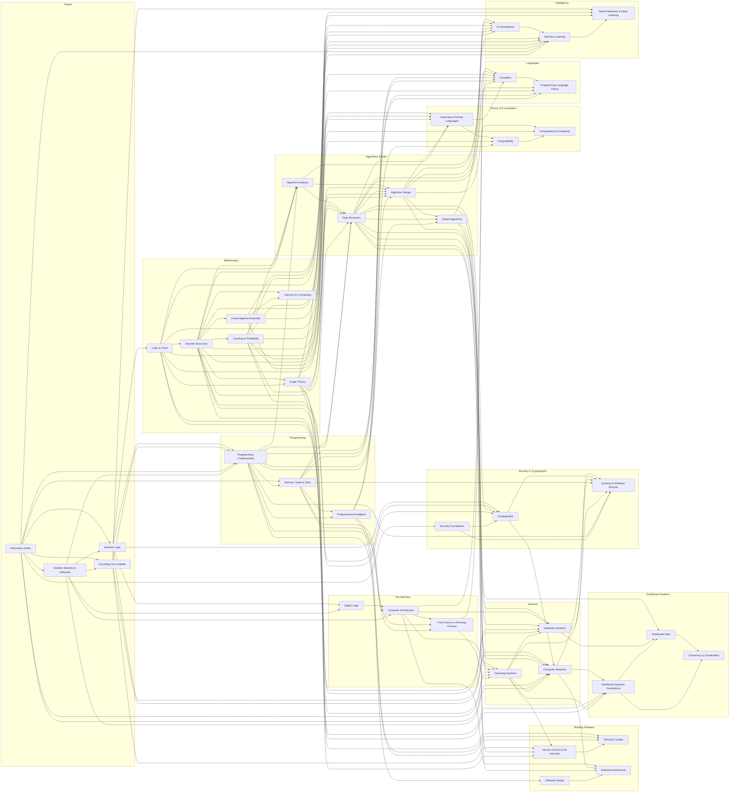

# 02 — Curriculum Knowledge Graph

> Persona: **Learning Scientist / CS Professor**. Source of truth: [`curriculum.graph.yaml`](curriculum.graph.yaml). This page is generated from it (do not hand-edit tables).

## Totals (validated)

| Metric | Value |
|---|---|
| Domains (regions) | 12 |
| Subjects | 41 |
| Topics (lesson nodes) | 581 |
| Core Path topics | 337 |
| Prerequisite edges (transitively reduced) | 806 |
| Cross-subject edges | 260 |
| Root topics | what-is-computer |
| Longest prerequisite chain | 32 |
| Topic-level cycles | 0 |
| Subject-level cycles | 0 |
| Boss challenges | 41 |
| Reserved expansion regions | 4 (Graphics, HCI, Quantum, Robotics) |

Validator checks (run on every edit, becomes the Zod build step in Phase 1): unique ids · every prerequisite resolves · topic DAG acyclic · subject graph acyclic · every subject in the Core Path order · **Core Path closure** (each core topic depends only on core topics in the same or an earlier subject, so a beginner on the Core Path never meets a lock) · no transitively redundant edges.

## Modelling rules

| Rule | Decision |
|---|---|
| Hierarchy | Universe → Domain → Subject → Unit (visual cluster, not a camera level) → Topic → Lesson |
| Edges | Hard prerequisites only, transitively reduced. Many parents allowed (e.g. `deadlock-conditions` ← `classic-sync-problems` + `paths-connectivity`). |
| Unlock | A topic becomes **Available** when every prerequisite is at least **Explored**. Locked topics can be peeked; the peek lists the missing prerequisites with fly-to links. |
| Core Path | Starred topics. Global order below interleaves math, programming and systems so a beginner never studies one area for too long. |
| Off-path topics | Depth and breadth for explorers; may reference later tiers (e.g. `tls` needs Cryptography topics). |
| Placement | Any subject offers a short "Prove it" check that marks its prerequisites Explored, for learners who already know them. |
| Tiers | Tier drives layout height and recommended timing, never locking. Locking comes only from edges. |

## Domains

| # | Domain | Tagline | Color | Subjects | Topics |
|---|---|---|---|---|---|
| 1 | **Origins** | How computers think | `#F2C46D` | Information & Bits, Number Systems & Arithmetic, Boolean Logic, Encoding Text & Media | 34 |
| 2 | **Mathematics** | The language of rigor | `#6EC1FF` | Logic & Proof, Discrete Structures, Counting & Probability, Graph Theory, Linear Algebra Essentials, Calculus for Computing | 65 |
| 3 | **Programming** | Thinking in code | `#6FE3B4` | Programming Fundamentals, Memory, Types & Data, Programming Paradigms | 40 |
| 4 | **The Machine** | From transistors to running programs | `#FF8A65` | Digital Logic, Computer Architecture, From Source to Running Process | 44 |
| 5 | **Algorithms & Data** | The core of computer science | `#B79CFF` | Algorithm Analysis, Data Structures, Algorithm Design, Graph Algorithms | 74 |
| 6 | **Theory of Computation** | The limits of what can be computed | `#D9DCE8` | Automata & Formal Languages, Computability, Computational Complexity | 34 |
| 7 | **Systems** | Software that runs the machine and connects the world | `#4FD1E0` | Operating Systems, Computer Networks, Database Systems | 117 |
| 8 | **Languages** | How code becomes meaning | `#FF7EB0` | Compilers, Programming Language Theory | 36 |
| 9 | **Building Software** | Engineering that lasts | `#B8E06A` | Software Design, Version Control & Git Internals, Testing & Quality, Software Architecture | 33 |
| 10 | **Distributed Systems** | Many machines, one system | `#8C9EFF` | Distributed Systems Foundations, Distributed Data, Consensus & Coordination | 33 |
| 11 | **Security & Cryptography** | Building systems worth trusting | `#6FD67A` | Security Foundations, Cryptography, Systems & Software Security | 33 |
| 12 | **Intelligence** | Machines that search, reason and learn | `#E58CF2` | AI Foundations, Machine Learning, Neural Networks & Deep Learning | 38 |

## Global Core Path (subject order)

| Step | Subject | Domain | Tier | Core topics | All topics |
|---|---|---|---|---|---|
| 1 | Information & Bits | Origins | 0 | 5 | 6 |
| 2 | Number Systems & Arithmetic | Origins | 0 | 9 | 12 |
| 3 | Boolean Logic | Origins | 0 | 8 | 8 |
| 4 | Encoding Text & Media | Origins | 0 | 6 | 8 |
| 5 | Programming Fundamentals | Programming | 1 | 13 | 15 |
| 6 | Logic & Proof | Mathematics | 1 | 6 | 9 |
| 7 | Discrete Structures | Mathematics | 1 | 12 | 15 |
| 8 | Memory, Types & Data | Programming | 1 | 8 | 13 |
| 9 | Counting & Probability | Mathematics | 1 | 9 | 14 |
| 10 | Graph Theory | Mathematics | 1 | 4 | 9 |
| 11 | Programming Paradigms | Programming | 1 | 6 | 12 |
| 12 | Digital Logic | The Machine | 2 | 10 | 12 |
| 13 | Computer Architecture | The Machine | 2 | 14 | 23 |
| 14 | From Source to Running Process | The Machine | 2 | 6 | 9 |
| 15 | Algorithm Analysis | Algorithms & Data | 2 | 5 | 11 |
| 16 | Data Structures | Algorithms & Data | 2 | 12 | 22 |
| 17 | Algorithm Design | Algorithms & Data | 2 | 10 | 25 |
| 18 | Graph Algorithms | Algorithms & Data | 2 | 5 | 16 |
| 19 | Automata & Formal Languages | Theory of Computation | 3 | 9 | 16 |
| 20 | Computability | Theory of Computation | 3 | 6 | 9 |
| 21 | Computational Complexity | Theory of Computation | 3 | 5 | 9 |
| 22 | Operating Systems | Systems | 3 | 25 | 45 |
| 23 | Computer Networks | Systems | 3 | 23 | 38 |
| 24 | Database Systems | Systems | 3 | 18 | 34 |
| 25 | Compilers | Languages | 4 | 13 | 23 |
| 26 | Programming Language Theory | Languages | 4 | 4 | 13 |
| 27 | Software Design | Building Software | 4 | 6 | 9 |
| 28 | Version Control & Git Internals | Building Software | 4 | 4 | 8 |
| 29 | Testing & Quality | Building Software | 4 | 4 | 9 |
| 30 | Software Architecture | Building Software | 4 | 4 | 7 |
| 31 | Distributed Systems Foundations | Distributed Systems | 4 | 9 | 10 |
| 32 | Distributed Data | Distributed Systems | 4 | 6 | 14 |
| 33 | Consensus & Coordination | Distributed Systems | 4 | 3 | 9 |
| 34 | Security Foundations | Security & Cryptography | 4 | 4 | 6 |
| 35 | Cryptography | Security & Cryptography | 4 | 11 | 15 |
| 36 | Systems & Software Security | Security & Cryptography | 4 | 5 | 12 |
| 37 | Linear Algebra Essentials | Mathematics | 1 | 4 | 11 |
| 38 | Calculus for Computing | Mathematics | 1 | 4 | 7 |
| 39 | AI Foundations | Intelligence | 5 | 4 | 9 |
| 40 | Machine Learning | Intelligence | 5 | 9 | 16 |
| 41 | Neural Networks & Deep Learning | Intelligence | 5 | 9 | 13 |

## Subject dependency map

Derived from topic edges (an arrow means at least one topic in the target needs a topic in the source).

## Subjects in detail

Legend: ★ = Core Path topic. Prerequisites in *italics* are in another subject.

### Origins — How computers think

#### Information & Bits  ·  tier 0  ·  6 topics

**Boss challenge:** Signal Decoder — turn a raw mystery bitstream into a message by choosing the right unit and grouping.  
**Canonical sources:** Petzold — Code, 2nd ed.; Bryant & O'Hallaron — CS:APP 3e, ch. 2  
**Builds on:** — (entry point)

| Unit | Topic | ★ | Prerequisites |
|---|---|---|---|
| The Big Picture | What Is a Computer? `what-is-computer` | ★ | — |
| The Big Picture | Layers of Abstraction `abstraction-layers` | ★ | `what-is-computer` |
| Information | Information as Distinguishable States `information-idea` | ★ | `what-is-computer` |
| Information | The Bit `bits` | ★ | `information-idea` |
| Information | Bytes, Words & Units (kB vs KiB) `bytes-words` | ★ | `bits` |
| Information | Measuring Information (Shannon, intro) `info-entropy-intro` |  | `bits` |

#### Number Systems & Arithmetic  ·  tier 0  ·  12 topics

**Boss challenge:** The Calculator Core — predict results and overflow flags for a mixed run of two's-complement and IEEE 754 operations.  
**Canonical sources:** Bryant & O'Hallaron — CS:APP 3e, ch. 2; Patterson & Hennessy — COD RISC-V 2e, ch. 3  
**Builds on:** Information & Bits

| Unit | Topic | ★ | Prerequisites |
|---|---|---|---|
| Positional Systems | Positional Number Systems `positional-notation` | ★ | *`bits`* |
| Positional Systems | Binary Numbers `binary-numbers` | ★ | `positional-notation` |
| Positional Systems | Converting Between Bases `base-conversion` | ★ | `binary-numbers` |
| Positional Systems | Hexadecimal & Octal `hex-octal` | ★ | `base-conversion` |
| Integer Arithmetic | Binary Addition & Carries `binary-addition` | ★ | `binary-numbers` |
| Integer Arithmetic | Sign-Magnitude, One's & Two's Complement `signed-numbers` | ★ | `binary-addition` |
| Integer Arithmetic | Fixed Width & Overflow `overflow` | ★ | `signed-numbers` |
| Integer Arithmetic | Binary Multiplication & Division `binary-mult-div` |  | `binary-addition` |
| Integer Arithmetic | Logical & Arithmetic Shifts `shifts` |  | `signed-numbers` |
| Real Numbers | Fixed-Point Numbers `fixed-point` | ★ | `signed-numbers` |
| Real Numbers | IEEE 754 Floating Point `floating-point` | ★ | `fixed-point`, `overflow` |
| Real Numbers | Floating-Point Pitfalls: Rounding, NaN, Epsilon `float-pitfalls` |  | `floating-point` |

#### Boolean Logic  ·  tier 0  ·  8 topics

**Boss challenge:** Gatekeeper — derive and minimize an expression from a truth table, then build it from NAND gates only.  
**Canonical sources:** Harris & Harris — Digital Design and Computer Architecture, RISC-V ed., ch. 2; Petzold — Code, 2nd ed.  
**Builds on:** Information & Bits, Number Systems & Arithmetic

| Unit | Topic | ★ | Prerequisites |
|---|---|---|---|
| Truth | Truth Values & Logical Operators `truth-values` | ★ | *`bits`* |
| Truth | Truth Tables `truth-tables` | ★ | `truth-values` |
| Truth | Boolean Algebra Laws `boolean-algebra` | ★ | `truth-tables` |
| Truth | De Morgan's Laws `de-morgan` | ★ | `boolean-algebra` |
| Truth | Bitwise Operations & Masks `bitwise-ops` | ★ | `truth-tables`, *`binary-numbers`* |
| Simplification | Sum-of-Products & Product-of-Sums `normal-forms` | ★ | `boolean-algebra` |
| Simplification | Karnaugh Map Simplification `karnaugh-maps` | ★ | `normal-forms` |
| Simplification | NAND & NOR Universality `universal-gates` | ★ | `de-morgan` |

#### Encoding Text & Media  ·  tier 0  ·  8 topics

**Boss challenge:** Babel Packet — decode a byte dump holding UTF-8 text, a little-endian integer and a parity-checked header.  
**Canonical sources:** The Unicode Standard (current version), ch. 2–3; RFC 3629 — UTF-8; Bryant & O'Hallaron — CS:APP 3e, ch. 2  
**Builds on:** Information & Bits, Number Systems & Arithmetic

| Unit | Topic | ★ | Prerequisites |
|---|---|---|---|
| Text | Characters as Numbers: ASCII `char-encoding` | ★ | *`binary-numbers`*, *`bytes-words`* |
| Text | Unicode Code Points `unicode` | ★ | `char-encoding` |
| Text | UTF-8, UTF-16 & Byte Order `utf8` | ★ | `unicode`, *`hex-octal`* |
| Text | Endianness `endianness` | ★ | *`bytes-words`*, *`hex-octal`* |
| Media & Integrity | Images: Pixels & Color Models `images-pixels` | ★ | *`bytes-words`* |
| Media & Integrity | Sound: Sampling & Quantization `sound-sampling` |  | *`bytes-words`* |
| Media & Integrity | Compression Basics: RLE & the Huffman Idea `compression-intro` |  | *`info-entropy-intro`* |
| Media & Integrity | Parity & Checksums `error-detection-intro` | ★ | *`bits`* |

### Mathematics — The language of rigor

#### Logic & Proof  ·  tier 1  ·  9 topics

**Boss challenge:** Proof Forge — assemble an induction proof from shuffled steps and find the flaw in a bogus one.  
**Canonical sources:** Rosen — Discrete Mathematics and Its Applications 8e, ch. 1, 5; Lehman, Leighton & Meyer — Mathematics for Computer Science, ch. 1–5  
**Builds on:** Boolean Logic

| Unit | Topic | ★ | Prerequisites |
|---|---|---|---|
| Logic | Propositional Logic `propositional-logic` | ★ | *`boolean-algebra`* |
| Logic | Logical Equivalence & Implication `logical-equivalence` | ★ | `propositional-logic` |
| Logic | Predicates & Quantifiers `predicate-logic` | ★ | `logical-equivalence` |
| Logic | Nested Quantifiers `nested-quantifiers` |  | `predicate-logic` |
| Logic | Rules of Inference `inference-rules` |  | `predicate-logic` |
| Proof | Direct Proof `proof-direct` | ★ | `logical-equivalence` |
| Proof | Contradiction & Contrapositive `proof-contradiction` | ★ | `proof-direct` |
| Proof | Mathematical Induction `induction` | ★ | `proof-direct` |
| Proof | Strong Induction & Well-Ordering `strong-induction` |  | `induction` |

#### Discrete Structures  ·  tier 1  ·  15 topics

**Boss challenge:** Structure Atlas — classify relations and functions by their properties and solve a system of congruences.  
**Canonical sources:** Rosen — Discrete Mathematics and Its Applications 8e, ch. 2, 4, 9; Lehman, Leighton & Meyer — Mathematics for Computer Science  
**Builds on:** Logic & Proof

| Unit | Topic | ★ | Prerequisites |
|---|---|---|---|
| Sets & Functions | Sets & Set Operations `sets` | ★ | *`predicate-logic`* |
| Sets & Functions | Functions: Injective, Surjective, Bijective `functions` | ★ | `sets` |
| Sets & Functions | Exponentials & Logarithms `log-exp` | ★ | `functions` |
| Sets & Functions | Sequences & Summations `sequences-sums` | ★ | `functions` |
| Sets & Functions | Recursive Definitions `recursive-definitions` | ★ | `sequences-sums`, *`induction`* |
| Sets & Functions | Structural Induction `structural-induction` |  | *`strong-induction`*, `recursive-definitions` |
| Sets & Functions | Cardinality & Countability `cardinality` | ★ | `functions` |
| Relations | Relations & Their Properties `relations` | ★ | `sets` |
| Relations | Equivalence Relations & Partitions `equivalence-relations` |  | `relations` |
| Relations | Partial Orders & Hasse Diagrams `partial-orders` | ★ | `relations` |
| Number Theory | Divisibility & Modular Arithmetic `modular-arithmetic` | ★ | *`proof-direct`* |
| Number Theory | GCD & the Euclidean Algorithm `gcd-euclid` | ★ | `modular-arithmetic` |
| Number Theory | Primes & Factorization `primes` | ★ | `modular-arithmetic` |
| Number Theory | Modular Inverses & Fermat's Little Theorem `modular-inverse` | ★ | `gcd-euclid`, `primes` |
| Number Theory | Chinese Remainder Theorem `crt` |  | `modular-inverse` |

#### Counting & Probability  ·  tier 1  ·  14 topics

**Boss challenge:** Monte Carlo Casino — predict outcomes analytically, then confirm them with your own simulation.  
**Canonical sources:** Rosen — Discrete Mathematics and Its Applications 8e, ch. 6–8; Blitzstein & Hwang — Introduction to Probability 2e  
**Builds on:** Discrete Structures

| Unit | Topic | ★ | Prerequisites |
|---|---|---|---|
| Counting | Sum & Product Rules `counting-rules` | ★ | *`sets`* |
| Counting | Permutations & Combinations `permutations-combinations` | ★ | `counting-rules` |
| Counting | The Pigeonhole Principle `pigeonhole` | ★ | `counting-rules` |
| Counting | Binomial Theorem & Pascal's Triangle `binomial-theorem` |  | `permutations-combinations` |
| Counting | Inclusion–Exclusion `inclusion-exclusion` |  | `permutations-combinations` |
| Counting | Solving Linear Recurrences `recurrence-relations` |  | *`recursive-definitions`* |
| Probability | Sample Spaces & Events `probability-basics` | ★ | `permutations-combinations` |
| Probability | Conditional Probability & Independence `conditional-probability` | ★ | `probability-basics` |
| Probability | Bayes' Theorem `bayes` | ★ | `conditional-probability` |
| Probability | Random Variables & Expectation `random-variables` | ★ | `probability-basics` |
| Probability | Linearity of Expectation `linearity-expectation` |  | `random-variables` |
| Probability | Variance & Standard Deviation `variance` | ★ | `random-variables` |
| Probability | Common Distributions `distributions` | ★ | `variance` |
| Probability | Markov & Chebyshev Bounds `tail-bounds` |  | `variance` |

#### Graph Theory  ·  tier 1  ·  9 topics

**Boss challenge:** Königsberg+ — decide Eulerian, Hamiltonian and colorability for generated graphs, with proof sketches.  
**Canonical sources:** Rosen — Discrete Mathematics and Its Applications 8e, ch. 10–11; West — Introduction to Graph Theory 2e  
**Builds on:** Discrete Structures, Logic & Proof

| Unit | Topic | ★ | Prerequisites |
|---|---|---|---|
| Graphs | Graphs, Vertices, Edges & Degree `graph-basics` | ★ | *`relations`* |
| Graphs | Directed, Weighted, Bipartite & Complete Graphs `graph-types` | ★ | `graph-basics` |
| Graphs | Paths, Cycles & Connectivity `paths-connectivity` | ★ | `graph-basics` |
| Graphs | Trees & Their Properties `trees-math` | ★ | `paths-connectivity`, *`induction`* |
| Graphs | DAGs & Partial Orders `dags-toposort-math` |  | `graph-types`, *`partial-orders`* |
| Classic Problems | Euler & Hamilton Paths `euler-hamilton` |  | `paths-connectivity` |
| Classic Problems | Planar Graphs & Euler's Formula `planarity` |  | `paths-connectivity` |
| Classic Problems | Graph Coloring `graph-coloring` |  | `graph-types` |
| Classic Problems | Graph Isomorphism `isomorphism` |  | `graph-types` |

#### Linear Algebra Essentials  ·  tier 1  ·  11 topics

**Boss challenge:** Transform Lab — find matrices that map a 2D/3D shape onto a target shape.  
**Canonical sources:** Strang — Introduction to Linear Algebra 6e; Axler — Linear Algebra Done Right 4e (open access)  
**Builds on:** Discrete Structures

| Unit | Topic | ★ | Prerequisites |
|---|---|---|---|
| Vectors & Matrices | Vectors & Vector Operations `vectors` | ★ | *`functions`* |
| Vectors & Matrices | Dot Product, Norms & Angles `dot-product` | ★ | `vectors` |
| Vectors & Matrices | Matrices & Matrix Multiplication `matrices` | ★ | `vectors` |
| Vectors & Matrices | Matrices as Linear Transformations `linear-transformations` | ★ | `matrices` |
| Structure | Linear Systems & Gaussian Elimination `linear-systems` |  | `matrices` |
| Structure | Span, Independence, Basis & Rank `span-basis` |  | `linear-systems` |
| Structure | Determinants `determinants` |  | `linear-transformations` |
| Structure | Matrix Inverses `inverse-matrices` |  | `determinants`, `linear-systems` |
| Structure | Eigenvalues & Eigenvectors `eigen` |  | `determinants`, `span-basis` |
| Structure | Orthogonality & Projections `projections` |  | `dot-product`, `span-basis` |
| Structure | Singular Value Decomposition (intuition) `svd-intro` |  | `eigen`, `projections` |

#### Calculus for Computing  ·  tier 1  ·  7 topics

**Boss challenge:** Descent — reach the minimum of a 2D loss surface by computing every gradient yourself.  
**Canonical sources:** Strang — Calculus 3e (MIT OpenCourseWare, free); Deisenroth, Faisal & Ong — Mathematics for Machine Learning, ch. 5  
**Builds on:** Discrete Structures, Linear Algebra Essentials

| Unit | Topic | ★ | Prerequisites |
|---|---|---|---|
| Change | Limits & Continuity (intuition) `functions-limits` | ★ | *`functions`* |
| Change | Derivatives & Rates of Change `derivatives` | ★ | `functions-limits` |
| Change | The Chain Rule `chain-rule` | ★ | `derivatives` |
| Change | Partial Derivatives & Gradients `partial-derivatives` | ★ | `chain-rule`, *`vectors`* |
| Applications | Finding Minima & Maxima `optimization-calc` |  | `derivatives` |
| Applications | Integrals as Accumulation `integrals` |  | `derivatives` |
| Applications | Taylor Approximations `series-approx` |  | `derivatives` |

### Programming — Thinking in code

#### Programming Fundamentals  ·  tier 1  ·  15 topics

**Boss challenge:** Text Adventure Engine — implement a tiny command interpreter that passes hidden tests.  
**Canonical sources:** Abelson & Sussman — SICP 2e, ch. 1; Downey — Think Python 3e (open access)  
**Builds on:** Boolean Logic, Encoding Text & Media, Information & Bits, Number Systems & Arithmetic

| Unit | Topic | ★ | Prerequisites |
|---|---|---|---|
| First Programs | Programs, Instructions & Execution `what-is-program` | ★ | *`abstraction-layers`* |
| First Programs | Values, Expressions & Basic Types `values-types-basic` | ★ | `what-is-program`, *`binary-numbers`* |
| First Programs | Variables & Assignment `variables` | ★ | `values-types-basic` |
| Control | Conditionals `conditionals` | ★ | `variables`, *`truth-values`* |
| Control | Loops & Iteration `loops` | ★ | `conditionals` |
| Control | Functions, Parameters & Return Values `functions-prog` | ★ | `loops` |
| Control | Scope & Lifetime `scope` | ★ | `functions-prog` |
| Control | Recursion `recursion` | ★ | `functions-prog` |
| Control | Recursion vs Iteration & Tail Calls `recursion-vs-iteration` |  | `recursion` |
| Data | Strings & Text Processing `strings` | ★ | `loops`, *`char-encoding`* |
| Data | Arrays & Lists `arrays-lists` | ★ | `loops` |
| Data | Maps, Dictionaries & Sets `maps-sets-prog` | ★ | `arrays-lists` |
| Data | Input, Output & Files `io-basics` |  | `strings` |
| When Things Break | Errors & Exceptions `errors-exceptions` | ★ | `functions-prog` |
| When Things Break | Debugging: Reading Errors & Tracing `debugging` | ★ | `errors-exceptions` |

#### Memory, Types & Data  ·  tier 1  ·  13 topics

**Boss challenge:** Memory Detective — trace a program's stack/heap diagram and find the aliasing and dangling-pointer bugs.  
**Canonical sources:** Bryant & O'Hallaron — CS:APP 3e, ch. 3, 9; Kernighan & Ritchie — The C Programming Language 2e, ch. 5–6  
**Builds on:** Information & Bits, Programming Fundamentals

| Unit | Topic | ★ | Prerequisites |
|---|---|---|---|
| Memory | The Memory Model: Addresses & Cells `memory-model` | ★ | *`variables`*, *`bytes-words`* |
| Memory | Stack vs Heap `stack-heap` | ★ | `memory-model`, *`functions-prog`* |
| Memory | The Call Stack & Stack Frames `call-stack` | ★ | `stack-heap`, *`recursion`* |
| Memory | References & Pointers `references-pointers` | ★ | `stack-heap` |
| Memory | Pointer Arithmetic & Arrays in Memory `pointer-arithmetic` |  | `references-pointers`, *`arrays-lists`* |
| Memory | Value vs Reference Semantics & Aliasing `value-vs-reference` |  | `references-pointers` |
| Memory | Mutability & Immutability `mutability` |  | `value-vs-reference` |
| Memory | Manual Memory Management: malloc & free `manual-memory` | ★ | `references-pointers` |
| Memory | Memory Bugs: Leaks, Dangling Pointers, Overflows `memory-bugs` | ★ | `manual-memory` |
| Types | Static vs Dynamic Typing `static-dynamic-types` | ★ | *`values-types-basic`* |
| Types | Type Conversion & Coercion `type-conversion` |  | `static-dynamic-types` |
| Types | Structs, Records & Enums `composite-types` | ★ | `static-dynamic-types` |
| Types | Generics & Parametric Types `generics-intro` |  | `composite-types` |

#### Programming Paradigms  ·  tier 1  ·  12 topics

**Boss challenge:** Paradigm Shift — rewrite one imperative program in OO and functional styles that pass the same tests.  
**Canonical sources:** Abelson & Sussman — SICP 2e, ch. 2–3; Van Roy & Haridi — Concepts, Techniques, and Models of Computer Programming  
**Builds on:** Memory, Types & Data, Programming Fundamentals

| Unit | Topic | ★ | Prerequisites |
|---|---|---|---|
| Objects | Objects & Classes `oop-objects` | ★ | *`composite-types`*, *`functions-prog`* |
| Objects | Encapsulation & Interfaces `encapsulation` | ★ | `oop-objects` |
| Objects | Inheritance & Its Costs `inheritance` | ★ | `encapsulation` |
| Objects | Polymorphism & Dynamic Dispatch `polymorphism` | ★ | `inheritance` |
| Objects | Composition over Inheritance `composition` |  | `polymorphism` |
| Functions | First-Class & Higher-Order Functions `first-class-functions` | ★ | *`functions-prog`* |
| Functions | Closures `closures` | ★ | `first-class-functions`, *`scope`* |
| Functions | Map, Filter & Reduce `map-filter-reduce` |  | `first-class-functions`, *`arrays-lists`* |
| Functions | Purity & Side Effects `pure-functions` |  | *`mutability`*, `first-class-functions` |
| Functions | Persistent Data Structures (idea) `immutable-data` |  | `pure-functions` |
| Functions | Declarative vs Imperative `declarative` |  | `map-filter-reduce` |
| Concurrency Preview | Concurrency vs Parallelism `concurrency-intro` |  | *`functions-prog`* |

### The Machine — From transistors to running programs

#### Digital Logic  ·  tier 2  ·  12 topics

**Boss challenge:** Build an ALU — wire a 4-bit ALU in the circuit sandbox that meets its truth specification.  
**Canonical sources:** Harris & Harris — Digital Design and Computer Architecture, RISC-V ed., ch. 1–5; Nisan & Schocken — The Elements of Computing Systems 2e, ch. 1–3  
**Builds on:** Boolean Logic, Number Systems & Arithmetic

| Unit | Topic | ★ | Prerequisites |
|---|---|---|---|
| Combinational | Logic Gates & Transistors (CMOS idea) `logic-gates` | ★ | *`universal-gates`* |
| Combinational | Combinational Circuits `combinational-circuits` | ★ | `logic-gates`, *`karnaugh-maps`* |
| Combinational | Multiplexers, Decoders & Encoders `multiplexers-decoders` | ★ | `combinational-circuits` |
| Combinational | Half Adders, Full Adders & Ripple Carry `adders` | ★ | `combinational-circuits`, *`binary-addition`* |
| Combinational | Carry-Lookahead Adders `carry-lookahead` |  | `adders` |
| Combinational | The Arithmetic Logic Unit `alu` | ★ | `adders`, `multiplexers-decoders`, *`signed-numbers`* |
| Sequential | Latches & Flip-Flops `latches-flipflops` | ★ | `combinational-circuits` |
| Sequential | Clocks & Timing `clocks-timing` | ★ | `latches-flipflops` |
| Sequential | Registers & Register Files `registers` | ★ | `latches-flipflops`, `multiplexers-decoders` |
| Sequential | Counters & Shift Registers `counters` |  | `registers` |
| Sequential | Finite State Machines in Hardware `fsm-hardware` | ★ | `clocks-timing` |
| Sequential | SRAM & DRAM Cells `memory-cells` | ★ | `latches-flipflops` |

#### Computer Architecture  ·  tier 2  ·  23 topics

**Boss challenge:** Cycle Hunter — predict stalls and cache hits for a program, then tune it to reach a target CPI.  
**Canonical sources:** Patterson & Hennessy — Computer Organization and Design, RISC-V ed. 2e; Hennessy & Patterson — Computer Architecture: A Quantitative Approach 6e; RISC-V ISA Specification (Unprivileged)  
**Builds on:** Digital Logic, Memory, Types & Data, Number Systems & Arithmetic

| Unit | Topic | ★ | Prerequisites |
|---|---|---|---|
| Organization | The Von Neumann Architecture `von-neumann` | ★ | *`registers`*, *`alu`* |
| Organization | Fetch–Decode–Execute `instruction-cycle` | ★ | `von-neumann` |
| Organization | Interrupts & Exceptions in Hardware `interrupts-hw` | ★ | `instruction-cycle` |
| Organization | Performance: CPI, Clock Rate & Amdahl's Law `performance-metrics` | ★ | `instruction-cycle` |
| Instruction Set | Instruction Set Architecture `isa-concepts` | ★ | `instruction-cycle` |
| Instruction Set | RISC vs CISC `risc-cisc` |  | `isa-concepts` |
| Instruction Set | RISC-V Assembly Basics `riscv-assembly` | ★ | `isa-concepts`, *`hex-octal`* |
| Instruction Set | Addressing Modes `addressing-modes` |  | `riscv-assembly` |
| Instruction Set | Procedure Calls & Calling Conventions `procedures-assembly` | ★ | `riscv-assembly`, *`call-stack`* |
| Instruction Set | Instruction Encoding `instruction-encoding` | ★ | `riscv-assembly` |
| Pipeline | The Single-Cycle Datapath `single-cycle-datapath` | ★ | `instruction-cycle`, *`fsm-hardware`* |
| Pipeline | Pipelining `pipelining` | ★ | `single-cycle-datapath` |
| Pipeline | Data & Control Hazards `hazards` | ★ | `pipelining` |
| Pipeline | Forwarding & Stalls `forwarding-stalls` |  | `hazards` |
| Pipeline | Branch Prediction `branch-prediction` |  | `hazards` |
| Memory Hierarchy | The Memory Hierarchy & Locality `memory-hierarchy` | ★ | *`memory-cells`*, `performance-metrics` |
| Memory Hierarchy | Caches: Direct-Mapped `cache-basics` | ★ | `memory-hierarchy` |
| Memory Hierarchy | Set-Associative Caches & Replacement `cache-associativity` |  | `cache-basics` |
| Memory Hierarchy | Write-Through vs Write-Back `cache-writes` |  | `cache-basics` |
| Memory Hierarchy | AMAT & Cache-Friendly Code `cache-performance` |  | `cache-associativity` |
| Memory Hierarchy | Address Translation Hardware: TLB & Page Tables `virtual-memory-hw` | ★ | `cache-basics` |
| Parallel Hardware | Multicore & Cache Coherence `multicore` |  | `cache-writes` |
| Parallel Hardware | SIMD & GPUs (overview) `simd-gpu` |  | `multicore` |

#### From Source to Running Process  ·  tier 2  ·  9 topics

**Boss challenge:** Link Map — resolve symbols and relocations by hand for three object files and predict the loaded memory layout.  
**Canonical sources:** Bryant & O'Hallaron — CS:APP 3e, ch. 7; Levine — Linkers and Loaders; System V ABI / ELF specification  
**Builds on:** Computer Architecture, Memory, Types & Data, Programming Fundamentals

| Unit | Topic | ★ | Prerequisites |
|---|---|---|---|
| Build | The Compilation Pipeline (overview) `compilation-overview` | ★ | *`what-is-program`*, *`riscv-assembly`* |
| Build | Preprocessing & Compiling to Assembly `preprocess-compile` | ★ | `compilation-overview` |
| Build | Assembling & Object Files `object-files` | ★ | `preprocess-compile`, *`instruction-encoding`* |
| Build | Executable Formats: ELF & PE `executable-formats` |  | `object-files` |
| Link & Load | Symbols & Relocation `symbols-relocation` | ★ | `object-files` |
| Link & Load | Static Linking `linking` | ★ | `symbols-relocation` |
| Link & Load | Dynamic Linking & Shared Libraries `dynamic-linking` |  | `linking` |
| Link & Load | Loading & Process Memory Layout `loading` | ★ | `linking`, *`stack-heap`* |
| Link & Load | Interpreters, Bytecode & JIT (overview) `interpreters-jit` |  | `compilation-overview` |

### Algorithms & Data — The core of computer science

#### Algorithm Analysis  ·  tier 2  ·  11 topics

**Boss challenge:** Complexity Court — rank and justify the complexity of ten code snippets and solve their recurrences.  
**Canonical sources:** Cormen, Leiserson, Rivest & Stein — Introduction to Algorithms 4e (CLRS), ch. 1–4, 16; Sedgewick & Wayne — Algorithms 4e, ch. 1.4  
**Builds on:** Counting & Probability, Discrete Structures, Logic & Proof, Programming Fundamentals

| Unit | Topic | ★ | Prerequisites |
|---|---|---|---|
| Measuring | What Is an Algorithm? Correctness & Efficiency `what-is-algorithm` | ★ | *`functions-prog`* |
| Measuring | Counting Operations & Cost Models `counting-steps` | ★ | `what-is-algorithm` |
| Measuring | Asymptotic Notation: O, Ω, Θ `asymptotic` | ★ | `counting-steps`, *`log-exp`* |
| Measuring | Comparing Growth Rates `growth-rates` |  | `asymptotic` |
| Measuring | Best, Worst & Average Case `best-worst-average` |  | `asymptotic`, *`random-variables`* |
| Measuring | Space Complexity `space-complexity` |  | `asymptotic` |
| Reasoning | Loop Invariants & Correctness `loop-invariants` | ★ | `what-is-algorithm`, *`induction`* |
| Reasoning | Recurrences for Recursive Algorithms `recurrences-analysis` | ★ | `asymptotic`, *`recursion`* |
| Reasoning | The Master Theorem `master-theorem` |  | `recurrences-analysis` |
| Reasoning | The Recursion-Tree Method `recursion-trees` |  | `recurrences-analysis` |
| Reasoning | Amortized Analysis `amortized` |  | `asymptotic` |

#### Data Structures  ·  tier 2  ·  22 topics

**Boss challenge:** Structure Architect — pick and implement the right structure for five workloads under time limits.  
**Canonical sources:** CLRS 4e, ch. 10–14, 17–19; Sedgewick & Wayne — Algorithms 4e, ch. 1.3, 2.4, 3  
**Builds on:** Algorithm Analysis, Counting & Probability, Discrete Structures, Graph Theory, Memory, Types & Data, Programming Fundamentals

| Unit | Topic | ★ | Prerequisites |
|---|---|---|---|
| Linear | Abstract Data Types `adt-concept` | ★ | *`asymptotic`* |
| Linear | Dynamic Arrays `dynamic-arrays` | ★ | `adt-concept`, *`arrays-lists`* |
| Linear | Linked Lists `linked-lists` | ★ | `adt-concept`, *`references-pointers`* |
| Linear | Stacks `stacks` | ★ | `adt-concept` |
| Linear | Queues & Deques `queues` | ★ | `linked-lists` |
| Linear | Circular Buffers `circular-buffers` |  | `queues` |
| Linear | Skip Lists `skip-lists` |  | `linked-lists`, *`random-variables`* |
| Trees | Trees & Tree Traversals `trees-ds` | ★ | `linked-lists`, *`recursion`*, *`trees-math`* |
| Trees | Binary Search Trees `bst` | ★ | `trees-ds` |
| Trees | AVL Trees & Rotations `avl-trees` |  | `bst` |
| Trees | Red-Black Trees `red-black-trees` |  | `avl-trees` |
| Trees | B-Trees `b-trees` |  | `bst` |
| Trees | Tries `tries` |  | `trees-ds`, *`strings`* |
| Trees | Segment & Fenwick Trees `segment-trees` |  | `trees-ds` |
| Heaps | Binary Heaps `heaps` | ★ | `trees-ds`, `dynamic-arrays` |
| Heaps | Priority Queues `priority-queues` | ★ | `heaps` |
| Hashing | Hash Functions `hash-functions` | ★ | `adt-concept`, *`modular-arithmetic`* |
| Hashing | Collision Resolution: Chaining & Open Addressing `hash-collisions` | ★ | `hash-functions`, `linked-lists` |
| Hashing | Load Factor & Rehashing `load-factor` |  | `hash-collisions`, *`amortized`* |
| Hashing | Bloom Filters `bloom-filters` |  | `hash-functions`, *`probability-basics`* |
| Graphs & Sets | Graph Representations `graph-representations` | ★ | *`graph-types`*, `dynamic-arrays`, `linked-lists` |
| Graphs & Sets | Disjoint Sets: Union–Find `union-find` |  | `trees-ds`, *`amortized`* |

#### Algorithm Design  ·  tier 2  ·  25 topics

**Boss challenge:** Strategy Gauntlet — identify the paradigm for six unseen problems and implement two of them.  
**Canonical sources:** CLRS 4e, ch. 2, 4, 6–9, 14–15, 32; Kleinberg & Tardos — Algorithm Design, ch. 4–6  
**Builds on:** Algorithm Analysis, Counting & Probability, Data Structures, Linear Algebra Essentials, Logic & Proof, Programming Fundamentals

| Unit | Topic | ★ | Prerequisites |
|---|---|---|---|
| Search & Sort | Linear Search `linear-search` | ★ | *`what-is-algorithm`*, *`arrays-lists`* |
| Search & Sort | Binary Search `binary-search` | ★ | `linear-search`, *`loop-invariants`* |
| Search & Sort | Selection, Insertion & Bubble Sort `elementary-sorts` | ★ | *`loop-invariants`*, *`asymptotic`* |
| Search & Sort | Merge Sort `merge-sort` | ★ | `elementary-sorts`, *`recurrences-analysis`* |
| Search & Sort | Quicksort & Partitioning `quicksort` | ★ | `merge-sort` |
| Search & Sort | Randomized Quicksort Analysis `randomized-quicksort` |  | `quicksort`, *`linearity-expectation`* |
| Search & Sort | Heapsort `heapsort` | ★ | *`heaps`*, `elementary-sorts` |
| Search & Sort | The Comparison-Sorting Lower Bound `sorting-lower-bound` |  | `merge-sort`, *`trees-ds`* |
| Search & Sort | Counting, Radix & Bucket Sort `linear-time-sorts` |  | `sorting-lower-bound` |
| Search & Sort | Order Statistics & Quickselect `selection-algorithms` |  | `quicksort` |
| Divide & Conquer | The Divide-and-Conquer Strategy `divide-conquer` | ★ | `merge-sort` |
| Divide & Conquer | Karatsuba Multiplication `karatsuba` |  | `divide-conquer`, *`master-theorem`* |
| Divide & Conquer | Closest Pair of Points `closest-pair` |  | `divide-conquer` |
| Greedy | The Greedy Method & Exchange Arguments `greedy-method` | ★ | `elementary-sorts`, *`proof-contradiction`* |
| Greedy | Activity Selection & Interval Scheduling `activity-selection` |  | `greedy-method` |
| Greedy | Huffman Coding `huffman-coding` |  | `greedy-method`, *`priority-queues`* |
| Dynamic Programming | Dynamic Programming: Overlapping Subproblems `dp-intro` | ★ | `divide-conquer` |
| Dynamic Programming | Memoization vs Tabulation `memo-tabulation` | ★ | `dp-intro`, *`maps-sets-prog`* |
| Dynamic Programming | 0/1 Knapsack `knapsack` |  | `memo-tabulation` |
| Dynamic Programming | LCS & Edit Distance `lcs-edit-distance` |  | `memo-tabulation`, *`strings`* |
| Dynamic Programming | Longest Increasing Subsequence `lis` |  | `memo-tabulation` |
| Dynamic Programming | Matrix-Chain Multiplication `matrix-chain` |  | `memo-tabulation`, *`matrices`* |
| Exhaustive & Strings | Backtracking: N-Queens & Sudoku `backtracking` |  | *`recursion`* |
| Exhaustive & Strings | Branch & Bound `branch-bound` |  | `backtracking`, *`priority-queues`* |
| Exhaustive & Strings | String Matching: KMP & Rabin–Karp `string-matching` |  | `linear-search`, *`strings`*, *`hash-functions`* |

#### Graph Algorithms  ·  tier 2  ·  16 topics

**Boss challenge:** Route Planner — implement shortest paths and a minimum spanning tree for a city map with constraints.  
**Canonical sources:** CLRS 4e, ch. 20–25; Sedgewick & Wayne — Algorithms 4e, ch. 4  
**Builds on:** Algorithm Design, Data Structures, Programming Fundamentals

| Unit | Topic | ★ | Prerequisites |
|---|---|---|---|
| Traversal | Breadth-First Search `bfs` | ★ | *`graph-representations`*, *`queues`* |
| Traversal | Depth-First Search `dfs` | ★ | *`graph-representations`*, *`stacks`*, *`recursion`* |
| Traversal | Topological Sort `topological-sort` | ★ | `dfs` |
| Traversal | Connected Components `connected-components` |  | `bfs`, `dfs` |
| Traversal | Strongly Connected Components `scc` |  | `topological-sort` |
| Traversal | Cycle Detection `cycle-detection` |  | `dfs` |
| Traversal | Bipartiteness Testing `bipartite-check` |  | `bfs` |
| Shortest Paths | Dijkstra's Algorithm `dijkstra` | ★ | `bfs`, *`priority-queues`*, *`greedy-method`* |
| Shortest Paths | Bellman–Ford & Negative Cycles `bellman-ford` |  | `dijkstra`, *`memo-tabulation`* |
| Shortest Paths | Floyd–Warshall All-Pairs `floyd-warshall` |  | *`memo-tabulation`*, *`graph-representations`* |
| Shortest Paths | A* Search `a-star` |  | `dijkstra` |
| Spanning Trees & Flow | MST: The Cut Property & Prim's Algorithm `mst-prim` | ★ | *`greedy-method`*, *`priority-queues`* |
| Spanning Trees & Flow | Kruskal's Algorithm `mst-kruskal` |  | `mst-prim`, *`union-find`* |
| Spanning Trees & Flow | Maximum Flow: Ford–Fulkerson `max-flow` |  | `bfs`, `dfs` |
| Spanning Trees & Flow | The Max-Flow Min-Cut Theorem `min-cut` |  | `max-flow` |
| Spanning Trees & Flow | Bipartite Matching `bipartite-matching` |  | `max-flow`, `bipartite-check` |

### Theory of Computation — The limits of what can be computed

#### Automata & Formal Languages  ·  tier 3  ·  16 topics

**Boss challenge:** Language Lab — build automata and grammars for five languages and prove one of them non-regular.  
**Canonical sources:** Sipser — Introduction to the Theory of Computation 3e, ch. 0–2; Hopcroft, Motwani & Ullman — Introduction to Automata Theory 3e  
**Builds on:** Algorithm Design, Counting & Probability, Data Structures, Discrete Structures, Logic & Proof

| Unit | Topic | ★ | Prerequisites |
|---|---|---|---|
| Regular Languages | Alphabets, Strings & Languages `alphabets-languages` | ★ | *`sequences-sums`* |
| Regular Languages | Deterministic Finite Automata `dfa` | ★ | `alphabets-languages` |
| Regular Languages | Nondeterministic Finite Automata `nfa` | ★ | `dfa` |
| Regular Languages | NFA → DFA: The Subset Construction `subset-construction` | ★ | `nfa` |
| Regular Languages | Regular Expressions `regular-expressions` | ★ | `nfa` |
| Regular Languages | Regex → NFA: Thompson's Construction `regex-to-nfa` |  | `regular-expressions` |
| Regular Languages | DFA Minimization `dfa-minimization` |  | `subset-construction`, *`equivalence-relations`* |
| Regular Languages | Closure Properties of Regular Languages `closure-properties` |  | `subset-construction` |
| Regular Languages | The Pumping Lemma for Regular Languages `pumping-lemma-regular` | ★ | `dfa`, *`proof-contradiction`*, *`pigeonhole`* |
| Context-Free Languages | Context-Free Grammars `cfg` | ★ | `regular-expressions`, *`recursive-definitions`* |
| Context-Free Languages | Derivations, Parse Trees & Ambiguity `derivations-parse-trees` | ★ | `cfg` |
| Context-Free Languages | Chomsky Normal Form `chomsky-normal-form` |  | `derivations-parse-trees` |
| Context-Free Languages | Pushdown Automata `pda` | ★ | `cfg`, *`stacks`* |
| Context-Free Languages | CFG ⇔ PDA Equivalence `cfg-pda-equivalence` |  | `pda` |
| Context-Free Languages | The Pumping Lemma for Context-Free Languages `pumping-lemma-cf` |  | `pda`, `pumping-lemma-regular` |
| Context-Free Languages | CYK Parsing `cyk` |  | `chomsky-normal-form`, *`memo-tabulation`* |

#### Computability  ·  tier 3  ·  9 topics

**Boss challenge:** The Undecidable — build a reduction chain that proves a new problem undecidable.  
**Canonical sources:** Sipser — Introduction to the Theory of Computation 3e, ch. 3–5; Turing (1936) — On Computable Numbers  
**Builds on:** Automata & Formal Languages, Discrete Structures, Programming Paradigms

| Unit | Topic | ★ | Prerequisites |
|---|---|---|---|
| Machines | Turing Machines `turing-machines` | ★ | *`pda`* |
| Machines | TM Variants: Multi-Tape & Nondeterministic `tm-variants` |  | `turing-machines` |
| Machines | The Church–Turing Thesis `church-turing` | ★ | `turing-machines` |
| Machines | Lambda Calculus as a Model of Computation `lambda-calculus-comp` |  | `church-turing`, *`first-class-functions`* |
| Limits | Decidable & Recognizable Languages `decidability` | ★ | `church-turing` |
| Limits | Diagonalization `diagonalization` | ★ | *`cardinality`*, `decidability` |
| Limits | The Halting Problem `halting-problem` | ★ | `diagonalization` |
| Limits | Reductions & Undecidability `reductions-computability` | ★ | `halting-problem` |
| Limits | Rice's Theorem `rice-theorem` |  | `reductions-computability` |

#### Computational Complexity  ·  tier 3  ·  9 topics

**Boss challenge:** Reduction Relay — chain reductions from 3-SAT to a target problem and verify gadgets in the visualizer.  
**Canonical sources:** Sipser — Introduction to the Theory of Computation 3e, ch. 7–8, 10; Garey & Johnson — Computers and Intractability; Cook (1971) — The Complexity of Theorem-Proving Procedures  
**Builds on:** Algorithm Design, Counting & Probability, Computability

| Unit | Topic | ★ | Prerequisites |
|---|---|---|---|
| Classes | Time Complexity & the Class P `time-complexity-classes` | ★ | *`decidability`* |
| Classes | The Class NP & Verifiers `np` | ★ | `time-complexity-classes` |
| Classes | PSPACE & Space Classes `space-complexity-classes` |  | `time-complexity-classes` |
| Classes | Randomized Classes: RP & BPP (overview) `randomized-complexity` |  | `time-complexity-classes`, *`probability-basics`* |
| Hardness | Polynomial-Time Reductions `poly-reductions` | ★ | `np`, *`reductions-computability`* |
| Hardness | NP-Completeness & Cook–Levin `np-completeness` | ★ | `poly-reductions` |
| Hardness | Classic NP-Complete Problems `classic-npc` |  | `np-completeness` |
| Hardness | P vs NP `p-vs-np` | ★ | `np-completeness` |
| Hardness | Approximation Algorithms `approximation` |  | `classic-npc`, *`greedy-method`* |

### Systems — Software that runs the machine and connects the world

#### Operating Systems  ·  tier 3  ·  45 topics

**Boss challenge:** Kernel Day — keep a simulated OS alive: choose a scheduler, break a deadlock and pick a page-replacement policy under load.  
**Canonical sources:** Silberschatz, Galvin & Gagne — Operating System Concepts 10e; Arpaci-Dusseau & Arpaci-Dusseau — Operating Systems: Three Easy Pieces (free); Tanenbaum & Bos — Modern Operating Systems  
**Builds on:** Computer Architecture, Data Structures, Graph Algorithms, Graph Theory, Information & Bits, From Source to Running Process

| Unit | Topic | ★ | Prerequisites |
|---|---|---|---|
| Foundations | What an Operating System Does `os-role` | ★ | *`abstraction-layers`*, *`von-neumann`* |
| Foundations | Kernel Mode vs User Mode `dual-mode` | ★ | `os-role`, *`interrupts-hw`* |
| Foundations | System Calls `system-calls` | ★ | `dual-mode`, *`procedures-assembly`* |
| Foundations | OS Structures: Monolithic, Micro & Hybrid Kernels `os-structures` |  | `system-calls` |
| Processes & Threads | The Process Abstraction `processes` | ★ | `system-calls`, *`loading`* |
| Processes & Threads | Process States & the PCB `process-states` | ★ | `processes` |
| Processes & Threads | Context Switching `context-switch` | ★ | `process-states` |
| Processes & Threads | Process Creation: fork, exec, wait `process-creation` | ★ | `processes` |
| Processes & Threads | Inter-Process Communication `ipc` | ★ | `process-creation` |
| Processes & Threads | Threads & Threading Models `threads` | ★ | `processes` |
| CPU Scheduling | Scheduling Criteria `scheduling-basics` | ★ | `context-switch` |
| CPU Scheduling | FCFS, SJF & SRTF `fcfs-sjf` | ★ | `scheduling-basics` |
| CPU Scheduling | Round Robin `round-robin` | ★ | `fcfs-sjf` |
| CPU Scheduling | Priority Scheduling & Aging `priority-scheduling` |  | `fcfs-sjf` |
| CPU Scheduling | Multilevel Feedback Queues `mlfq` |  | `round-robin`, `priority-scheduling` |
| CPU Scheduling | Multiprocessor & Real-Time Scheduling `multiprocessor-scheduling` |  | `mlfq`, *`multicore`* |
| Synchronization | Race Conditions & Critical Sections `race-conditions` | ★ | `threads` |
| Synchronization | Peterson's Solution `peterson` |  | `race-conditions` |
| Synchronization | Atomic Instructions & Spinlocks `locks-hardware` | ★ | `race-conditions` |
| Synchronization | Mutexes & Semaphores `mutex-semaphores` | ★ | `locks-hardware` |
| Synchronization | Monitors & Condition Variables `monitors-condvars` |  | `mutex-semaphores` |
| Synchronization | Bounded Buffer, Readers–Writers & Dining Philosophers `classic-sync-problems` | ★ | `mutex-semaphores` |
| Deadlocks | Deadlock & Its Four Conditions `deadlock-conditions` | ★ | `classic-sync-problems`, *`paths-connectivity`* |
| Deadlocks | Deadlock Prevention `deadlock-prevention` |  | `deadlock-conditions` |
| Deadlocks | Deadlock Avoidance: The Banker's Algorithm `bankers-algorithm` | ★ | `deadlock-conditions` |
| Deadlocks | Deadlock Detection & Recovery `deadlock-detection` |  | `deadlock-conditions`, *`cycle-detection`* |
| Memory Management | Address Spaces & Binding `address-binding` | ★ | *`loading`* |
| Memory Management | Contiguous Allocation & Fragmentation `contiguous-allocation` |  | `address-binding` |
| Memory Management | Segmentation `segmentation` |  | `contiguous-allocation` |
| Memory Management | Paging `paging` | ★ | `address-binding`, *`virtual-memory-hw`* |
| Memory Management | Multi-Level & Inverted Page Tables `page-table-structures` |  | `paging` |
| Virtual Memory | Demand Paging & Page Faults `demand-paging` | ★ | `paging` |
| Virtual Memory | Page Replacement: FIFO, OPT & LRU `page-replacement` | ★ | `demand-paging` |
| Virtual Memory | Clock & LRU Approximations `lru-approximation` |  | `page-replacement` |
| Virtual Memory | Frame Allocation & Thrashing `frame-allocation` |  | `page-replacement` |
| Virtual Memory | Copy-on-Write & Memory-Mapped Files `copy-on-write` |  | `demand-paging`, `process-creation` |
| Storage | Files, Directories & the File API `file-concept` | ★ | `system-calls` |
| Storage | File-System Implementation: Allocation & Inodes `fs-implementation` | ★ | `file-concept`, *`linked-lists`* |
| Storage | Free-Space Management `free-space` |  | `fs-implementation` |
| Storage | Crash Consistency & Journaling `journaling` |  | `fs-implementation` |
| Storage | I/O: Polling, Interrupts & DMA `io-systems` | ★ | `system-calls` |
| Storage | HDD Scheduling `disk-scheduling` |  | `io-systems` |
| Storage | SSDs & RAID `ssd-raid` |  | `io-systems` |
| Virtualization | Virtual Machines & Hypervisors `virtualization` |  | `dual-mode`, `paging` |
| Virtualization | Containers & Namespaces `containers` |  | `virtualization`, `processes` |

#### Computer Networks  ·  tier 3  ·  38 topics

**Boss challenge:** Packet's Journey — trace one URL fetch end to end (DNS, ARP, NAT, handshake, congestion window, HTTP) and predict every step.  
**Canonical sources:** Kurose & Ross — Computer Networking: A Top-Down Approach 8e; Peterson & Davie — Computer Networks: A Systems Approach (open edition); RFC 9293 — TCP; RFC 791 — IPv4  
**Builds on:** Boolean Logic, Cryptography, Encoding Text & Media, Graph Algorithms, Information & Bits, Number Systems & Arithmetic, Operating Systems

| Unit | Topic | ★ | Prerequisites |
|---|---|---|---|
| Foundations | Hosts, Links & Packets `network-intro` | ★ | *`abstraction-layers`* |
| Foundations | Packet vs Circuit Switching `packet-switching` | ★ | `network-intro` |
| Foundations | Delay, Loss & Throughput `delay-throughput` | ★ | `packet-switching` |
| Foundations | Protocol Layering: OSI & TCP/IP `layering` | ★ | `network-intro` |
| Physical & Link | The Physical Layer: Signals & Encoding `physical-signals` | ★ | `layering`, *`bits`* |
| Physical & Link | Framing & Error Detection (CRC) `framing-errors` | ★ | `physical-signals`, *`error-detection-intro`* |
| Physical & Link | Multiple Access: ALOHA, CSMA/CD & CSMA/CA `mac-protocols` | ★ | `framing-errors` |
| Physical & Link | Ethernet, MAC Addresses & Switches `ethernet-switching` | ★ | `mac-protocols` |
| Physical & Link | ARP `arp` |  | `ethernet-switching`, `ip-addressing` |
| Physical & Link | VLANs `vlans` |  | `ethernet-switching` |
| Physical & Link | Wi-Fi Basics (802.11) `wireless-lan` |  | `mac-protocols` |
| Network Layer | IPv4 Datagrams & Forwarding `ip-datagram` | ★ | `layering`, *`binary-numbers`* |
| Network Layer | IP Addressing & Subnetting (CIDR) `ip-addressing` | ★ | `ip-datagram`, *`bitwise-ops`* |
| Network Layer | DHCP `dhcp` |  | `ip-addressing` |
| Network Layer | NAT `nat` | ★ | `ip-addressing` |
| Network Layer | ICMP, ping & traceroute `icmp` |  | `ip-datagram` |
| Network Layer | IPv6 `ipv6` |  | `ip-addressing` |
| Network Layer | Routing: Link-State vs Distance-Vector `routing-algorithms` | ★ | `ip-datagram`, *`dijkstra`* |
| Network Layer | Intra-Domain Routing: OSPF `ospf` |  | `routing-algorithms` |
| Network Layer | Inter-Domain Routing: BGP `bgp` |  | `routing-algorithms` |
| Transport Layer | Transport Services & Port Multiplexing `transport-services` | ★ | `ip-datagram` |
| Transport Layer | UDP `udp` | ★ | `transport-services` |
| Transport Layer | Principles of Reliable Transfer (ARQ) `reliable-transfer` | ★ | `transport-services`, `framing-errors` |
| Transport Layer | Go-Back-N & Selective Repeat `sliding-window` | ★ | `reliable-transfer` |
| Transport Layer | TCP Segments & the Three-Way Handshake `tcp-connection` | ★ | `reliable-transfer` |
| Transport Layer | The TCP Connection State Machine `tcp-state-machine` |  | `tcp-connection` |
| Transport Layer | TCP Reliability, RTT Estimation & Flow Control `tcp-reliability` | ★ | `tcp-connection`, `sliding-window` |
| Transport Layer | Congestion Control Principles `congestion-principles` | ★ | `tcp-reliability`, `delay-throughput` |
| Transport Layer | TCP Reno: Slow Start, AIMD & Fast Recovery `tcp-congestion` | ★ | `congestion-principles` |
| Transport Layer | CUBIC & BBR `cubic-bbr` |  | `tcp-congestion` |
| Application Layer | DNS `dns` | ★ | `udp` |
| Application Layer | HTTP/1.1 & the Web `http` | ★ | `tcp-connection`, `dns` |
| Application Layer | HTTP/2, HTTP/3 & QUIC `http2-3` |  | `http`, `tcp-congestion` |
| Application Layer | TLS: Secure Channels `tls` |  | `http`, *`certificates-pki`*, *`diffie-hellman`*, *`authenticated-encryption`* |
| Application Layer | Email: SMTP & IMAP `email-protocols` |  | `tcp-connection`, `dns` |
| Application Layer | CDNs & Peer-to-Peer `cdn-p2p` |  | `http` |
| Sockets | The Sockets API `sockets-api` | ★ | `tcp-connection`, `udp`, *`system-calls`* |
| Sockets | Concurrent Servers: Threads, select & epoll `socket-servers` |  | `sockets-api`, *`threads`* |

#### Database Systems  ·  tier 3  ·  34 topics

**Boss challenge:** Bank on It — design the schema, write queries, choose indexes and an isolation level for a banking workload, then survive a crash.  
**Canonical sources:** Silberschatz, Korth & Sudarshan — Database System Concepts 7e; Ramakrishnan & Gehrke — Database Management Systems 3e; Mohan et al. (1992) — ARIES  
**Builds on:** Algorithm Design, Computer Architecture, Data Structures, Discrete Structures, Graph Theory, Operating Systems

| Unit | Topic | ★ | Prerequisites |
|---|---|---|---|
| The Relational Model | Why Databases? Data Models & the DBMS `why-databases` | ★ | *`file-concept`*, *`sets`* |
| The Relational Model | Relations, Keys & Schemas `relational-model` | ★ | `why-databases`, *`relations`* |
| The Relational Model | Relational Algebra `relational-algebra` | ★ | `relational-model` |
| SQL | SQL: SELECT, WHERE, ORDER BY `sql-basics` | ★ | `relational-algebra` |
| SQL | SQL Joins `sql-joins` | ★ | `sql-basics` |
| SQL | Aggregation & GROUP BY `sql-aggregation` | ★ | `sql-basics` |
| SQL | Subqueries & Set Operations `sql-subqueries` |  | `sql-joins` |
| SQL | NULLs & Three-Valued Logic `sql-nulls` |  | `sql-basics` |
| SQL | DDL & Integrity Constraints `sql-ddl-constraints` |  | `sql-basics` |
| SQL | Window Functions `sql-window` |  | `sql-aggregation` |
| SQL | Views `views` |  | `sql-subqueries` |
| Design | Entity–Relationship Modeling `er-modeling` | ★ | `relational-model` |
| Design | Functional Dependencies `functional-dependencies` | ★ | `relational-model`, *`functions`* |
| Design | Normal Forms: 1NF to BCNF `normalization` | ★ | `functional-dependencies` |
| Design | Lossless Decomposition & Dependency Preservation `decomposition` |  | `normalization` |
| Storage & Indexing | Disk Storage, Pages & Records `storage-pages` | ★ | `why-databases`, *`memory-hierarchy`* |
| Storage & Indexing | Buffer Pool Management `buffer-pool` |  | `storage-pages`, *`page-replacement`* |
| Storage & Indexing | Indexing: Primary, Secondary & Clustered `indexing-basics` | ★ | `storage-pages` |
| Storage & Indexing | B+-Trees `bplus-trees` | ★ | `indexing-basics`, *`bst`* |
| Storage & Indexing | Hash Indexes: Static, Extendible & Linear `hash-indexes` |  | `indexing-basics`, *`hash-collisions`* |
| Storage & Indexing | LSM Trees `lsm-trees` |  | `indexing-basics` |
| Query Processing | The Query Processing Pipeline `query-processing` | ★ | `relational-algebra`, `indexing-basics` |
| Query Processing | External Merge Sort `external-sorting` |  | *`merge-sort`*, `storage-pages` |
| Query Processing | Join Algorithms: Nested-Loop, Hash & Sort-Merge `join-algorithms` | ★ | `query-processing`, *`merge-sort`* |
| Query Processing | Query Optimization & Cost Estimation `query-optimization` |  | `join-algorithms` |
| Transactions | Transactions & ACID `transactions-acid` | ★ | `sql-basics` |
| Transactions | Schedules & Conflict Serializability `schedules-serializability` | ★ | `transactions-acid`, *`paths-connectivity`* |
| Transactions | Two-Phase Locking `two-phase-locking` | ★ | `schedules-serializability`, *`mutex-semaphores`* |
| Transactions | Isolation Levels & Anomalies `isolation-levels` |  | `two-phase-locking` |
| Transactions | MVCC & Snapshot Isolation `mvcc` |  | `isolation-levels` |
| Transactions | Timestamp Ordering & Optimistic Concurrency `timestamp-ordering` |  | `schedules-serializability` |
| Recovery | Logging & Write-Ahead Logging `logging-recovery` | ★ | `transactions-acid`, `storage-pages` |
| Recovery | ARIES Recovery `aries` |  | `logging-recovery` |
| Beyond Relational | Key-Value, Document & Wide-Column Stores `nosql-models` |  | `relational-model` |

### Languages — How code becomes meaning

#### Compilers  ·  tier 4  ·  23 topics

**Boss challenge:** Mini-Compiler — finish a compiler for a tiny language: lexer, parser, type checker and code generator, all tests green.  
**Canonical sources:** Aho, Lam, Sethi & Ullman — Compilers: Principles, Techniques, and Tools 2e (Dragon Book); Cooper & Torczon — Engineering a Compiler 3e; Appel — Modern Compiler Implementation  
**Builds on:** Automata & Formal Languages, Computer Architecture, Data Structures, Graph Theory, Memory, Types & Data, Programming Fundamentals, From Source to Running Process

| Unit | Topic | ★ | Prerequisites |
|---|---|---|---|
| Front End | The Structure of a Compiler `compiler-structure` | ★ | *`compilation-overview`* |
| Front End | Tokens, Lexemes & Patterns `tokens-lexemes` | ★ | `compiler-structure`, *`regular-expressions`* |
| Front End | Building a Lexer from Regexes & DFAs `lexer-construction` | ★ | `tokens-lexemes`, *`subset-construction`* |
| Front End | Grammars for Programming Languages `grammars-for-parsing` | ★ | *`derivations-parse-trees`* |
| Front End | Recursive-Descent Parsing `recursive-descent` | ★ | `grammars-for-parsing`, *`recursion`* |
| Front End | FIRST & FOLLOW Sets `first-follow` |  | `grammars-for-parsing` |
| Front End | LL(1) Parsing Tables `ll1` |  | `first-follow` |
| Front End | Bottom-Up & Shift–Reduce Parsing `shift-reduce` | ★ | `grammars-for-parsing`, *`pda`* |
| Front End | LR(0), SLR & LALR Parsing `lr-parsing` |  | `shift-reduce`, `first-follow` |
| Middle | Abstract Syntax Trees `ast` | ★ | `recursive-descent` |
| Middle | Scopes & Symbol Tables `symbol-tables` | ★ | `ast`, *`scope`*, *`maps-sets-prog`* |
| Middle | Type Checking `type-checking` | ★ | `symbol-tables`, *`static-dynamic-types`* |
| Middle | Intermediate Representation: Three-Address Code `three-address-code` | ★ | `ast` |
| Middle | Basic Blocks & Control-Flow Graphs `control-flow-graphs` |  | `three-address-code`, *`graph-representations`* |
| Middle | Static Single Assignment Form `ssa` |  | `control-flow-graphs` |
| Optimization | Local Optimization: Constant Folding & CSE `local-optimization` |  | `three-address-code` |
| Optimization | Dataflow Analysis: Liveness & Reaching Definitions `dataflow-analysis` |  | `control-flow-graphs` |
| Optimization | Loop Optimizations `loop-optimization` |  | `dataflow-analysis` |
| Back End & Runtime | Instruction Selection `instruction-selection` | ★ | `three-address-code`, *`riscv-assembly`* |
| Back End & Runtime | Register Allocation by Graph Coloring `register-allocation` |  | `dataflow-analysis`, *`graph-coloring`* |
| Back End & Runtime | Activation Records `activation-records` | ★ | *`procedures-assembly`*, `symbol-tables` |
| Back End & Runtime | Garbage Collection: Ref-Counting, Mark–Sweep & Copying `garbage-collection` | ★ | `activation-records`, *`references-pointers`* |
| Back End & Runtime | Generational & Incremental GC `generational-gc` |  | `garbage-collection` |

#### Programming Language Theory  ·  tier 4  ·  13 topics

**Boss challenge:** Interpreter Forge — write an evaluator and type checker for a small lambda language.  
**Canonical sources:** Pierce — Types and Programming Languages; Krishnamurthi — Programming Languages: Application and Interpretation (free); Nystrom — Crafting Interpreters (free online)  
**Builds on:** Compilers, Data Structures, Logic & Proof, Memory, Types & Data, Programming Paradigms

| Unit | Topic | ★ | Prerequisites |
|---|---|---|---|
| Meaning | Syntax vs Semantics `syntax-semantics` | ★ | *`ast`* |
| Meaning | Tree-Walking Interpreters `tree-walk-interpreter` | ★ | *`ast`* |
| Meaning | Bytecode & Stack-Based VMs `bytecode-vm` |  | `tree-walk-interpreter`, *`stacks`* |
| Meaning | Operational Semantics `operational-semantics` |  | `syntax-semantics`, *`inference-rules`* |
| Lambda Calculus | The Untyped Lambda Calculus `lambda-calculus` | ★ | *`closures`* |
| Lambda Calculus | Evaluation Strategies: Strict, Lazy & Call-by-Name `evaluation-strategies` |  | `lambda-calculus` |
| Lambda Calculus | Continuations `continuations` |  | `lambda-calculus` |
| Types | Type Systems & Soundness `type-systems` | ★ | *`type-checking`*, `syntax-semantics` |
| Types | The Simply Typed Lambda Calculus `simply-typed-lambda` |  | `type-systems`, `lambda-calculus` |
| Types | Hindley–Milner Type Inference `type-inference` |  | `simply-typed-lambda` |
| Types | Subtyping & Variance `subtyping` |  | `type-systems`, *`polymorphism`* |
| Types | Parametric Polymorphism `parametric-polymorphism` |  | `type-systems`, *`generics-intro`* |
| Types | Algebraic Data Types & Pattern Matching `algebraic-data-types` |  | *`composite-types`*, `type-systems` |

### Building Software — Engineering that lasts

#### Software Design  ·  tier 4  ·  9 topics

**Boss challenge:** Refactor Rescue — untangle a messy module with the right patterns without breaking a single test.  
**Canonical sources:** Ousterhout — A Philosophy of Software Design 2e; Gamma, Helm, Johnson & Vlissides — Design Patterns; Fowler — Refactoring 2e  
**Builds on:** Programming Paradigms

| Unit | Topic | ★ | Prerequisites |
|---|---|---|---|
| Principles | Managing Complexity: Modularity & Abstraction `complexity-in-software` | ★ | *`encapsulation`* |
| Principles | Coupling & Cohesion `coupling-cohesion` | ★ | `complexity-in-software` |
| Principles | The SOLID Principles `solid` | ★ | `coupling-cohesion`, *`polymorphism`* |
| Principles | DRY, KISS, YAGNI & Their Limits `dry-kiss-yagni` |  | `coupling-cohesion` |
| Principles | API Design `api-design` |  | `coupling-cohesion` |
| Patterns | Creational Patterns `patterns-creational` | ★ | `solid` |
| Patterns | Structural Patterns `patterns-structural` | ★ | `solid` |
| Patterns | Behavioral Patterns `patterns-behavioral` | ★ | `solid`, *`first-class-functions`* |
| Patterns | Refactoring & Code Smells `refactoring` |  | `coupling-cohesion` |

#### Version Control & Git Internals  ·  tier 4  ·  8 topics

**Boss challenge:** Time Travel — repair a broken repository history by predicting its object graph step by step.  
**Canonical sources:** Chacon & Straub — Pro Git 2e (free), ch. 2–3, 10; Git documentation — gitglossary, git-merge  
**Builds on:** Encoding Text & Media, Data Structures, Graph Theory, Operating Systems

| Unit | Topic | ★ | Prerequisites |
|---|---|---|---|
| Model | Why Version Control `vcs-concepts` | ★ | *`file-concept`* |
| Model | Git Objects: Blobs, Trees & Commits `git-objects` | ★ | `vcs-concepts`, *`hash-functions`* |
| Model | The Index (Staging Area) `git-index` |  | `git-objects` |
| Model | The Commit DAG & Refs `git-dag` | ★ | `git-objects`, *`graph-types`* |
| Model | Packfiles & Delta Compression `packfiles` |  | `git-objects`, *`compression-intro`* |
| Collaboration | Branching & Three-Way Merge `branching-merging` | ★ | `git-dag` |
| Collaboration | Rebase vs Merge `rebase` |  | `branching-merging` |
| Collaboration | Remotes, Fetch, Push & Workflows `distributed-workflows` |  | `branching-merging` |

#### Testing & Quality  ·  tier 4  ·  9 topics

**Boss challenge:** Bug Bounty — write tests that kill every mutant in the mutation-testing arena.  
**Canonical sources:** Ammann & Offutt — Introduction to Software Testing 2e; Beck — Test-Driven Development: By Example  
**Builds on:** Logic & Proof, Programming Paradigms, Programming Fundamentals, Version Control & Git Internals

| Unit | Topic | ★ | Prerequisites |
|---|---|---|---|
| Tests | Why Test? Verification vs Validation `why-test` | ★ | *`debugging`* |
| Tests | Unit Testing `unit-tests` | ★ | `why-test` |
| Tests | Test Doubles: Mocks, Stubs & Fakes `test-doubles` |  | `unit-tests`, *`encapsulation`* |
| Tests | Integration & End-to-End Tests `integration-e2e` | ★ | `unit-tests` |
| Tests | Coverage & Its Limits `coverage` | ★ | `unit-tests` |
| Tests | Property-Based Testing `property-testing` |  | `unit-tests`, *`predicate-logic`* |
| Tests | Test-Driven Development `tdd` |  | `unit-tests` |
| Quality Systems | Static Analysis & Linting `static-analysis` |  | `unit-tests` |
| Quality Systems | Continuous Integration `ci` |  | `integration-e2e`, *`distributed-workflows`* |

#### Software Architecture  ·  tier 4  ·  7 topics

**Boss challenge:** Scale the Startup — choose how an architecture evolves under growing load and defend every trade-off.  
**Canonical sources:** Bass, Clements & Kazman — Software Architecture in Practice 4e; Richards & Ford — Fundamentals of Software Architecture  
**Builds on:** Computer Architecture, Computer Networks, Data Structures, Software Design

| Unit | Topic | ★ | Prerequisites |
|---|---|---|---|
| Structures | What Is Software Architecture? Quality Attributes `architecture-intro` | ★ | *`coupling-cohesion`* |
| Structures | Layered & Hexagonal Architecture `layered-architecture` | ★ | `architecture-intro` |
| Structures | Client–Server & Request/Response `client-server` | ★ | `architecture-intro`, *`http`* |
| Structures | Monoliths vs Microservices `monolith-microservices` | ★ | `layered-architecture`, `client-server` |
| Structures | Event-Driven Architecture & Message Queues `event-driven` |  | `monolith-microservices`, *`queues`* |
| Structures | Caching Strategies `caching-strategies` |  | `client-server`, *`cache-basics`* |
| Structures | REST vs RPC vs GraphQL `rest-rpc` |  | `client-server`, *`api-design`* |

### Distributed Systems — Many machines, one system

#### Distributed Systems Foundations  ·  tier 4  ·  10 topics

**Boss challenge:** Clockwork — order events from logs across four nodes with vector clocks and flag every concurrent pair.  
**Canonical sources:** van Steen & Tanenbaum — Distributed Systems 4e (free); Lamport (1978) — Time, Clocks, and the Ordering of Events; Fischer, Lynch & Paterson (1985) — Impossibility of Distributed Consensus  
**Builds on:** Computer Networks, Discrete Structures, Logic & Proof, Operating Systems

| Unit | Topic | ★ | Prerequisites |
|---|---|---|---|
| Models | Why Distribute? Goals & Fallacies `why-distributed` | ★ | *`network-intro`*, *`processes`* |
| Models | System Models: Synchronous, Asynchronous & Partial `system-models` | ★ | `why-distributed` |
| Models | Failure Models: Crash, Omission & Byzantine `failure-models` | ★ | `system-models` |
| Models | Remote Procedure Calls & Idempotency `rpc` | ★ | `why-distributed`, *`tcp-connection`* |
| Models | Two Generals & FLP Impossibility `impossibility` | ★ | `failure-models`, *`proof-contradiction`* |
| Time | Physical Clocks & Clock Synchronization `physical-clocks` | ★ | `system-models` |
| Time | Lamport Logical Clocks `lamport-clocks` | ★ | `physical-clocks`, *`partial-orders`* |
| Time | Vector Clocks `vector-clocks` | ★ | `lamport-clocks` |
| Failure Handling | Failure Detection & Heartbeats `failure-detectors` |  | `failure-models` |
| Failure Handling | Timeouts, Retries, Backoff & Circuit Breakers `fault-tolerance-patterns` | ★ | `rpc`, `failure-models` |

#### Distributed Data  ·  tier 4  ·  14 topics

**Boss challenge:** Global Store — configure replication, quorums and partitioning for a geo-distributed store under injected failures.  
**Canonical sources:** Kleppmann — Designing Data-Intensive Applications, ch. 5–9; DeCandia et al. (2007) — Dynamo; Shapiro et al. (2011) — CRDTs  
**Builds on:** Data Structures, Database Systems, Distributed Systems Foundations

| Unit | Topic | ★ | Prerequisites |
|---|---|---|---|
| Replication | Replication: Why & How `replication-intro` | ★ | *`why-distributed`*, *`logging-recovery`* |
| Replication | Single-Leader Replication `leader-replication` | ★ | `replication-intro` |
| Replication | Multi-Leader Replication & Conflicts `multi-leader` |  | `leader-replication`, *`vector-clocks`* |
| Replication | Leaderless Replication & Quorums `leaderless` |  | `leader-replication` |
| Replication | CRDTs `crdts` |  | `multi-leader` |
| Consistency | Consistency Models: Linearizability to Eventual `consistency-models` | ★ | `leader-replication`, *`schedules-serializability`* |
| Consistency | Causal Consistency `causal-consistency` |  | `consistency-models`, *`vector-clocks`* |
| Consistency | CAP & PACELC `cap-pacelc` | ★ | `consistency-models` |
| Partitioning | Partitioning by Key Range & Hash `partitioning` | ★ | `replication-intro`, *`hash-functions`* |
| Partitioning | Consistent Hashing `consistent-hashing` |  | `partitioning` |
| Partitioning | Rebalancing & Request Routing `rebalancing` |  | `consistent-hashing` |
| Transactions & Processing | Distributed Transactions: Two-Phase Commit `two-phase-commit` | ★ | *`transactions-acid`*, *`failure-models`* |
| Transactions & Processing | Sagas & Compensation `sagas` |  | `two-phase-commit` |
| Transactions & Processing | Batch (MapReduce) & Stream Processing `batch-stream` |  | `partitioning` |

#### Consensus & Coordination  ·  tier 4  ·  9 topics

**Boss challenge:** Split Brain — keep the replicated log safe through a network partition in the Raft simulator.  
**Canonical sources:** Ongaro & Ousterhout (2014) — In Search of an Understandable Consensus Algorithm (Raft); Lamport (2001) — Paxos Made Simple; Castro & Liskov (1999) — Practical Byzantine Fault Tolerance  
**Builds on:** Distributed Data, Distributed Systems Foundations

| Unit | Topic | ★ | Prerequisites |
|---|---|---|---|
| Agreement | The Consensus Problem `consensus-problem` | ★ | *`impossibility`* |
| Agreement | Leader Election `leader-election` | ★ | `consensus-problem` |
| Agreement | Raft: Leader Election & Log Replication `raft` | ★ | `leader-election`, *`leader-replication`* |
| Agreement | Raft Safety & Membership Changes `raft-safety` |  | `raft` |
| Agreement | Paxos `paxos` |  | `consensus-problem` |
| Agreement | Multi-Paxos `multi-paxos` |  | `paxos` |
| Agreement | Byzantine Fault Tolerance: PBFT (overview) `byzantine-ft` |  | `paxos` |
| Coordination | Coordination Services: ZooKeeper & etcd `coordination-services` |  | `raft` |
| Coordination | Distributed Locks & Fencing Tokens `distributed-locks` |  | `coordination-services` |

### Security & Cryptography — Building systems worth trusting

#### Security Foundations  ·  tier 4  ·  6 topics

**Boss challenge:** Threat Map — threat-model a small app and assign a mitigation to every attack path.  
**Canonical sources:** Anderson — Security Engineering 3e (free chapters); Saltzer & Schroeder (1975) — The Protection of Information in Computer Systems  
**Builds on:** Information & Bits

| Unit | Topic | ★ | Prerequisites |
|---|---|---|---|
| Thinking Securely | The CIA Triad & Security Goals `security-goals` | ★ | *`abstraction-layers`* |
| Thinking Securely | Threat Modeling & Attack Surfaces `threat-models` | ★ | `security-goals` |
| Thinking Securely | Saltzer & Schroeder's Design Principles `principles-secure-design` | ★ | `threat-models` |
| Thinking Securely | Access Control: DAC, MAC & RBAC `access-control` |  | `principles-secure-design` |
| Thinking Securely | Authentication Factors `authentication-concepts` | ★ | `security-goals` |
| Thinking Securely | Human Factors & Social Engineering `human-factors` |  | `threat-models` |

#### Cryptography  ·  tier 4  ·  15 topics

**Boss challenge:** Cipher Breaker — break toy systems (ECB images, a reused one-time pad, tiny RSA) and explain each flaw.  
**Canonical sources:** Katz & Lindell — Introduction to Modern Cryptography 3e; Boneh & Shoup — A Graduate Course in Applied Cryptography (free); FIPS 197 — AES; RFC 8446 — TLS 1.3  
**Builds on:** Boolean Logic, Counting & Probability, Data Structures, Discrete Structures, Security Foundations

| Unit | Topic | ★ | Prerequisites |
|---|---|---|---|
| Symmetric | Classical Ciphers & Kerckhoffs's Principle `crypto-intro` | ★ | *`security-goals`*, *`modular-arithmetic`* |
| Symmetric | Perfect Secrecy & the One-Time Pad `one-time-pad` | ★ | `crypto-intro`, *`bitwise-ops`*, *`probability-basics`* |
| Symmetric | Stream Ciphers `stream-ciphers` |  | `one-time-pad` |
| Symmetric | Block Ciphers & AES Structure `block-ciphers` | ★ | `one-time-pad` |
| Symmetric | Modes of Operation: ECB, CBC, CTR & GCM `modes-of-operation` | ★ | `block-ciphers` |
| Integrity | Cryptographic Hash Functions `crypto-hash` | ★ | *`hash-functions`*, *`security-goals`* |
| Integrity | Message Authentication Codes & HMAC `mac` | ★ | `crypto-hash` |
| Integrity | Authenticated Encryption `authenticated-encryption` |  | `modes-of-operation`, `mac` |
| Public Key | The Public-Key Idea `public-key-crypto` | ★ | `crypto-intro` |
| Public Key | RSA `rsa` | ★ | `public-key-crypto`, *`modular-inverse`* |
| Public Key | Diffie–Hellman Key Exchange `diffie-hellman` | ★ | `public-key-crypto` |
| Public Key | Elliptic-Curve Cryptography (overview) `elliptic-curves` |  | `diffie-hellman` |
| Public Key | Digital Signatures `digital-signatures` | ★ | `rsa`, `crypto-hash` |
| Public Key | Certificates & PKI `certificates-pki` | ★ | `digital-signatures` |
| Public Key | Key Management & Randomness `key-management` |  | `public-key-crypto` |

#### Systems & Software Security  ·  tier 4  ·  12 topics

**Boss challenge:** Red Team / Blue Team — find and patch five vulnerabilities in a sandboxed app.  
**Canonical sources:** OWASP Top 10 (current edition); Anderson — Security Engineering 3e; Erickson — Hacking: The Art of Exploitation 2e  
**Builds on:** Computer Networks, Cryptography, Database Systems, Memory, Types & Data, Operating Systems, Programming Fundamentals, Security Foundations

| Unit | Topic | ★ | Prerequisites |
|---|---|---|---|
| Identity | Password Storage: Salts & Slow Hashes `password-storage` | ★ | *`authentication-concepts`*, *`crypto-hash`* |
| Identity | Sessions, Cookies & Tokens `sessions-tokens` |  | *`authentication-concepts`*, *`http`* |
| Identity | OAuth 2.0 & OpenID Connect `oauth-oidc` |  | `sessions-tokens`, *`digital-signatures`* |
| Identity | Multi-Factor Authentication `mfa` |  | *`authentication-concepts`* |
| Vulnerabilities | Buffer Overflows & Memory-Safety Bugs `memory-safety-vulns` | ★ | *`memory-bugs`*, *`call-stack`* |
| Vulnerabilities | Mitigations: ASLR, NX & Stack Canaries `exploit-mitigations` |  | `memory-safety-vulns` |
| Vulnerabilities | Injection: SQL & Command Injection `injection` | ★ | *`sql-basics`*, *`strings`* |
| Vulnerabilities | Cross-Site Scripting `xss` | ★ | *`http`*, `injection` |
| Vulnerabilities | Cross-Site Request Forgery `csrf` |  | `sessions-tokens` |
| Defense | Input Validation & Secure Coding `secure-coding` | ★ | `injection`, *`principles-secure-design`* |
| Defense | Sandboxing & Isolation `sandboxing` |  | *`dual-mode`*, *`principles-secure-design`* |
| Defense | Firewalls, VPNs & Intrusion Detection `network-security` |  | *`nat`*, *`principles-secure-design`* |

### Intelligence — Machines that search, reason and learn

#### AI Foundations  ·  tier 5  ·  9 topics

**Boss challenge:** Game Mind — write an alpha–beta agent that beats the baseline bot.  
**Canonical sources:** Russell & Norvig — Artificial Intelligence: A Modern Approach 4e, ch. 2–6, 13  
**Builds on:** Algorithm Analysis, Algorithm Design, Counting & Probability, Graph Algorithms, Graph Theory, Logic & Proof

| Unit | Topic | ★ | Prerequisites |
|---|---|---|---|
| Search | What Is AI? Agents & Environments `what-is-ai` | ★ | *`what-is-algorithm`* |
| Search | Problem Solving as State-Space Search `state-space-search` | ★ | `what-is-ai`, *`bfs`*, *`dfs`* |
| Search | Uniform-Cost Search `uniform-cost` |  | `state-space-search`, *`dijkstra`* |
| Search | Informed Search & A* Heuristics `heuristic-search` | ★ | `state-space-search`, *`dijkstra`* |
| Search | Local Search: Hill Climbing & Simulated Annealing `local-search` |  | `state-space-search` |
| Search | Minimax & Alpha–Beta Pruning `adversarial-search` | ★ | `state-space-search` |
| Search | Constraint Satisfaction Problems `csp` |  | *`backtracking`* |
| Reasoning | Logic-Based Knowledge Representation `knowledge-representation` |  | *`predicate-logic`*, `what-is-ai` |
| Reasoning | Bayesian Networks `bayesian-networks` |  | *`bayes`*, *`dags-toposort-math`* |

#### Machine Learning  ·  tier 5  ·  16 topics

**Boss challenge:** Honest Model — build, regularize and evaluate a classifier on a held-out set and beat the baseline without leakage.  
**Canonical sources:** James, Witten, Hastie & Tibshirani — An Introduction to Statistical Learning 2e (free); Bishop — Pattern Recognition and Machine Learning; Sutton & Barto — Reinforcement Learning 2e (free)  
**Builds on:** AI Foundations, Algorithm Design, Calculus for Computing, Counting & Probability, Discrete Structures, Information & Bits, Linear Algebra Essentials

| Unit | Topic | ★ | Prerequisites |
|---|---|---|---|
| Learning from Data | What Is Learning from Data? `what-is-ml` | ★ | *`what-is-ai`*, *`random-variables`* |
| Learning from Data | Likelihood & Maximum Likelihood `mle` | ★ | `what-is-ml`, *`distributions`* |
| Learning from Data | Linear Regression `linear-regression` | ★ | `what-is-ml`, *`matrices`*, *`derivatives`* |
| Learning from Data | Loss Functions `loss-functions` | ★ | `linear-regression` |
| Learning from Data | Gradient Descent `gradient-descent` | ★ | `loss-functions`, *`partial-derivatives`* |
| Learning from Data | Logistic Regression & Classification `logistic-regression` | ★ | `gradient-descent`, *`log-exp`*, `mle` |
| Generalization | Overfitting, Bias–Variance & Regularization `generalization` | ★ | `logistic-regression` |
| Generalization | Train/Validation/Test Splits & Metrics `evaluation` | ★ | `generalization` |
| Generalization | Cross-Validation `cross-validation` |  | `evaluation` |
| Model Families | k-Nearest Neighbors `knn` |  | `what-is-ml`, *`dot-product`* |
| Model Families | Naive Bayes `naive-bayes` |  | *`bayes`*, `what-is-ml` |
| Model Families | Decision Trees & Ensembles `decision-trees` |  | `evaluation`, *`info-entropy-intro`* |
| Model Families | Support Vector Machines (intuition) `svm` |  | `logistic-regression`, *`dot-product`* |
| Beyond Supervised | k-Means Clustering `clustering` | ★ | `what-is-ml`, *`dot-product`* |
| Beyond Supervised | Principal Component Analysis `pca` |  | *`eigen`*, `clustering` |
| Beyond Supervised | Reinforcement Learning: MDPs & Q-Learning `rl-intro` |  | `what-is-ml`, *`memo-tabulation`* |

#### Neural Networks & Deep Learning  ·  tier 5  ·  13 topics

**Boss challenge:** Backprop by Hand — compute every gradient of a tiny network, then train an MLP in the browser to a target accuracy.  
**Canonical sources:** Goodfellow, Bengio & Courville — Deep Learning (free online); Bishop & Bishop — Deep Learning: Foundations and Concepts; Vaswani et al. (2017) — Attention Is All You Need  
**Builds on:** Encoding Text & Media, Discrete Structures, Linear Algebra Essentials, Machine Learning

| Unit | Topic | ★ | Prerequisites |
|---|---|---|---|
| Networks | The Perceptron `perceptron` | ★ | *`logistic-regression`* |
| Networks | Multi-Layer Networks & Activations `mlp` | ★ | `perceptron` |
| Networks | Backpropagation & Computational Graphs `backprop` | ★ | `mlp` |
| Training | Initialization & Optimizers: SGD, Momentum, Adam `training-dynamics` | ★ | `backprop` |
| Training | Dropout, Batch Norm & Early Stopping `regularization-dl` | ★ | `training-dynamics`, *`generalization`* |
| Architectures | Convolutional Neural Networks `cnn` | ★ | `mlp`, *`images-pixels`* |
| Architectures | Recurrent Networks & LSTMs `rnn` |  | `mlp`, *`sequences-sums`* |
| Architectures | Embeddings & Representation Learning `embeddings` | ★ | `mlp`, *`dot-product`* |
| Architectures | Attention `attention` | ★ | `embeddings` |
| Architectures | Transformers (overview) `transformers` | ★ | `attention` |
| Architectures | Language Models & Pretraining (overview) `language-models` |  | `transformers` |
| Architectures | Generative Models: VAEs, GANs & Diffusion (overview) `generative-models` |  | `mlp` |
| Responsibility | Fairness, Bias & Responsible ML `ml-ethics` |  | *`evaluation`* |

## Reserved expansion regions

| Region | Status |
|---|---|
| Computer Graphics | Reserved (Phase 8+) |
| Human–Computer Interaction | Reserved (Phase 8+) |
| Quantum Computing | Reserved (Phase 8+) |
| Robotics & Embedded Systems | Reserved (Phase 8+) |

Adding a region = adding a domain block to the graph file plus its lessons. No engine change: layout, colors, labels, Core Path checks and the Atlas all derive from data.

## Needs-review list (honest gaps)

| Item | Why |
|---|---|
| Chapter/section references | Phase 0 cites books at subject level. Exact chapter/section refs are added and checked per lesson when each lesson is written (Phase 5+), never guessed. |
| Edition numbers | Editions listed are the ones known to me; each is re-verified when its lesson is written. |
| Topic granularity | Some topics (e.g. `transformers`, `generative-models`) are deliberately overview-level; may split later. |