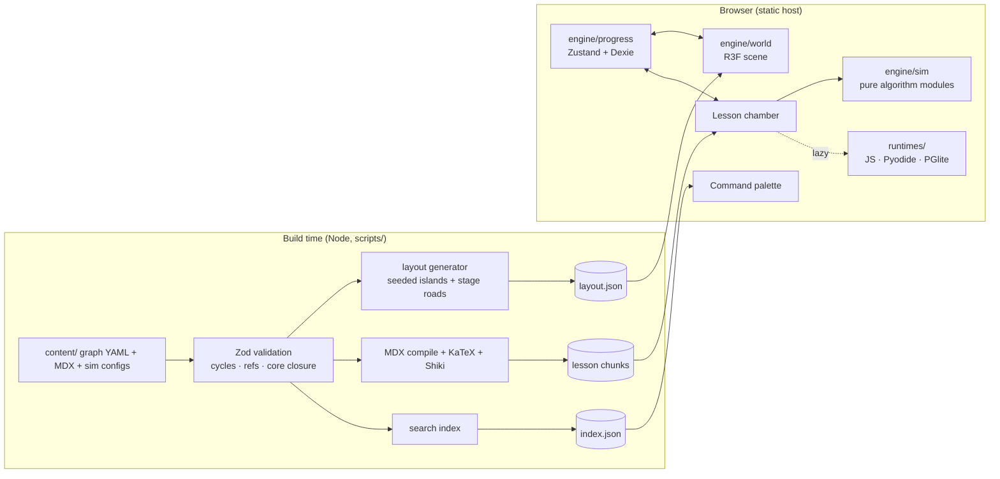

# 04 — Architecture & Technology Decisions

> Personas: **Senior Frontend Architect** (lead), Real-time 3D Engineer, Runtime/Sandboxing Engineer, Performance & Accessibility Engineer.

## 1. Shape of the system

Static, local-first single-page app. No server in Phases 1–8. Everything heavy (layout, validation, content compilation, search index) happens **at build time**; the browser loads precomputed JSON and lazy-loads runtimes only when a lesson needs them.

## 2. Technology choices (versions and licenses checked on npm, 2026-11-23)

| Layer | Choice | Version seen | License | Status |
|---|---|---|---|---|
| Build | Vite | 8.3.x | MIT | ✓ |
| Language | TypeScript (strict) | 6.0.x | Apache-2.0 | ✓ — Phase 1 chose 6.0: typescript-eslint supports < 6.1, not 7.0 yet |
| UI | React / React DOM | 19.3.x | MIT | ✓ |
| 3D | three | 0.187.x | MIT | ✓ |
| 3D | @react-three/fiber · drei | 9.8 · 10.7 | MIT | ✓ |
| Post FX | @react-three/postprocessing → postprocessing | 3.2 → 6.39 | MIT → **Zlib** | **Needs approval (D1)** |
| Layout (build) | d3-force-3d | 3.0.x | MIT | ✓ (custom layered layout + this relaxation) |
| Layout (build) | elkjs | 0.12 | EPL-2.0 / GPL-3.0 | ✗ rejected (license) |
| Styling | Tailwind CSS | 4.3.x | MIT | ✓ |
| Primitives | Radix UI | 1.x | MIT | ✓ |
| Command palette | cmdk | 1.1.x | MIT | ✓ |
| 2D motion | motion (Framer Motion) | 14.x | MIT | ✓ |
| 3D motion | @react-spring/three | 10.x | MIT | ✓ |
| — | GSAP | 3.15 | GSAP "Standard no-charge" (not OSI) | ✗ rejected (not on allowed list) |
| State | Zustand | 5.1.x | MIT | ✓ |
| Routing | @tanstack/react-router | 1.x | MIT | ✓ chosen over React Router for type-safe params & search |
| Validation | Zod | 4.x | MIT | ✓ |
| Content | MDX (@mdx-js/rollup), yaml | 3.1 · 2.9 | MIT · ISC | ✓ |
| Math / code | KaTeX · Shiki | 0.19 · 4.6 | MIT · MIT | ✓ (Shiki runs at build time → zero runtime cost) |
| 3D text | troika-three-text (via drei) | 0.53 | MIT | ✓ |
| Editor | **CodeMirror 6** | 6.x | MIT | ✓ substitution: Monaco has no real mobile/touch support and is several MB; CM6 is modular and small |
| JS runtime | Web Worker + sandboxed iframe | — | — | ✓ |
| Python | Pyodide | npm `314.0.x` | **MPL-2.0** | **Needs approval (D2)** |
| SQL | @electric-sql/pglite | 0.5.x | Apache-2.0 / PostgreSQL | ✓ primary; sql.js (MIT) fallback |
| Persistence | Dexie | 4.4.x | Apache-2.0 | ✓ |
| SRS | ts-fsrs | 6.x | MIT | ✓ |
| Audio | Web Audio API (+ howler 2.2, MIT, only if files are used) | — | — | ✓ |
| PWA | vite-plugin-pwa | 2.0.x | MIT | ✓ |
| Tests | Vitest · Playwright | 5.1 · 1.65 | MIT · Apache-2.0 | ✓ |
| Lint/format | ESLint · Prettier | 9.39 · 3.10 | MIT | ✓ — ESLint 9 because eslint-plugin-jsx-a11y does not support 10 yet |
| Fonts | Outfit · Inter · JetBrains Mono (Fontsource) | 5.3.x | OFL-1.1 | ✓ |
| Icons | lucide-static / lucide-react | 1.78.x | ISC | ✓ |
| Hosting | Cloudflare Pages (or GitHub Pages) | — | free, no card | ✓ |

Exact versions are pinned in Phase 1 from what is current then; every dependency is re-checked and recorded in `CREDITS.md`.

## 3. Repository layout

| Path | Owns | Must not |
|---|---|---|
| `content/` | `core-path.yaml` + `worlds/NN-world/world.yaml` + `worlds/NN-world/NN-stage/stage.yaml` (units, levels, prerequisites, boss, sources) | Contain code |
| `content/worlds/…/NN-stage/levels/<level-id>/` (Phase 3+) | `lesson.mdx`, `sim.config.ts`, `test.yaml` (level test, every item linked to the lesson step it checks), `review.md` | Import engine internals |
| `src/engine/world/` | Scene, camera rig, layout loading, instanced stars/edges, LOD, picking, labels, transitions, quality tiers | Know about XP rules |
| `src/engine/sim/` | Simulation framework (stepper, timeline, inspector) + `algorithms/` pure modules (LRU, Banker's, Dijkstra, TCP FSM, B+-tree…) with tests | Touch DOM/three in `algorithms/` |
| `src/engine/progress/` | XP, ranks, node states, FSRS, streaks, achievements, recommendation, persistence (Dexie), export/import | Render anything |
| `src/engine/lesson/` | Lesson loader, step model, challenge engine & graders | Know about 3D |
| `src/ui/` | Design tokens, glass & 3D-button components, HUD, breadcrumb, minimap, command palette, panels, Atlas | Hold domain logic |
| `src/runtimes/` | Adapters `js`, `python`, `sql` (later `c`) behind one interface | Run on main thread |
| `src/app/` | Routes, providers, composition root | Contain business rules |
| `scripts/` | `validate-content`, `build-layout`, `build-search`, `check-refs`, `check-licenses` | Be imported by the app |
| `tests/e2e/` | Playwright flows + screenshot baselines | |

## 4. Key module contracts (shape only — implemented from Phase 1)

| Contract | Shape |
|---|---|
| `GraphNode` | `{ id, title, domainId, subjectId, unit, tier, core, prereqs[], estMinutes }` |
| `LayoutNode` | `{ id, pos:[x,y,z], level bounds, labelPriority }` (from `layout.json`) |
| `TopicProgress` | `{ topicId, state, stepIndex, bestChallenge, fsrsCard, firstExploredAt, masteredAt }` |
| `Simulation<S, A>` | `init(config) → S`, `step(S, A?) → S`, `isGoal(S, goal) → boolean`, `describe(S) → string` (text alternative). Pure and deterministic, so the timeline is a list of states |
| `ChallengeItem` | Union over `mcq`, `predict-output`, `order-steps`, `spot-bug`, `match`, `numeric`, `code` — each with a pure `grade(answer)` |
| `Runtime` | `load()`, `run(code, tests, {timeoutMs, memoryMb}) → {passed[], failed[], stdout, error}` in a Worker; killable |
| `ProgressEvent` | `step-done · sim-goal · challenge-graded · review-graded · boss-cleared` → reducers compute XP, states, achievements (event-sourced, so export/import and replay are trivial) |

## 5. Routing (deep links)

| URL | View | Since |
|---|---|---|
| `/` | Atlas home (Phase 2: 3D World Map; Atlas stays at `/atlas`) | 1 |
| `/atlas/<world>` | World: its stages in order | 1 |
| `/atlas/<world>/<stage>` | Stage: units → levels, boss, sources | 1 |
| `/atlas/<world>/<stage>/<level>` | Level card: state, prerequisites, what it unlocks | 1 |
| `/gallery` | UI kit gallery (design review) | 1 |
| `/play/<level>?step=N` | Level play: lesson then level test | 3 |
| `/journey`, `/settings` | Overlays | 4 |

## 6. Persistence (IndexedDB via Dexie)

| Table | Key | Content |
|---|---|---|
| `events` | auto | Append-only progress events (source of truth) |
| `topics` | topicId | Derived `TopicProgress` snapshot (rebuildable from events) |
| `profile` | singleton | XP, rank, streak, freezes, settings (quality tier, sound, motion) |
| `achievements` | id | Unlocked at |
| `code` | topicId+taskId | Learner's last code per task |

Export = JSON file of `events` + `profile` + `code`, schema-versioned. Import validates with Zod, then replays.

## 7. Performance strategy (integrated Radeon target)

| Technique | Detail |
|---|---|
| Instancing | Every prop type (tree, palm, pine, rock, crystal, building, chest, pedestal, flower) = 1 `InstancedMesh` per material with per-instance colour; prototype stage view ≈ 60 draw calls |
| LOD by level | World Map: low-res island heightfields + sparse props; Stage: full-res heightfield for one island only; off-screen islands culled |
| Labels | DOM glass cards positioned from projected anchors, collision solver with leader lines; re-solved only when the camera settles |
| Terrain & water | Heightfields baked at build time (no runtime noise); water = one full-screen-ish plane with a single shader reading a baked depth texture |
| Frame budget | Target < 30 draw calls in Universe view; dev overlay shows fps, draw calls, triangles, GPU memory |
| Quality tiers | **High**: 2048 soft shadows + bloom on emissives + full prop density · **Balanced**: 1024 shadows, no bloom, 70 % props · **Lite**: baked shadow blobs, 40 % props, DPR ≤ 1, no glass blur (solid panels). Auto-downgrade when rolling p90 frame time > 18 ms for 3 s; never auto-upgrade mid-session |
| Loading | Route-level code splitting; three/R3F chunk separate from Atlas; Pyodide/PGlite/CodeMirror lazy; fonts subset |
| Memory | Single shared geometry/material set, explicit disposal on unmount, leak test in Playwright (open/close 50 lessons, heap stable) |
| Render on demand | `frameloop="demand"` when idle and no ambient motion is visible (saves battery) |

## 8. Accessibility

| Area | Approach |
|---|---|
| Keyboard | Every action reachable; visible focus rings; roving focus over stars ordered by Core Path |
| Screen readers | 2D Atlas is the primary SR surface; 3D canvas exposes a hidden accessible list of focusable nodes; ARIA live region narrates fly-tos and simulation steps |
| Motion | `prefers-reduced-motion` + in-app toggle: no camera flights, no flicker, celebrations become static |
| Contrast | Tokens checked for WCAG AA (text ≥ 4.5:1, large text/UI ≥ 3:1) in a unit test |
| Simulations | Every sim implements `describe(state)` text alternative; every visual has a caption |

## 9. Quality gates (from Phase 1 onward)

| Gate | Tool | Fails build when |
|---|---|---|
| Content | `scripts/validate-content` (Zod) | Broken edge, cycle, Core Path closure violation, missing refs/review checklist |
| Types & lint | `tsc --noEmit`, ESLint | Any error |
| Logic | Vitest | Any failing test; algorithm modules < 95 % branch coverage |
| E2E | Playwright | Flow breaks or screenshot diff over threshold |
| Licenses | `scripts/check-licenses` | Dependency license outside the allowed list (+ any approved exceptions) |
| Perf | Lighthouse CI + in-app fps probe | Regression beyond budget |

## 10. Decisions needing your approval

| ID | Decision | Recommendation | Alternative |
|---|---|---|---|
| **D1** | Allow **Zlib** license (`postprocessing`, required by `@react-three/postprocessing`) | Approve — Zlib is a permissive, OSI-approved license like MIT; this library merges effects into fewer passes, which matters on an iGPU | Use three.js's own `EffectComposer` (MIT), more GPU passes |
| **D2** | Allow **MPL-2.0** for **Pyodide** (used unmodified, lazy-loaded) | Approve — file-level copyleft only applies if Pyodide's own files are modified; we just ship them with their notice | Brython (BSD-3): smaller but not real CPython, weaker for teaching accuracy |
| **D3** | World look | **Isles of Computing** premium 3D (01) — theme already accepted by you | — |
| **D4** | CodeMirror 6 instead of Monaco | Approve (mobile + size) | Monaco on desktop only |
| **D5** | Phase 5 vertical slice | Tier 0 (Origins) + **Operating Systems** | Tier 0 + Data Structures |
