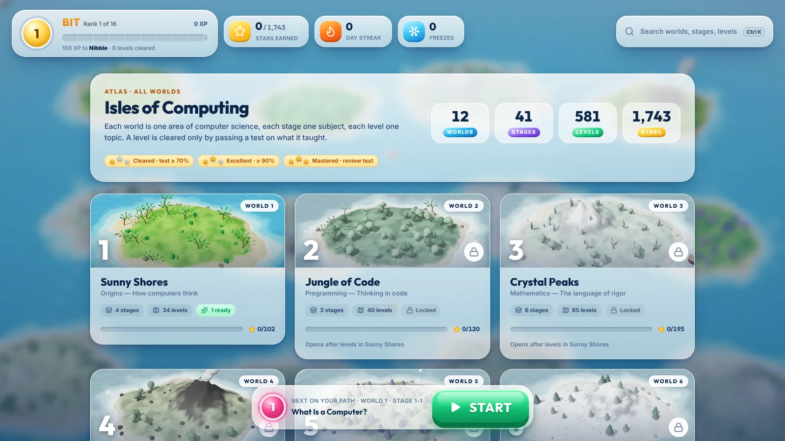
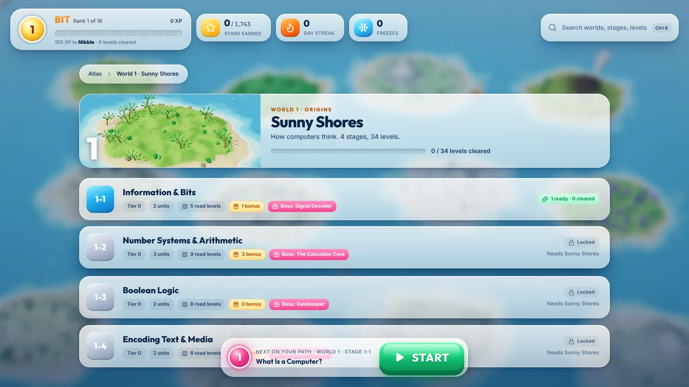
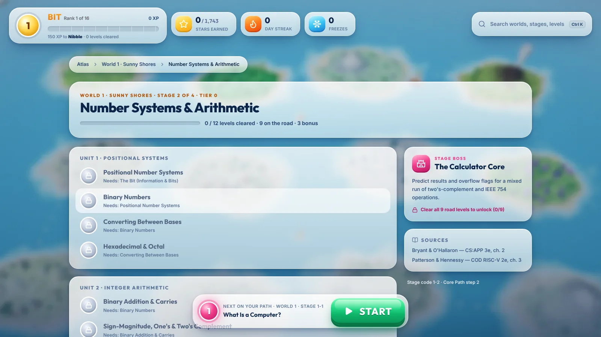
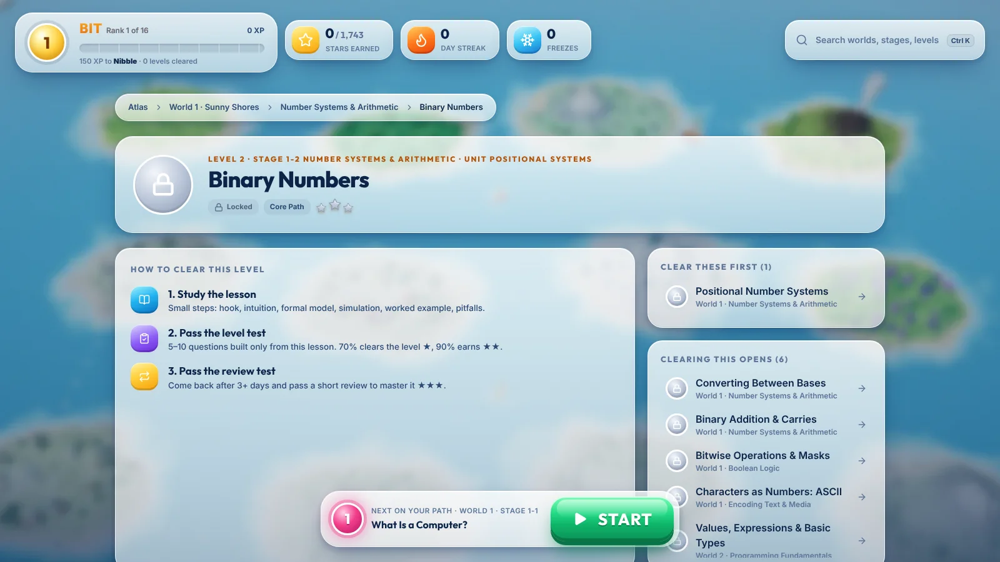
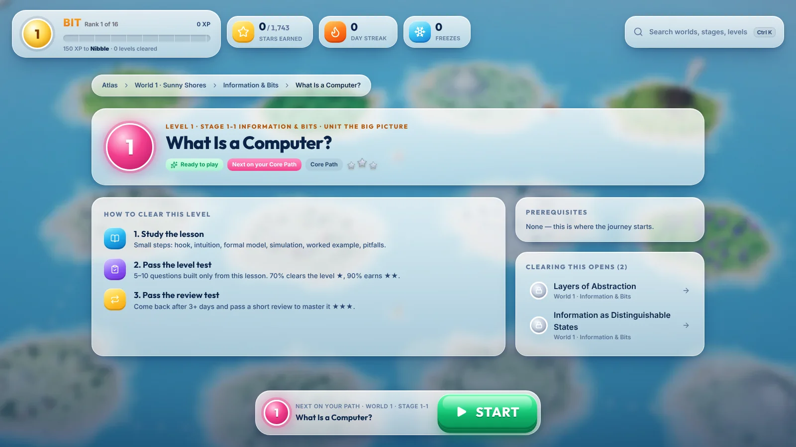
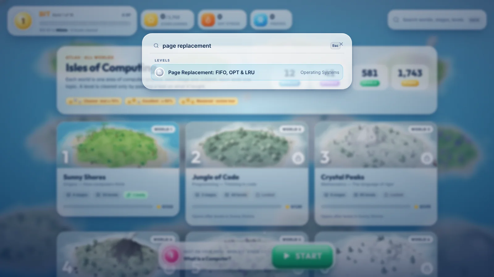

# Phase 1 — Foundation & Design System

> Personas: **Senior Frontend Architect** (lead), **Senior UI/UX & Motion Designer**, Learning Scientist (content structure).

## Goal

A working, tested app skeleton with the premium game UI kit from the Phase 0 renders, the HUD shell, deep-link routes, and a content pipeline in which every world, stage and level lives in its own clearly separated file and the build fails on any structural error.

## Owner requirements carried into this phase (2026-11-23)

| # | Requirement | How Phase 1 honours it |
|---|---|---|
| R-A | Education content properly structured, separated and categorized — never all subjects in one place | `content/worlds/<nn-world>/<nn-stage>/stage.yaml`: one folder per world, one folder per stage; units group levels inside a stage; folder numbers are checked against the Core Path order |
| R-B | A level is cleared only by passing a test on what that level taught | Rule written into 02/03 (Cleared = level test ≥ 70 %); Phase 1 implements the availability logic on top of it (a level unlocks only when every prerequisite level is **Cleared**). The test engine itself is Phase 3 |
| D1–D5 | All approved | Zlib + MPL-2.0 added to the license allow-list; CodeMirror 6; slice = Origins + OS |

## Scope

| In | Out (later phase) |
|---|---|
| Vite 8 + React 19 + TypeScript 6 (strict) scaffold | 3D world, island renders (2) |
| ESLint 9 (typescript-eslint, react-hooks, jsx-a11y), Prettier | Lesson chamber, MDX, quiz engine (3) |
| Vitest (unit + component), Playwright (E2E + screenshots) | XP/star/FSRS persistence (4) |
| Design tokens (CSS variables + Tailwind 4 theme), self-hosted OFL fonts | Lesson content (5) |
| UI kit: GlassPanel, GemButton, IconButton, StatChip, ProgressBar, ProgressRing, StarRating, LevelMedallion, Tag, Kbd, Modal, Tooltip | Code runtimes (6) |
| HUD shell: ProfileCard, StatChips, ToolBar, ContinueButton, Command palette (Ctrl K) | Sound, PWA (7) |
| Routes: `/` Atlas home, `/atlas/$world`, `/atlas/$world/$stage`, `/atlas/$world/$stage/$level`, `/gallery` | |
| Content pipeline: YAML → Zod → graph checks → `src/generated/curriculum.json`; build fails on errors | |
| Pure modules: rank table, level availability, Core Path "next level" | |
| `scripts/check-licenses.mjs` | |

The Atlas pages are the real 2D Atlas mode in its first form (structured browsing of worlds → stages → units → levels with lock state and prerequisites). Phase 2 adds the 3D world as `/` and keeps the Atlas at `/atlas`.

## Learner state in Phase 1

No fake data. The HUD and lock states show a **new learner** (rank Bit, 0 XP, 0 / 1,743 stars, no streak) computed from the real rank table and the real graph. Persistence arrives in Phase 4.

## Content file layout

```
content/
  README.md                   how the structure works (for authors)
  core-path.yaml              global stage order for beginners
  worlds/
    01-origins/
      world.yaml              id, title, biome, tagline, colour
      01-information-bits/
        stage.yaml            id, title, tier, refs, boss, units → levels
      02-number-systems/
        stage.yaml
    02-programming/ …
```
Phase 3+ adds `levels/<nn-topic>/lesson.mdx` and `test.yaml` inside each stage folder.

## Validation (build-breaking)

| Check | Error when |
|---|---|
| Schema (Zod) | Missing/extra/ill-typed field in any file |
| Folder naming | `NN-id` prefix does not match the item's id or its order |
| Unique ids | Duplicate world, stage, unit (within stage) or level id |
| References | A `requires` id does not exist |
| DAG | Any prerequisite cycle (level graph or derived stage graph) |
| Core Path | A stage missing from `core-path.yaml`; a core level that needs a non-core level or a level from a later stage |
| Stage order | Stage folder order inside a world disagrees with Core Path order |
| Redundant edges | Warning (not error) for transitively implied prerequisites |

## Acceptance criteria

| # | Criterion |
|---|---|
| 1 | `npm run build` succeeds from a clean checkout and runs content validation first |
| 2 | `npm run typecheck`, `npm run lint`, `npm test` pass with zero errors |
| 3 | Validator unit tests cover every check above with failing fixtures |
| 4 | Content totals after migration identical to Phase 0: 12 / 41 / 581 / 337 core / 806 edges |
| 5 | Playwright: Atlas navigation world → stage → level works; locked level shows its missing prerequisites; Ctrl K finds a level and navigates; keyboard-only path works |
| 6 | Gallery and Atlas screenshots reviewed against Phase 0 render language |
| 7 | All production dependencies pass `check-licenses` |
| 8 | Reduced-motion preference disables springs |
| 9 | Local commit as Rajdeep Biswas |

---

# Phase 1 report

## Deliverables

| Area | Files |
|---|---|
| Structured curriculum | `content/core-path.yaml`, `content/worlds/NN-world/world.yaml` (12), `content/worlds/NN-world/NN-stage/stage.yaml` (41), `content/README.md` |
| Content pipeline | `src/engine/content/schema.ts` (Zod), `src/engine/content/validate.ts` (graph checks + compiler), `scripts/content/load.ts`, `scripts/build-content.ts`, `scripts/content/doc.ts` |
| Progress logic (pure) | `src/engine/progress/ranks.ts`, `availability.ts`, `learner.ts` |
| Design system | `src/ui/tokens.css`, `src/ui/kit.css`, `src/ui/components/*` (13 components) |
| HUD | `src/ui/hud/` ProfileCard, TopBar, ContinueBar, CommandPalette |
| App | `src/app/router.tsx`, routes: AtlasHome, WorldPage, StagePage, LevelPage, Gallery, NotFound |
| Assets | `public/islands/*.webp` (12 island thumbnails rendered from the prototype), `public/bg/archipelago.webp` |
| Tooling | `package.json` scripts, `tsconfig*.json`, `vite.config.ts`, `eslint.config.js`, `.prettierrc.json`, `playwright.config.ts`, `scripts/check-licenses.mjs` |
| Tests | 5 Vitest files (31 tests), 1 Playwright file (8 flows) |

## Acceptance checklist

| # | Criterion | Result |
|---|---|---|
| 1 | `npm run build` runs content validation first and succeeds | ✓ — largest JS chunk 219 kB (React), ~225 kB gzip total |
| 2 | `typecheck`, `lint`, `test`, `format:check` clean | ✓ 0 errors, 0 warnings |
| 3 | Validator tests cover every check with failing fixtures | ✓ 12 tests: folder names, order gaps, duplicate ids, unknown/forward prerequisites, cycles, core → bonus, core → later stage, missing stage, stage order, redundant-edge warning |
| 4 | Totals unchanged after migration | ✓ 12 worlds · 41 stages · 581 levels · 337 core · 806 prerequisites · 260 cross-stage |
| 5 | E2E: navigation, locked-level prerequisites, Ctrl K search, keyboard-only, not-found | ✓ 8/8 (run 3× in a row, no flakes) |
| 6 | Screens reviewed | ✓ [phase-1-screens/](phase-1-screens/) |
| 7 | License check | ✓ 60 production packages |
| 8 | Reduced motion disables button springs | ✓ E2E-asserted |
| 9 | Local commit | ✓ |

## Screens

| Atlas home | World |
|---|---|
|  |  |
| **Stage** | **Locked level** |
|  |  |
| **Ready level** | **Search (Ctrl K)** |
|  |  |

## Changes and findings

| Item | Note |
|---|---|
| TypeScript 6.0 (not 7.0) | typescript-eslint supports TS < 6.1 only |
| ESLint 9 (not 10) | eslint-plugin-jsx-a11y does not support ESLint 10 yet |
| ARP level moved | Was before IP Addressing in the same stage; the new "prerequisites first" rule caught it. Now in the Network Layer unit |
| Unlicense accepted | `isbot` (inside TanStack Router) is public-domain dedicated, same effect as CC0; added to the allow-list |
| Old `curriculum.graph.yaml` removed | Replaced by the per-world/per-stage files; `02-curriculum.md` is now generated from them |

## Known issues

| Issue | Plan |
|---|---|
| Progress is in memory (new learner every reload) | Phase 4: event log + IndexedDB |
| Level pages explain how to clear but cannot be played yet | Phase 3: lesson chamber + level test engine |
| `/` is the Atlas | Phase 2: 3D World Map at `/`, Atlas moves to `/atlas` only |
| Island thumbnails are static renders | Phase 2 renders islands live |

## What Phase 2 will do

Build the 3D World Engine: World Map of 12 islands, island and stage views with the level road, pedestals, bonus chests and castles from a seeded build-time layout; terrain and water shaders; instanced prop kit; camera glides, picking, label solver, quality tiers (High / Balanced / Lite) with auto-downgrade, and the 3D view wired to the same progress data as the Atlas. Target 60 fps on the Ryzen 5 7530U iGPU.
