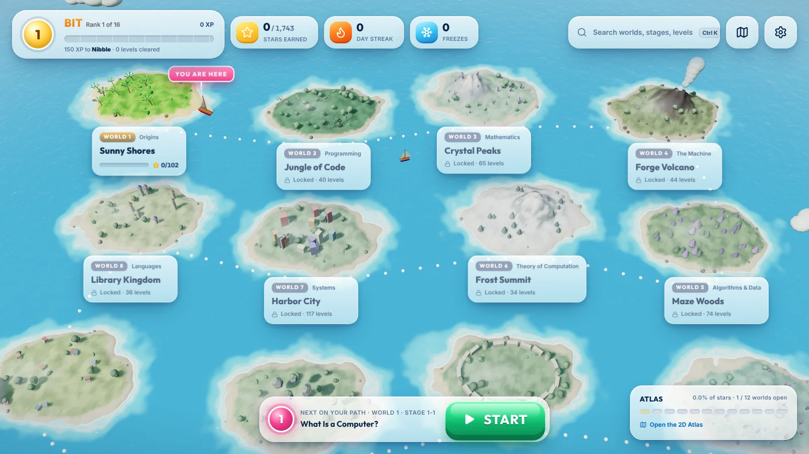
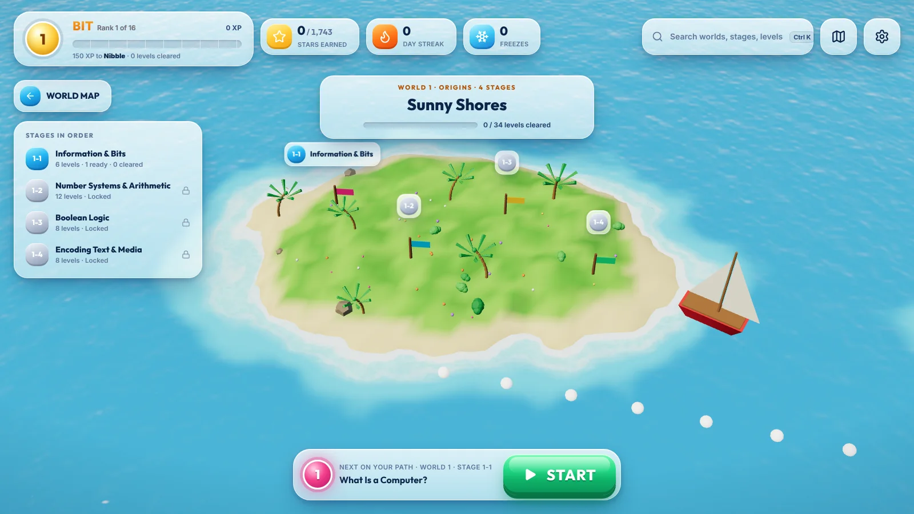
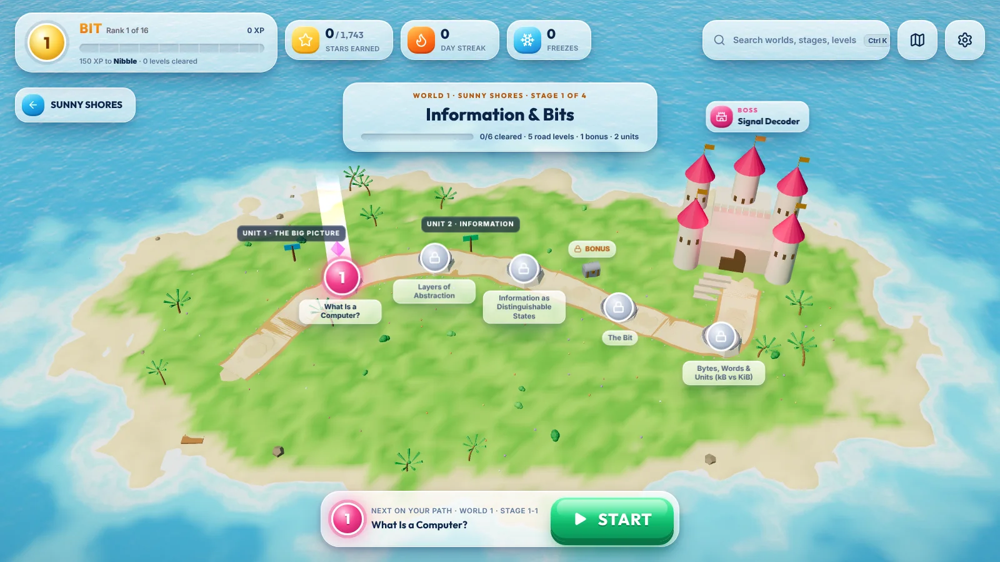
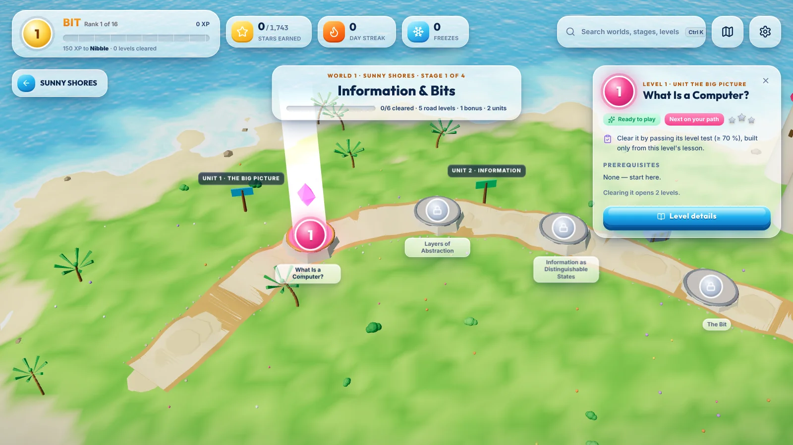

# Phase 2 — World Engine (Isles)

> Personas: **Real-time 3D / WebGL Graphics Engineer** + **Technical Artist** (lead), Performance & Accessibility Engineer, UI/UX & Motion Designer.

## Goal

The Phase 0 renders become the real, interactive app: a 3D World Map of 12 islands, an island view of each world's stages, and a stage view with the numbered level road, bonus chests and boss castle — all generated from `content/`, wired to the same progress data as the Atlas, and built to hold 60 fps on an integrated Radeon GPU.

## Scope

| In | Out (later) |
|---|---|
| `/` World Map · `/world/<world>` island view · `/world/<world>/<stage>` stage view; Atlas kept at `/atlas` | Level play / tests (3) |
| Seeded procedural terrain per island, generated in a Web Worker (no main-thread jank, nothing large to download) | XP/star persistence (4) |
| Water shader (depth tint, shoreline foam, caustics, fresnel, sun glint) | Sound (7) |
| Instanced prop kit per biome (palms, broadleaf, pines, crystals, rocks, buildings, towers, walls, volcano, flowers) | Celebration cinematics (4) |
| Stage road: pedestals per core level, bonus chests on side trails, unit signposts, castle | |
| Camera rig: spring glides between views, constrained orbit/pan/zoom, keyboard controls | |
| Picking + hover; DOM glass labels with a collision solver | |
| Level card panel in 3D view (state, prerequisites, unlocks, link to Atlas page) | |
| Search (Ctrl K) flies the camera to a world, stage or level | |
| Quality tiers High / Balanced / Lite / Auto with auto-downgrade; F3 dev overlay (fps, draw calls, triangles) | |
| WebGL capability check → Atlas fallback; 2D ⇄ 3D toggle in HUD | |

## Design decisions for this phase

| Decision | Reason |
|---|---|
| Layout = pure function of the curriculum (tested), run in the browser | Deterministic and cheap (< 5 ms); no generated layout file to keep in sync |
| Heightfields generated at runtime in a worker from the same seed | Baking 41 stage heightfields would add ~20 MB of downloads; generation takes ~0.2–0.5 s off the main thread |
| One stage = its own island scene | Each subject gets a clear, separate place (owner rule R-A) with room for up to ~50 levels |
| Road numbers follow content order | Level 1 → N is exactly the order the content files teach |
| Labels in the DOM, not WebGL text | Crisp text, accessible, same glass style; solver runs only when the camera settles |

## Quality tiers

| Tier | DPR cap | Shadows | Props | Post FX |
|---|---|---|---|---|
| High | 2 | 2048 soft | 100 % | Bloom on emissives |
| Balanced (default) | 1.5 | 1024 | 70 % | — |
| Lite | 1 | off | 40 % | — |

Auto: starts Balanced; drops one tier if the frame rate stays below ~45 fps; never raises itself mid-session.

## Acceptance criteria

| # | Criterion |
|---|---|
| 1 | All 12 worlds and 41 stages render from content with correct lock state for a new learner |
| 2 | Every core level has exactly one pedestal in road order; every bonus level a chest; one castle per stage; no overlaps (unit-tested) |
| 3 | Click/keyboard: island → island view → stage → level card; Esc goes up one level; breadcrumb works |
| 4 | Search flies to world, stage and level |
| 5 | Labels never overlap (solver) and never cover HUD panels |
| 6 | Quality tier switch and F3 overlay work; reduced motion → no camera flights |
| 7 | No WebGL → Atlas fallback with a notice |
| 8 | typecheck, lint, unit, E2E, build, license check pass |
| 9 | Draw calls: World Map ≤ 80, stage view ≤ 80 (overlay-verified) |

---

# Phase 2 report

## Deliverables

| Area | Files |
|---|---|
| Pure engine (tested) | `src/engine/world/noise.ts` (seeded simplex/fBm, PRNG, hash), `biomes.ts` (12 biome palettes + prop recipes), `terrain.ts` (heightfield + vertex colours + sampler), `layout.ts` (World Map + stage road layout), `props.ts` (instanced prop kit + seeded scatter), `pieces.ts` (road ribbons, pedestals, chests, signposts, castle, boats), `water.ts` (ocean shader) |
| Off-main-thread | `terrain.worker.ts` + `terrainClient.ts` (cached; in-thread fallback) |
| Scenes | `src/world/WorldMapScene.tsx`, `StageScene.tsx`, `TerrainWater.tsx`, `Atmosphere.tsx`, `Batch.tsx` |
| Interaction | `CameraRig.tsx` (CameraControls glides, limits, boundary, arrow/±/Esc keys), picking volumes + hover, `labels.tsx` (DOM labels + collision solver), `views.tsx` (World Map / Island / Stage overlays, level card) |
| Performance | `quality.ts` (High / Balanced / Lite / Auto, persisted), drei `PerformanceMonitor` auto-downgrade, `DevOverlay.tsx` (F3), Bloom on High only, lazy 3D chunks |
| App | Routes `/`, `/world/$worldId`, `/world/$worldId/$stageId?level=`, Atlas moved to `/atlas`; HUD 2D⇄3D toggle and Settings dialog; search flies the camera; WebGL 2 check → Atlas fallback |

## Acceptance checklist

| # | Criterion | Result |
|---|---|---|
| 1 | 12 worlds / 41 stages render from content with new-learner lock state | ✓ E2E: 12 island cards, 11 locked, "You are here" on World 1 |
| 2 | One pedestal per core level in order, one chest per bonus, one castle, no overlaps | ✓ unit-tested on all 41 real stages (pairwise gap ≥ 7.4, all on the island) |
| 3 | Island → stage → level card; Esc walks back up | ✓ E2E |
| 4 | Search flies to world, stage, level | ✓ E2E (level: `page-replacement` → OS stage, card open) |
| 5 | Labels never overlap each other or HUD panels | ✓ solver hides lower-priority labels; HUD panels marked `data-hud`; off-screen labels hidden |
| 6 | Quality tiers + F3 overlay; reduced motion → no camera flights | ✓ E2E (setting persists across reload); camera/water/gem animation off under reduced motion |
| 7 | No WebGL 2 → Atlas fallback | ✓ E2E |
| 8 | typecheck, lint, unit (79), E2E (13), build, licenses (124 pkgs) | ✓ |
| 9 | Draw calls ≤ 80 | ✓ World Map 63, Operating Systems stage 53, Number Systems stage 31 (F3 overlay) |

## Screens (software WebGL, auto-downgraded tiers)

| World Map | Island |
|---|---|
|  |  |
| **Stage** | **Level card** |
|  |  |

## Bundle

| Chunk | gzip | Loaded |
|---|---|---|
| App + React + router + UI + curriculum | ≈ 225 kB | Always |
| three.js | ≈ 189 kB | 3D routes only |
| R3F + drei + postprocessing | ≈ 110 kB | 3D routes only |
| World code + worker | ≈ 20 kB | 3D routes only |

## Honest limits

| Item | Status |
|---|---|
| 60 fps on your Ryzen 5 7530U | **Not measured here** (this build machine has no GPU; software rendering runs at 1–2 fps and auto-downgrades to Lite, which proves the downgrade path). Please open the app, press F3 and read FPS at Balanced; tiers and prop density are tuned to make this achievable (63 draw calls, ~0.7 M triangles on the World Map). |
| Mobile | Lite tier and touch orbit/pinch work through CameraControls; real-device check is a Phase 7 item. |
| Name labels on big stages | Only the current, selected, hovered and non-colliding names show — intentional to keep the road readable. |
| Stage art | Procedural; same visual language as the Phase 0 renders. A polish pass on signature props is planned for Phase 7. |

## What Phase 3 will do

Level play: the lesson chamber (step rail, MDX lessons with KaTeX and Shiki), the reusable simulation framework (step / scrub / inspector, pure algorithm modules with textbook tests), and the **level test engine** (all item formats, every item linked to the lesson step it checks, 70 % to clear, 90 % for the second star, failed items link back to the step). One demo level exercising every part.
