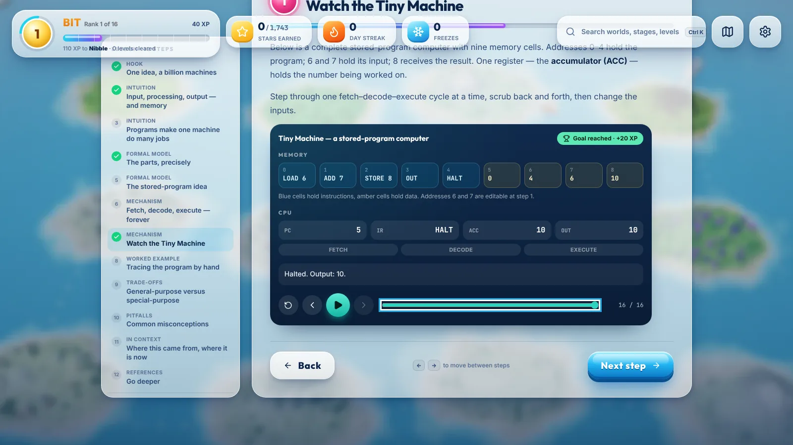
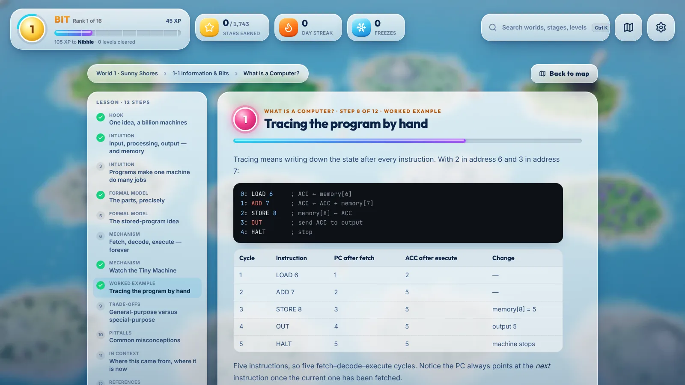
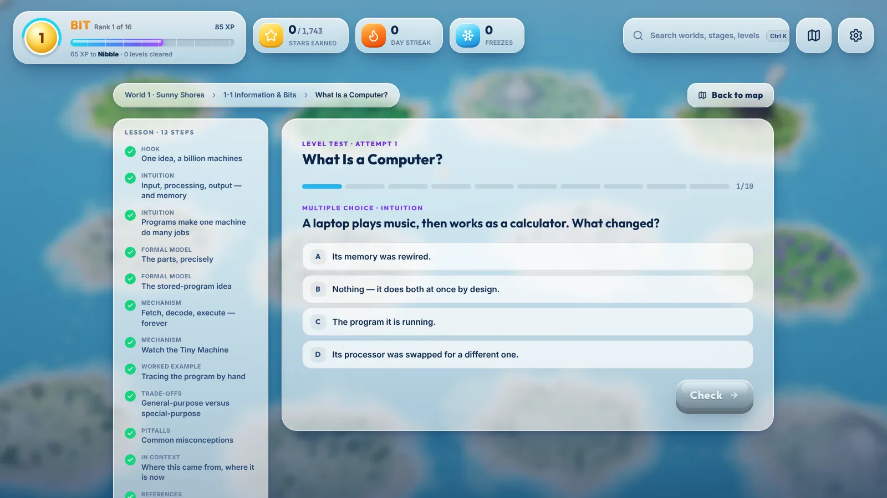
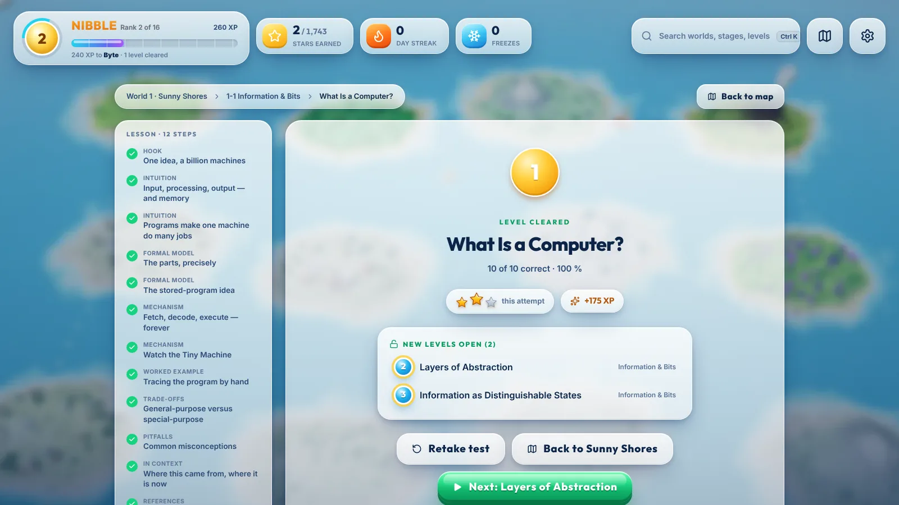
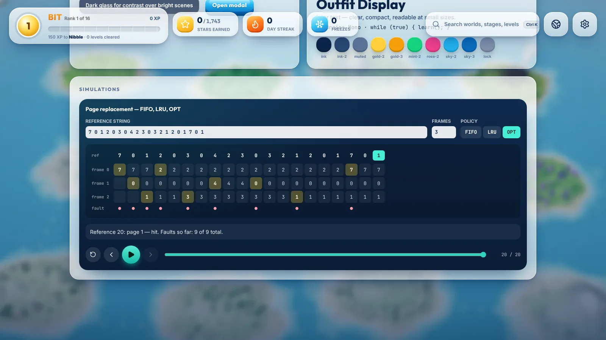

# Phase 3 — Lesson Experience, Simulation Framework & Level Test

> Personas: **Senior UI/UX & Motion Designer** + **Educational Technologist** (lead), Learning Scientist / CS Professor (content accuracy), Frontend Architect.

## Goal

A level can be played end to end: study a structured lesson one small step at a time (with an interactive simulation at its heart), then pass a **level test built only from that lesson** to clear it — exactly the owner's rule R-B.

## Scope

| In | Out (later) |
|---|---|
| `/play/<level>` lesson chamber: step rail by section, one step per screen, keyboard ←/→, resume | XP persistence, FSRS reviews, streaks (4) |
| Lessons as MDX in `content/…/NN-stage/levels/<level-id>/lesson.mdx` with `<Step>` blocks; KaTeX maths and Shiki code highlighting at build time | Remaining lessons (5, 8) |
| Simulation framework: pure `Simulation<S, A>` modules, timeline (step back / step / play / scrub), state inspector, goals, screen-reader text per state | Code runtimes & coding items (6) |
| Algorithm modules with textbook tests: Tiny Machine (fetch–decode–execute), page replacement FIFO / OPT / LRU | |
| Level test engine: `test.yaml` pool, seeded draw, 6 item formats, grading, feedback that links back to the taught step, 70 % / 90 % rules, Level Clear screen | |
| Build-time checks: step ids/sections, every item linked to a real step, section coverage, answer validity | |
| Demo level written in full: **World 1 · Level 1 — What Is a Computer?** | |

## Lesson model

| Section (in order) | Required | Tested |
|---|---|---|
| hook | ✓ | — |
| intuition | ✓ | ✓ |
| formal | ✓ | ✓ |
| mechanism (simulation) | ✓ | ✓ |
| worked-example | ✓ | ✓ |
| tradeoffs | ✓ | ✓ |
| pitfalls | ✓ | ✓ |
| context | ✓ | — |
| references | ✓ | — |

## Test item formats

| Format | Learner action | Grading |
|---|---|---|
| `mcq` | Pick one option | exact index |
| `numeric` | Type a number | within `tolerance` |
| `predict-output` | Read code/program, pick its output | exact index |
| `order-steps` | Arrange steps (buttons or keys) | exact order |
| `spot-the-bug` | Select the faulty line | exact line |
| `match` | Pair each term with a definition | all pairs correct |

Each item has `teaches: <step-id>`; the build fails if that step does not exist in the level's lesson. Each draw takes up to 10 items, covering every tested section at least once.

## Acceptance criteria

| # | Criterion |
|---|---|
| 1 | Demo level playable from the 3D level card and the Atlas level page |
| 2 | All 9 sections present; simulation reachable and goal-checked; KaTeX and code render without runtime cost |
| 3 | Test: all 6 formats work by mouse and keyboard; < 70 % fails with links to steps; ≥ 70 % clears (1★), ≥ 90 % (2★); dependants unlock immediately |
| 4 | Algorithm modules pass textbook tests (Silberschatz reference string: FIFO 15, OPT 9, LRU 12 faults with 3 frames) |
| 5 | Build fails on a broken `teaches` link, missing section, or invalid answer (unit-tested) |
| 6 | typecheck, lint, unit, E2E, build, licenses pass |

---

# Phase 3 report

## Deliverables

| Area | Files | Notes |
|---|---|---|
| Lesson chamber | `src/play/LessonChamber.tsx`, `play.css`, route `/play/$levelId` | Step rail by section with ✓ per seen step, one step per screen, ←/→ keys, Back/Next, progress bar; locked levels show their blockers; levels without a lesson say so honestly |
| MDX lessons | `content/…/levels/<id>/lesson.mdx`, `src/play/lessons.ts`, `mdx.tsx`, `vite.config.ts` | `<Step>`, `<Callout>`, `<Simulation>`; KaTeX + Shiki + GFM at build time; each lesson is its own lazy chunk |
| Lesson pipeline | `src/engine/lesson/{schema,compile}.ts`, `scripts/content/lessons.ts` | Validates lesson + test, writes `src/generated/lessons.json` |
| Test engine | `src/engine/lesson/testEngine.ts`, `src/play/TestRunner.tsx`, `LevelClear.tsx` | Seeded draw (mulberry32), 6 formats, per-item feedback with the step it was taught in, 70 % / 90 % rules, XP, unlocked levels, steps to revisit |
| Simulations | `src/engine/sim/{types,registry}.ts`, `algorithms/{tinyMachine,pageReplacement}.ts`, `src/play/sims/*` | Pure state machines → precomputed timeline; reset / back / play / forward / scrub; `aria-live` description per state; goals award XP once |
| Progress | `src/engine/progress/learner.ts`, `availability.ts` | Pure reducers: step views (+5, studied +25), sim goals (+20), attempts, tests (stars never drop); `newlyAvailable` |
| Entry points | `src/app/PlayButton.tsx` in the 3D level card and the Atlas level page | Locked / Lesson in production / Play / Replay |
| Demo level | `content/worlds/01-origins/01-information-bits/levels/what-is-computer/` | 12 steps over all 9 sections, Tiny Machine simulation with goal, 15-item test pool covering all 6 formats |

## Content accuracy (demo level)

| Claim | Source |
|---|---|
| Stored-program design, PC, fetch–decode–execute | von Neumann, *First Draft of a Report on the EDVAC* (1945); Patterson & Hennessy ch. 1; CS:APP ch. 1 |
| ENIAC programmed by rewiring; Manchester Baby ran first stored program on 21 June 1948 | Standard histories (Petzold, *Code*, 2nd ed.) |
| "von Neumann bottleneck" named by Backus | Backus, *CACM* 21(8), 1978 (1977 Turing lecture) |
| FIFO 15 / OPT 9 / LRU 12 faults; Bélády's anomaly 9 → 10 | Silberschatz, Galvin & Gagne, *OSC* 10e, ch. 10 — unit-tested |

## Verification

| Check | Result |
|---|---|
| `npm run typecheck` / `lint` / `format:check` | Pass |
| Unit (Vitest) | 105 pass — incl. Tiny Machine purity & errors, FIFO 15 / OPT 9 / LRU 12, Bélády, lesson compiler errors, draw coverage & determinism, grading of all 6 formats, 70/90 rules, XP |
| E2E (Playwright) | 18 pass — study → test → clear (100 % → ★★, +175 XP, 2 levels opened), fail path (60 % → steps to revisit), ←/→ keys, KaTeX & Shiki present, sim goal, locked level, page-replacement sim in Gallery |
| `npm run build` | Pass; lesson chunk 22 kB, chamber 22 kB, KaTeX CSS 30 kB, sims 2–5 kB each — none load on the map |
| `npm run check:licenses` | 126 production packages OK |

## Screens

| | |
|---|---|
|  |  |
|  |  |
|  | |

## Known issues / limits

| Issue | Plan |
|---|---|
| Progress lives in memory: a page reload resets XP, stars and seen steps | Phase 4 (event log + IndexedDB save) |
| Only one lesson exists; every other level shows "Lesson in production" | Lessons are written world by world in the content phases |
| 3rd star (review test after 3+ days) not yet active | Phase 4 (FSRS) |
| Coding items (write/fix code) not yet available | Phase 6 (code runtimes) |

## Next phase

**Phase 4 — Progression & Rewards**: event log with IndexedDB save, XP and rank events, FSRS review tests and the 3rd star, streaks and freezes, achievements, celebration hierarchy, journey log, world lit by progress.
