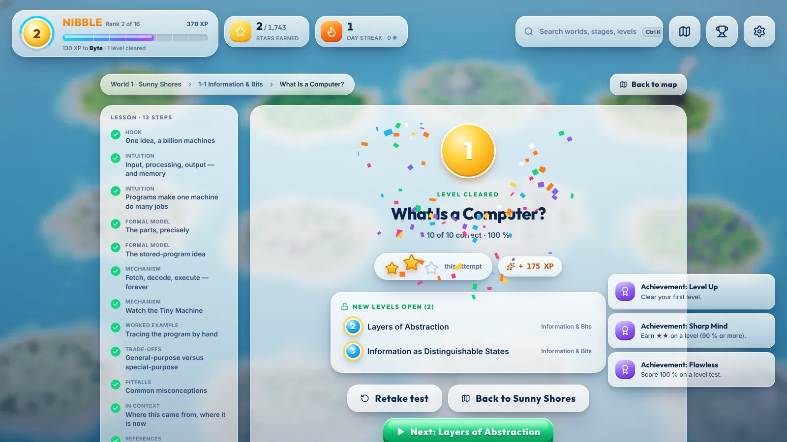
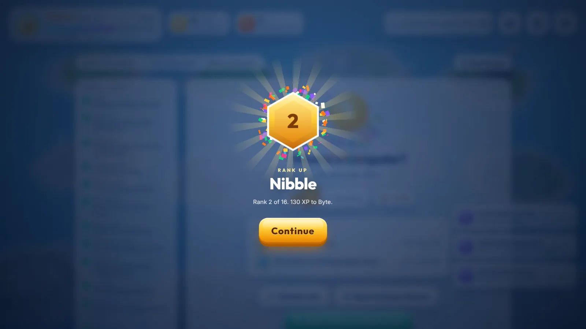
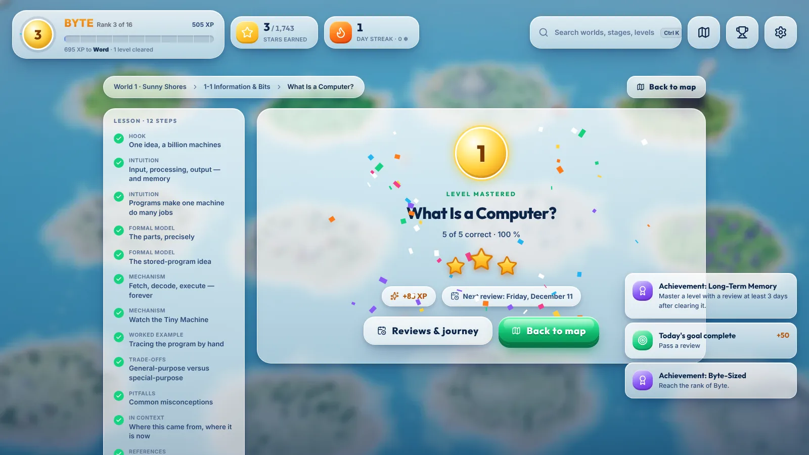
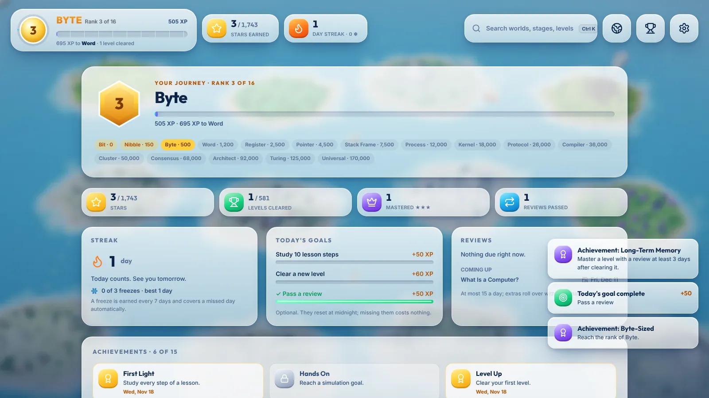
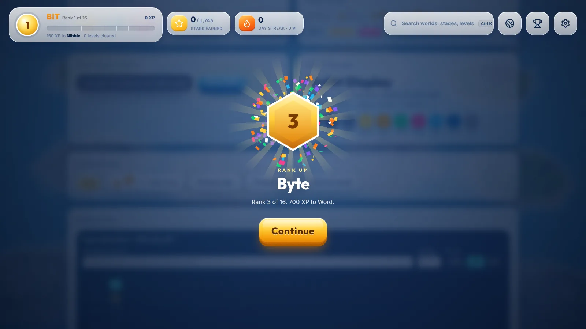
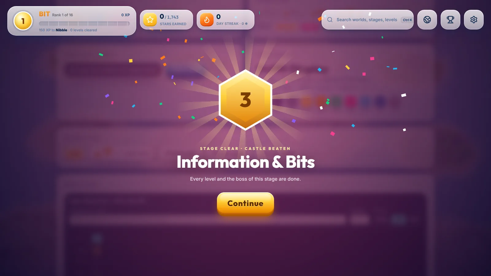
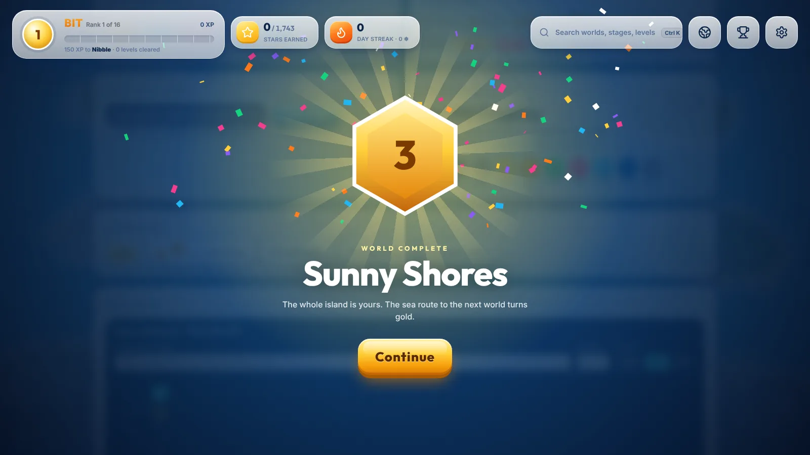
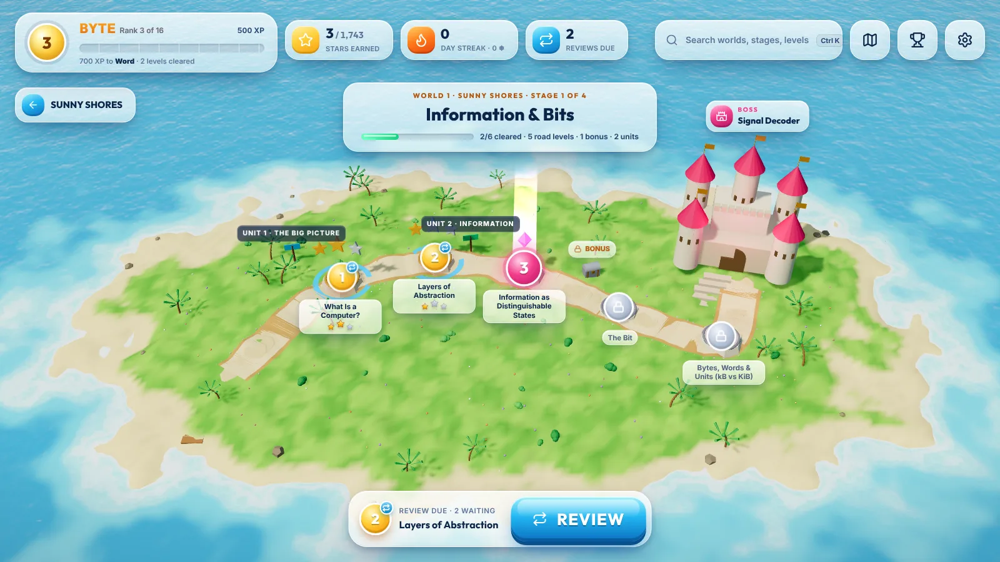
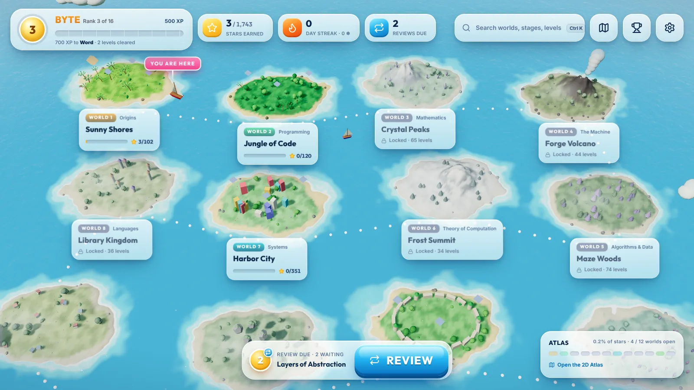

# Phase 4 — Progression & Rewards

> Personas: **Game Systems Designer** (lead), Learning Scientist (spaced repetition, ethics), UI/UX & Motion Designer (celebrations), Frontend Architect (event log, storage).

## Goal

Progress becomes durable, honest and motivating: everything the learner does is an event in a local log; XP, stars, ranks, reviews, streaks, achievements and the journey log are all **derived by replaying that log** with pure functions. Rewards follow docs/blueprint/03 exactly, with the ethics rules enforced.

## Scope

| In | Out (later) |
|---|---|
| Append-only event log in IndexedDB; pure `replay(events, settings)`; export / import / reset | Cloud sync (9) |
| XP economy from 03 §2 (steps, sim goals, items, studied, cleared, ★★, mastered, review, daily goals) | Boss / stage / world XP (bosses arrive in 5) |
| Level states: locked · available · in progress (ring) · studied · ★ · ★★ · ★★★ mastered (dims after a failed review) · review due | |
| FSRS spaced review (`ts-fsrs`, MIT): one card per cleared level; review test of up to 5 items; target retention 0.80–0.95; daily cap; mastery = review passed ≥ 3 days after clearing | |
| "Prove it": take the level test without studying | |
| Streaks: any activity on a local day; freezes (+1 per 7 days, max 3, auto-applied); neutral break message; optional weekly goal mode | |
| Achievements (only those observable with current features; more ship with their content) | Content-specific badges (5+) |
| Celebration hierarchy: micro (XP chip, step tick) < level (stars stamp, XP count-up, confetti) < rank-up (badge forge) < stage < world; skippable; calm mode; reduced motion → static | Sound (7) |
| Today's goals (optional, +50/+60 XP, reset at local midnight) | |
| Journey page: rank ladder, stats, today's goals, reviews due, achievements, weekly timeline | Share card PNG (9) |
| Recommendation: one CONTINUE target — overdue review first, else next Core Path level | |
| World lit by progress: stage lanterns on the World Map glow with completion; cleared/mastered/due halos on pedestals | |
| Settings: celebrations, streak display & mode, retention, review cap, progress export / import / reset | |

## Event model

| Event | Fields | Derived effects |
|---|---|---|
| `step` | level, step | +5 XP first view; +25 when the last unseen step is viewed (studied) |
| `sim` | level, sim | +20 XP first time |
| `test` | level, attempt, correct, total, ms, proveIt | Item XP 10 (first attempt) / 5; +50 first clear; +25 first ★★; FSRS card created on first clear (≥ 90 % Good, else Hard) |
| `review` | level, correct, total, ms | ≥ 70 % passed: +10 XP, FSRS Good (100 %) / Hard; ≥ 3 days after clear and not yet mastered: +75 XP, ★★★; < 70 %: FSRS Again, ★★★ dims until the next passed review |

Every event carries `at` (ms), local `day` (YYYY-MM-DD) and local `hour`, so replay is deterministic on any machine. Ranks, achievements, daily goals and journal entries are outputs of replay, never stored.

## Ethics checklist (03 §12)

| Rule | How it is met |
|---|---|
| No loss/guilt framing | Streak break copy: "New streak started — your best is N days." Failed review: "Review again soon" |
| No fake urgency | Due dates shown as calm dates; no timers |
| Natural stopping points | Level Clear ends with choices, never auto-advances |
| Deterministic, explained rewards | Every XP amount is listed in the Journey page; no random rewards |
| Off switches | Celebrations (full / calm), streak display, daily goals, weekly mode — all in Settings |

## Acceptance criteria

| # | Criterion |
|---|---|
| 1 | Replaying the same event log always yields the same state (unit-tested, incl. XP totals, stars, FSRS due dates, streaks, achievements) |
| 2 | Progress survives reload; export → reset → import restores it exactly |
| 3 | A review becomes due after clearing; passing it ≥ 3 days later masters the level (★★★, +75 XP) |
| 4 | Each celebration tier is visibly larger than the one below (screenshots); all skippable; calm and reduced-motion modes show static summaries |
| 5 | Ethics checklist passes |
| 6 | typecheck, lint, unit, E2E, build, licenses pass |

---

# Phase 4 report

## Deliverables

| Area | Files | Notes |
|---|---|---|
| Event log | `src/engine/progress/events.ts`, `storage.ts`, `main.tsx` | Zod-validated events stamped with local day/hour; IndexedDB store loaded and replayed before first paint; memory fallback where IndexedDB is unavailable |
| Replay | `replay.ts` | One pure fold: XP table, stars, studied, sim goals, first clear, ★★, FSRS cards, reviews, mastery (≥ 3 days), dimmed third star, daily goals, ranks, achievements, journal |
| Store | `learner.ts`, `settings.ts` | `record()` appends + reduces incrementally and queues rewards; export / import / reset; prefs in localStorage; retention or daily-goal changes trigger a full replay |
| Spaced review | `fsrsReview.ts`, `LessonChamber.tsx`, `ReviewClear.tsx` | `ts-fsrs` with learning steps off; first clear ≥ 90 % = Good else Hard; review 100 % Good, ≥ 70 % Hard, else Again; 5-item review draws; daily cap; `/play/<id>?review=true` |
| Prove it | `LessonChamber.tsx` | Test without studying; clears normally, no study XP, hidden badge |
| Streaks | `streak.ts`, `useStreak.ts` | Daily with freezes (+1 per 7 days, max 3, auto-applied, neutral break copy) or weekly goal mode |
| Achievements | `achievements.ts` | 15 badges observable today (3 hidden); content badges ship with their content |
| Celebrations | `src/ui/celebrate/*` | Micro XP chip & step tick → toasts → level clear (stars stamp, XP count-up, confetti) → rank-up forge → stage → world; Esc/Continue skips; calm + reduced motion = static |
| Journey | `src/app/routes/JourneyPage.tsx` (`/journey`) | Rank ladder, stats, streak, today's goals, reviews due + coming up, achievements, weekly log, XP table |
| HUD & entry points | `TopBar`, `ContinueBar`, `PlayButton`, `ReviewNote`, `LevelMedallion` | Reviews-due chip, Journey button; overdue review takes the single CONTINUE slot; medallions show progress ring, review-due badge, mastered finish |
| World lit by progress | `WorldMapScene.tsx`, `StageScene.tsx`, `WorldLayout.tsx` | A lantern per stage glows with its clear share (2 instanced draw calls total); gold / bright-gold / blue halos under cleared / mastered / due pedestals |
| Settings | `SettingsDialog.tsx` | Celebrations, streak display & mode, daily goals, target recall 80–95 %, reviews/day, export / import / two-step reset |

## Verification

| Check | Result |
|---|---|
| typecheck · lint · format | Pass |
| Unit (Vitest) | 127 pass — 37 new: XP totals for every source, no double awards, Prove it, input-order-independent replay, rank journal, FSRS due/pass/fail/retention, mastery gap, dimmed third star, daily-goal toggle, freezes, broken streak, weekly mode, time-of-day badges, store export → reset → import round trip |
| E2E (Playwright) | 24 pass — 6 new: reload persistence; import → overdue review on CONTINUE → 5/5 → LEVEL MASTERED +85 XP → Byte rank-up → Journey; review not offered early; Prove it + calm mode (no canvas); export + reset; celebration tiers measured rank 200 px < stage 250 px < world 300 px |
| Build | Pass; Journey 12 kB, chamber 26 kB; draw calls +2 at most |
| Licenses | 127 production packages OK (`ts-fsrs` MIT, zero dependencies) |

## Ethics checklist (03 §12)

| Rule | Status |
|---|---|
| No loss/guilt framing | ✓ "New streak started — your best is N days"; failed review: "Nothing is lost — your stars stay" |
| No fake urgency | ✓ calm dates only, no timers |
| Natural stopping points | ✓ results end with choices; nothing auto-advances |
| Deterministic, explained rewards | ✓ fixed XP table on the Journey page; no random rewards |
| Off switches | ✓ calm celebrations, hide streak, weekly mode, daily goals off |

## Screens

| | |
|---|---|
|  |  |
|  |  |
|  |  |
|  |  |
|  | |

## Known issues / limits

| Issue | Plan |
|---|---|
| Stage and world celebrations are built and previewable in `/gallery`, but fire only once bosses exist | Phase 5 (bosses) |
| No sound with celebrations | Phase 7 (audio layer) |
| Progress lives in one browser; moving devices = export / import | Optional sync, Phase 9 |
| Only one playable lesson, so most achievements and reviews can be seen only through import or a long play | Phase 5 content |

## Next phase

**Phase 5 — First Complete Region**: Origins (World 1) and Operating Systems as production lessons with simulations, level tests and stage bosses — which also switches on the stage and world celebrations.
