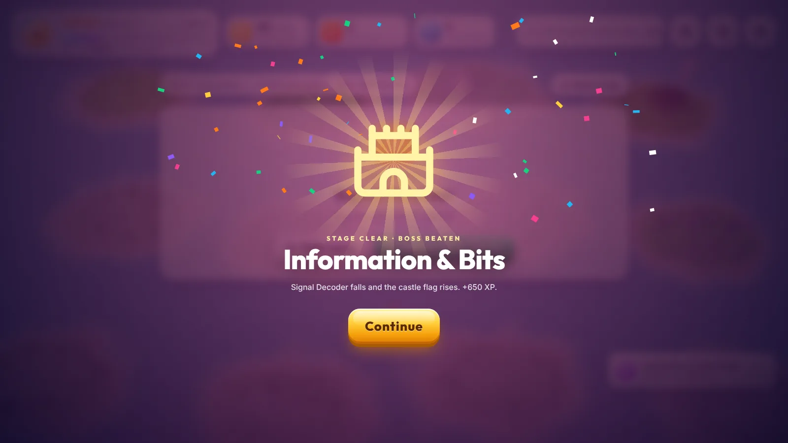
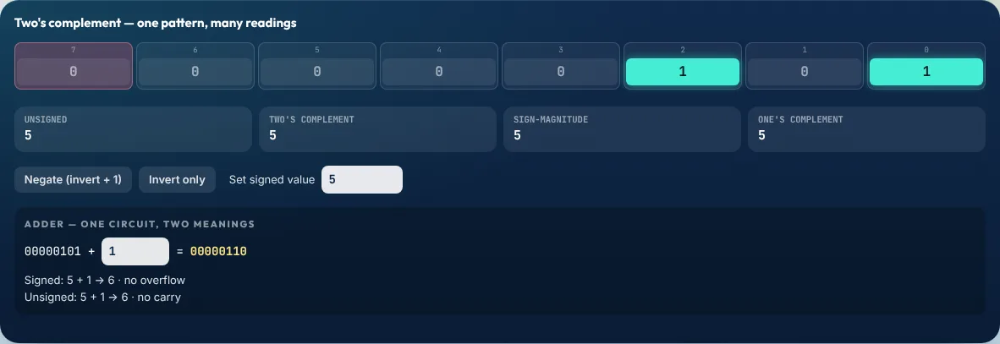
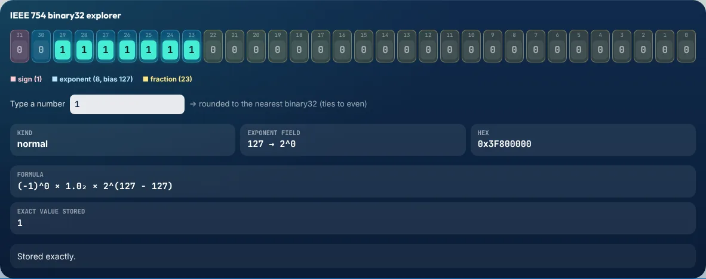
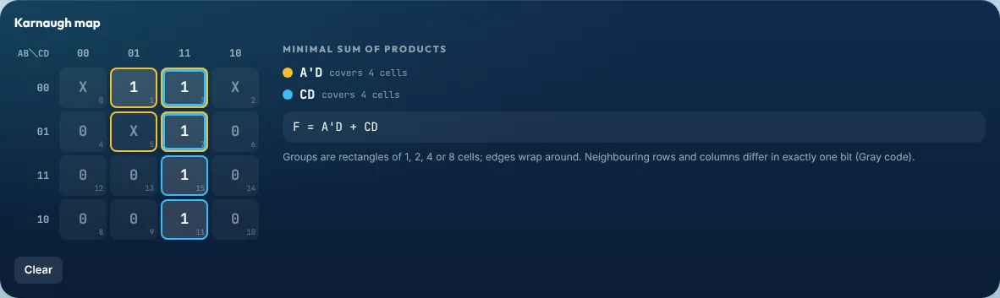
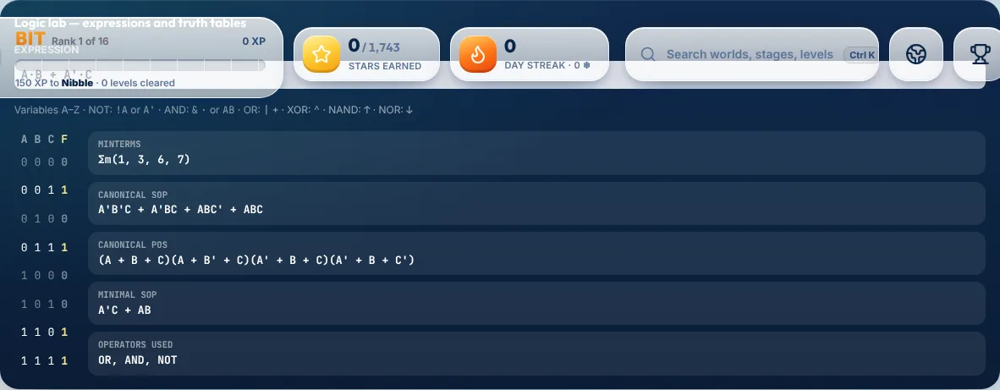
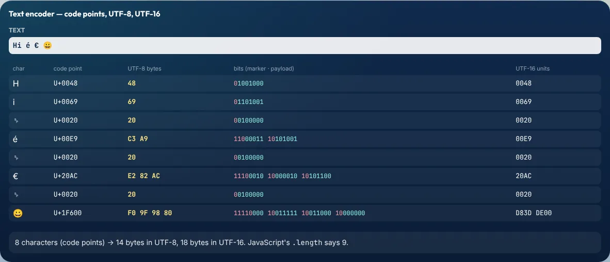

# Phase 5 — First Complete Region (Origins + Operating Systems)

> Personas: **CS Professor** (lead, accuracy), **Technical Writer** (lesson voice and structure), Learning Scientist (test design), Educational Technologist (simulations), Game Systems Designer (bosses).

## Goal

The vertical slice approved in Phase 0 (D5) becomes fully playable: every level of **World 1 · Origins** (4 stages, 34 levels) and of **Operating Systems** (45 levels) has a production lesson and level test, every stage has a working **boss**, and beating bosses fires the stage and world celebrations.

## Delivery in batches

79 lessons are written and reviewed in four committed batches, so each can be checked before the next.

| Batch | Content | Engine work |
|---|---|---|
| **5.1** | Stage 1-1 Information & Bits (6), Stage 1-2 Number Systems (12) | Boss system (stage exam, XP, stage/world completion, celebrations, achievements); sims: base converter, two's complement, IEEE 754 explorer |
| 5.2 | Stage 1-3 Boolean Logic (8), Stage 1-4 Encoding Text & Media (8) → **World 1 complete** | Sims: truth table / gate builder, Karnaugh map, UTF-8 encoder, parity |
| 5.3 | OS units Foundations → Synchronization (22) | Sims: CPU scheduler (FCFS/SJF/SRTF/RR/priority), race-condition interleaver, semaphore |
| 5.4 | OS units Deadlocks → Virtualization (23) + OS boss | Sims: Banker's algorithm, resource-allocation graph, address translation, clock, disk scheduling |

## Lesson standard (every level)

| Rule | Detail |
|---|---|
| Structure | All 9 sections in order (hook → references), one idea per step |
| Accuracy | Definitions, numbers and algorithms checked against the stage's reference texts; references section cites them (chapter level) |
| Mechanism | A simulation where the topic is a process; otherwise a worked trace or diagram table |
| Test pool | 8–12 items, ≥ 3 formats, every item `teaches` a step, every tested section covered |
| Prerequisites | Cross-stage prerequisites outside the slice (e.g. OS needs `von-neumann`, `loading`) stay as authored; their levels show "Lesson in production" until written |

## Bosses

| Rule | Decision |
|---|---|
| Unlock | Every core level of the stage Cleared (unchanged) |
| Format | Stage exam: ≥ 1 item from every core level's pool plus items from cleared bonus levels, up to 15, presented as the boss scenario |
| Pass | 70 % — boss beaten, castle flag rises, stage complete |
| XP | Boss +400, stage complete +250, world complete +1,000 (03 §2), once each |
| World | Complete when every stage boss of the world is beaten → world celebration |
| Achievements | First Boss; Two's Complement (beat Number Systems); Gatekeeper (beat Boolean Logic); Island Hopper (complete a world) |

## Acceptance criteria

| # | Criterion |
|---|---|
| 1 | Every Origins and OS level has a lesson + test that pass the build checks |
| 2 | Every new simulation module has textbook unit tests |
| 3 | Boss flow works end to end; stage and world celebrations fire from real events (E2E) |
| 4 | Accuracy review table per batch (claim → source) |
| 5 | typecheck, lint, unit, E2E, build, licenses pass |

---

# Batch 5.1 report — Stages 1-1 and 1-2 + bosses

## Deliverables

| Area | Files | Notes |
|---|---|---|
| Lessons | 17 new: `content/worlds/01-origins/01-information-bits/levels/*`, `02-number-systems/levels/*` | Stage 1-1 now complete (6/6), Stage 1-2 complete (12/12); 9 sections each, 10–12 test items each, ≥ 3 formats per pool |
| Boss engine | `events.ts` (`boss` event), `replay.ts` (+400 boss, +250 stage, +1,000 world, journal `boss`/`world`), `achievements.ts` (Castle Breaker, Two's Complement, Gatekeeper, Island Hopper) | World completes when every stage boss of the world is beaten |
| Boss arena | `src/play/BossArena.tsx`, route `/boss/$stageId`; Fight buttons in the 3D boss card and the Atlas stage page | Exam = 1 item per core level first, then fill to 15 from core + cleared bonus levels (`drawBoss`); feedback names the source level; missed levels linked |
| Celebrations | `RewardHost.tsx` | Stage and world celebrations now fire from real boss events (world first, then stage, then rank) |
| 3D | `StageScene.tsx` | Castle light turns bright gold when its boss is beaten |
| Simulations | `numbers.ts` (+ 25 tests), `BinaryBoardView`, `BaseConverterView`, `TwosComplementView`, `FloatView` | Sims accept lesson parameters (`bits`, `target`, `value`, `base`) and lesson-specific goals |

## Accuracy review (claim → source)

| Claim | Source |
|---|---|
| Levels of transformation: problem → algorithm → program → ISA → microarchitecture → circuits → devices | Patt & Patel, *ICS* 3e, ch. 1 |
| Law of leaky abstractions | Spolsky, 2002 |
| 3.3 V logic thresholds ≈ 0.8 V / 2.0 V | LVTTL input levels (JEDEC JESD8C) |
| Bit named by Tukey; Shannon 1948 | Shannon, *BSTJ* 27, 1948 |
| 8-bit byte standardised by IBM System/360 (1964); IEC binary prefixes (1998, now IEC 80000-13) | CS:APP 3e §2.1; IEC 80000-13:2008 |
| 1 TB = 10¹² B ≈ 931.3 GiB | Arithmetic (unit-checked) |
| H(0.9, 0.1) ≈ 0.469 bits; source coding theorem | Cover & Thomas 2e, ch. 2, 5 |
| Repeated division / Horner; 0.1 is a repeating binary fraction | Knuth TAOCP 2, §4.1, §4.4 |
| Full adder equations; ripple vs lookahead delay | Harris & Harris §5.2.1; P&H App. A.5 |
| Two's complement range, negation, sign extension; C++20/C23 mandate two's complement | CS:APP 3e §2.2; ISO C++20, C23 |
| Carry vs overflow flags (worked examples unit-tested in `numbers.test.ts`) | CS:APP 3e §2.3; P&H §3.2 |
| Ariane 5 Flight 501: 64-bit float → 16-bit signed conversion | Lions inquiry board report, 1996 |
| Year 2038 at 03:14:07 UTC, 19 Jan 2038 | 2³¹ − 1 s after the Unix epoch |
| Arithmetic right shift rounds toward −∞; Java `>>`/`>>>`; C shift ≥ width is UB | CS:APP 3e §2.1.9; JLS §15.19; ISO C §6.5.7 |
| Patriot clock drift ≈ 0.34 s after 100 h; 28 killed at Dhahran | GAO/IMTEC-92-26 (1992) |
| binary32/64 layouts, bias, specials, 0.1 → 0x3DCCCCCD = 0.100000001490116119384765625, −6.25 = 0xC0C80000 | IEEE 754-2019; unit-tested |
| Kahan, Turing Award 1989 | ACM |
| 0.1 + 0.2 = 0.30000000000000004; ε₆₄ = 2⁻⁵²; Kahan summation | Goldberg 1991; Higham 2e §4.3 |
| Vancouver Stock Exchange index ≈ 524 vs ≈ 1,099 (Nov 1983) | *The Wall Street Journal*, November 1983 (widely retold since) |

## Verification

| Check | Result |
|---|---|
| Content build | 18 lessons pass every check (sections, teaches links, coverage, answers) |
| Unit | 146 pass (+19: bosses & world completion, boss draw, number algorithms) |
| E2E | 27 pass (+3: boss locked, lose → revisit → win → stage celebration, last boss → world celebration → Journey) |
| typecheck · lint · format · build · licenses | Pass (no new packages) |

## Screens

| | |
|---|---|
|  |  |
|  |  |

## Next batch

**5.2** — Stage 1-3 Boolean Logic (8 levels) and Stage 1-4 Encoding Text & Media (8 levels), with truth-table/gate, Karnaugh-map, UTF-8 and parity simulations. After 5.2, World 1 is fully playable end to end.

---

# Batch 5.2 report — Stages 1-3 and 1-4 → World 1 complete

## Deliverables

| Area | Files | Notes |
|---|---|---|
| Lessons | 16 new: `03-boolean-logic/levels/*` (8), `04-data-representation/levels/*` (8) | **All 34 World 1 levels are now playable**; a content test enforces this |
| Logic engine | `logic.ts` (+ 13 tests) | Parser (NOT/AND/OR/XOR/NAND/NOR, postfix ', juxtaposition), truth tables, equivalence, canonical SOP/POS, Quine–McCluskey with exact minimum cover, Karnaugh layout, goal helpers (operator count, NOT-on-variables) |
| Encoding engine | `encoding.ts` (+ 9 tests) | UTF-8 encode / strict decode (overlong, surrogate, truncation errors), UTF-16 surrogates, byte order, parity, RFC 1071 checksum, RLE, Huffman |
| Simulations | `LogicLabView`, `KarnaughView`, `Utf8View`, `ByteOrderView`, `ParityView`, `RgbView` | Lesson goals: write XOR without ^, simplify to A, complement in NNF, majority in ≤ 5 operators, NAND-only, K-map corners, find an emoji / €, parity blind spot, mix yellow |

## Accuracy review (claim → source)

| Claim | Source |
|---|---|
| Boole 1854; Shannon's 1937 thesis (published 1938) maps Boolean algebra to switching circuits | Shannon, *Trans. AIEE* 57 (1938) |
| Boolean laws, duality, De Morgan, bubble pushing, NAND-NAND | Harris & Harris DDCA RISC-V §2.2–2.5 |
| 2^(2^n) functions of n inputs | Counting (rows × outputs) |
| K-map Gray-code layout, wrap-around, don't-cares; example Σm(1,3,7,11,15)+d(0,2,5) has two minimal covers | H&H §2.7; Karnaugh 1953; verified by Quine–McCluskey in tests |
| CMOS NAND/NOR 4 transistors, AND/OR 6 | H&H §1.7 |
| Apollo Guidance Computer built from 3-input NOR gates | Hall, *Journey to the Moon* (1996) |
| XOR-only circuits are affine, AND/OR-only are monotone (not complete) | Post's functional completeness criterion |
| ASCII 7-bit (1963); case differs by bit 5; digits 48–57 | ANSI X3.4; RFC 20 |
| Unicode U+0000–U+10FFFF, 17 planes, surrogates D800–DFFF, NFC/NFD, grapheme clusters | Unicode Standard ch. 2–3; UAX #15, #29 |
| UTF-8 patterns, 4-byte limit (RFC 3629, 2003); Thompson & Pike, Sept 1992 | RFC 3629; Pike's 2003 history note |
| UTF-16 surrogate pairs and BOM; '😀'.length = 2 in JS | RFC 2781; ECMAScript string semantics (unit-tested) |
| Endianness definitions; x86 little, network big; Cohen 1980 | CS:APP §2.1.3; IEN 137; RFC 1700 |
| sRGB gamma: 128 ≈ 22 % linear light | IEC 61966-2-1 transfer function |
| Nyquist–Shannon; CD 44.1 kHz/16-bit = 1,411.2 kbit/s; SQNR ≈ 6.02N + 1.76 dB | Shannon 1949; Oppenheim & Schafer 3e; IEC 60908 |
| Huffman example a:45 … f:5 → 224 vs 300 thousand bits | CLRS 4e §15.3 (unit-tested) |
| Internet checksum example 0001 F203 F4F5 F6F7 → 220D | RFC 1071 §3 (unit-tested) |
| CRC-32 detects all bursts ≤ 32 bits; Hamming 1950 | Kurose & Ross 8e §6.2; Hamming, *BSTJ* 29 |

## Verification

| Check | Result |
|---|---|
| Content build | 34 lessons pass every check |
| Unit | 168 pass (+22) |
| E2E | 28 pass (+1: Karnaugh corners → B'D', UTF-8 € → E2 82 AC, parity double flip → undetected) |
| typecheck · lint · format · build · licenses | Pass (no new packages) |

## Screens

| | |
|---|---|
|  |  |
|  | |

## Next batch

**5.3** — Operating Systems units Foundations → Synchronization (22 levels), with CPU-scheduler, race-condition and semaphore simulations.
